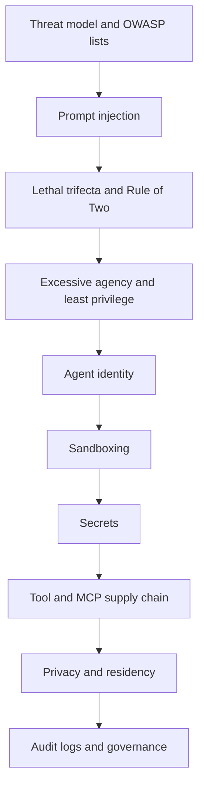

# Chapter 10: Security & Identity in Agentic Environments

A chatbot that gives a wrong answer is embarrassing. An agent that gives a wrong answer *and* sends an email, runs a script or moves data is a security incident.

Agents read text from the outside world, hold credentials, and take actions. That mix is new. The model cannot reliably tell a trusted instruction from an attacker's text, so we cannot depend on the model alone. This chapter shows how to build agents where the damage from a fooled model stays small.

It builds on [Chapter 8](08-agentic-architectures.md) (how agents work) and [Chapter 9](09-mcp.md) (how tools are connected). Later, [Chapter 11](../module-5/11-observability.md) and [Chapter 12](../module-5/12-evaluation-safety.md) cover monitoring and testing.

*Figure: From understanding the attack, to limiting it, to proving control.*

## What you will learn

- **Threat model for agents:** what is different, plus the OWASP LLM and Agentic Top 10 lists.
- **Prompt injection:** direct and indirect attacks, and why layers are needed.
- **The lethal trifecta and the Rule of Two:** a simple test to spot dangerous agent designs.
- **Excessive agency and least privilege:** policy gates, approvals and narrow tools.
- **Agent identity and delegated access:** OAuth, token exchange, workload identity and MCP rules.
- **Sandboxing code execution:** containers, gVisor, microVMs, and network control.
- **Secrets handling:** keep keys away from the model.
- **Tool and MCP supply-chain risk:** poisoned descriptions, rug pulls and fake packages.
- **Data privacy and residency:** India's DPDP Act and Rules, and GDPR, in brief.
- **Audit logs and governance frameworks:** NIST AI RMF, ISO/IEC 42001 and the EU AI Act.

> [!NOTE]
> Security guidance and laws change fast. Facts in this chapter are dated as of 2 November 2026. Check the official sources listed in the recap before you rely on them.
