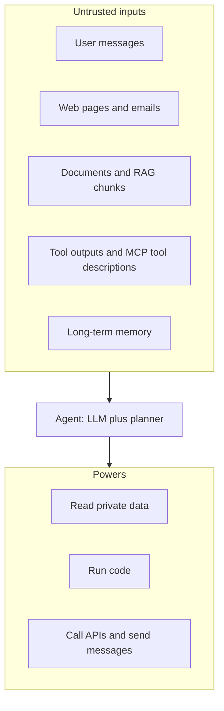

# Threat Model for Agents

Imagine a peon who obeys any chit slipped under the office door. He is polite and fast. He also has the keys to the cupboard. That is the security problem with an AI agent.

## What it is

A **threat model** is a simple list: what we protect, who may attack, where they can get in, and what can go wrong.

An agent has four parts, and each part adds risk:

- a **model** (the LLM) that decides what to do,
- **tools** that act on the world (APIs, shell, browser, email),
- **memory** and retrieved data that go into the prompt,
- an **identity** (credentials) that the tools use.

A normal chatbot can only say wrong things. An agent can *do* wrong things.

## How it works

The key idea: the model reads instructions and data in the same stream of text. It has no reliable way to tell them apart. The UK National Cyber Security Centre (NCSC) put it plainly in December 2025: there is no inherent distinction between "data" and "instruction" inside an LLM. So treat the model like a very capable, easily confused deputy.

*Figure: Anything that reaches the prompt can steer the agent, and the agent holds real powers.*

So we move the security checks **outside the model**: in the tool layer, the identity system and the sandbox. Never depend only on "please do not obey bad instructions" in the prompt.

## A quick threat table

| Asset | Example attack | Chapter page |
|---|---|---|
| Private data | Hidden text makes the agent leak it | [Prompt injection](02-prompt-injection.md) |
| Permissions | Agent has far more access than the task needs | [Excessive agency](04-excessive-agency-least-privilege.md) |
| Credentials | Stolen or over-shared tokens | [Identity](05-agent-identity-delegated-access.md), [Secrets](07-secrets-handling.md) |
| Host machine | Generated code escapes or wipes files | [Sandboxing](06-sandboxing-code-execution.md) |
| Tool ecosystem | Malicious package or tool description | [Supply chain](08-tool-mcp-supply-chain.md) |
| Personal data | Wrong region, no consent, no deletion | [Privacy](09-data-privacy-residency.md) |

## The OWASP lists

OWASP (Open Worldwide Application Security Project) keeps two community lists. Use them as a checklist, not as a full threat model.

**OWASP Top 10 for LLM Applications 2026.** The OWASP landing page is dated 3 August 2026. It does not print the ten names, so the list below comes from the Cloud Security Alliance article and the AI Governance Library. The first six also match OWASP's own Q3 2026 exploit roundup.

| ID | Risk |
|---|---|
| LLM01 | Prompt Injection |
| LLM02 | Sensitive Information Disclosure |
| LLM03 | Excessive Agency |
| LLM04 | Supply Chain |
| LLM05 | Data and Model Poisoning |
| LLM06 | Unbounded Consumption |
| LLM07 | Misinformation |
| LLM08 | Hidden Context Exposure (renamed from System Prompt Leakage) |
| LLM09 | Vector and Embedding Weaknesses |
| LLM10 | Improper Output Handling |

**OWASP Top 10 for Agentic Applications 2026** (published 9 December 2025) covers what happens once a model has tools and memory:

| ID | Risk |
|---|---|
| ASI01 | Agent Goal Hijack |
| ASI02 | Tool Misuse and Exploitation |
| ASI03 | Identity and Privilege Abuse |
| ASI04 | Agentic Supply Chain Vulnerabilities |
| ASI05 | Unexpected Code Execution |
| ASI06 | Memory and Context Poisoning |
| ASI07 | Insecure Inter-Agent Communication |
| ASI08 | Cascading Failures |
| ASI09 | Human-Agent Trust Exploitation |
| ASI10 | Rogue Agents |

Each remaining page of this chapter answers one or more of these rows.

## In the AI era

Old web security assumed code and data are separate. Here they are not. Also, the "user" may be a web page the agent opened by itself. Your threat model must list every place text enters the prompt.

> [!TIP]
> **Key takeaways**
> - An agent = model + tools + memory + identity. Risk grows with each part.
> - The model cannot reliably separate instructions from data, so put controls outside the model.
> - Use the OWASP LLM and Agentic lists as checklists, and note their year.
