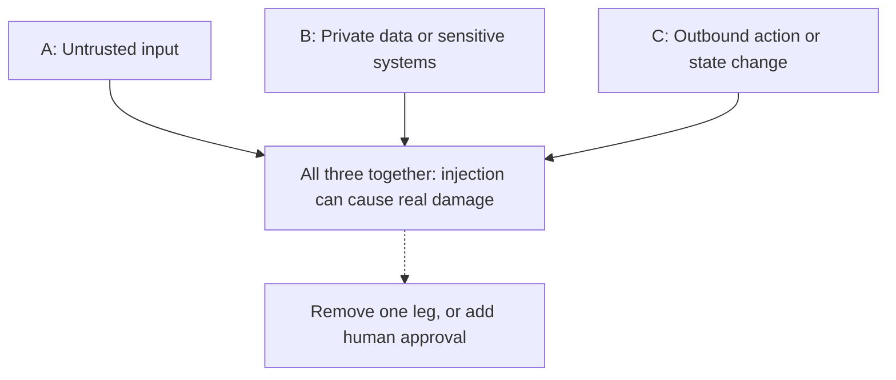

# The Lethal Trifecta and the Rule of Two

Think of a home with three things: a locker full of cash, a stranger who can walk in, and an open back door. Any one is fine. All three together is a robbery waiting to happen.

## What it is

On 16 June 2025, Simon Willison named the **lethal trifecta**. An AI agent becomes dangerous to your data when it has all three of these in one system:

1. **Access to private data.** Mail, files, databases, secrets.
2. **Exposure to untrusted content.** Any text or image an attacker could place where the agent will read it.
3. **Ability to communicate externally.** Web requests, emails, links, anything that sends data out.

If all three are present, an attacker can plant instructions in the untrusted content, make the agent read private data, and make it send that data out.

On 31 October 2025, Meta published a similar idea, the **Agents Rule of Two**. It uses three properties:

- **[A]** the agent processes untrusted input,
- **[B]** it can reach sensitive systems or private data,
- **[C]** it can change state or communicate externally.

The rule: until prompt injection can be reliably detected and refused, an agent should have **no more than two** of the three in one session. If a task truly needs all three, do not run it autonomously. Add human approval or another reliable check.

Note the small difference. Meta's [C] also covers changing state (for example editing records), not only sending data out.

## How it works

*Figure: The danger is the combination. Remove any one leg to break the attack.*

## Applying it

*Example agents, for teaching only:*

| Agent | A: untrusted input | B: private data | C: outbound or write | What to do |
|---|---|---|---|---|
| Public web researcher with no access to your files | Yes | No | Yes | Fine to run on its own |
| Personal assistant that reads your inbox and drafts replies, you press Send | Yes | Yes | No (human sends) | Fine, keep the human step |
| Assistant that reads your inbox and sends mail by itself | Yes | Yes | Yes | Needs approval for every send |
| Internal report bot on trusted data, no internet | No | Yes | Yes | Fine, input is trusted |

Practical ways to remove a leg:

- **Cut A:** read only from trusted sources. Or process untrusted text in a separate, locked-down agent that has no tools.
- **Cut B:** give the agent only the data for this one task, not the whole mailbox.
- **Cut C:** block outbound network except an allowlist. Make writes go through a human or a strict API with narrow limits.

Remember that the rule applies *per session*. Meta notes that starting a fresh session with a new context window can also help.

## Going further: design patterns

Research teams have proposed stronger designs. A June 2025 paper, "Design Patterns for Securing LLM Agents against Prompt Injections", studies design patterns that give resistance to injection at some cost in capability. CaMeL (Debenedetti et al., 2025) keeps the trusted user request and the untrusted data in separate flows, and checks tool calls against policies. On the AgentDojo benchmark it completed 77% of tasks with security guarantees, against 84% for an undefended system. So you pay a small utility cost for stronger safety.

## Trade-offs

- The trifecta is a rule of thumb, not a proof of safety. Two legs can still hurt: an agent with untrusted input and write access can still damage data.
- Mixing tools from many MCP servers can create the trifecta by accident. Review the *combined* tool set, not each server alone. See [Supply chain](08-tool-mcp-supply-chain.md).

> [!TIP]
> **Key takeaways**
> - Dangerous combination: untrusted content + private data + a way to send data out.
> - Meta's Rule of Two: at most two of the three per session, else add human approval.
> - Audit the whole tool set an agent can see, since mixed tools can form the trifecta by accident.
