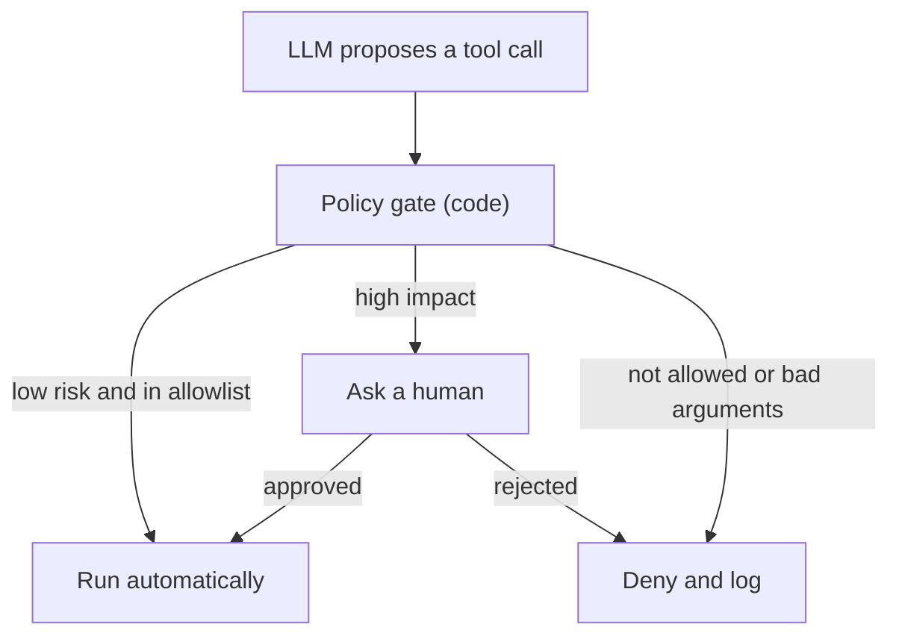

# Excessive Agency and Least Privilege

A hotel gives the room-service boy a master key "to save time". One day he is tricked, and every room is open. The fault is not only the trick. The fault is the master key.

## What it is

**Excessive agency** means an LLM-based system can take harmful actions because it has more power than its job needs. It ranks LLM06 in OWASP's 2025 list and LLM03 in the 2026 list. The trigger can be a hallucination, a prompt injection, or a compromised tool or peer agent. OWASP names three root causes:

| Root cause | Meaning | Example |
|---|---|---|
| Too many functions | Tools the job does not need | A summary bot that can also delete files |
| Too many permissions | Tools reach more than needed downstream | Database account with write access, when only reads are needed |
| Too much autonomy | High-impact actions run with no check | Agent sends money without approval |

**Least privilege** is the cure: give each agent only the access needed for the current task, for the shortest time.

## How it works

Put a **policy gate** between the model and the tools. The model *asks*. The gate *decides*. The gate is plain code, not a prompt, so a clever sentence cannot talk it out of its rules.


*Figure: Every tool call passes a gate that the model cannot rewrite.*

A tiny gate in Python:

```python
READ_ONLY = {"search_docs", "get_order"}
NEEDS_APPROVAL = {"refund", "send_email"}

def gate(tool, args, user_scopes):
    if tool in READ_ONLY:
        return "allow"
    if tool in NEEDS_APPROVAL:
        if tool == "refund" and args.get("amount", 0) > 500:
            return "deny"          # hard limit, no override
        return "ask_human"
    return "deny"                  # default deny
```

Notice the default is **deny**. Unknown tools never run.

## Rules of thumb (from OWASP's guidance)

- Give the model only the tools it needs, and only the functions inside each tool it needs.
- Prefer narrow tools ("get_order_status") over open-ended ones (general shell, "run any SQL").
- Give read-only scopes where possible.
- Run actions under the **requesting user's identity**, not a shared high-privilege account. See [Agent identity](05-agent-identity-delegated-access.md).
- Enforce authorisation in the downstream system. Do not trust the LLM to judge who may do what.
- Require human approval for high-impact actions. Add rate limits and log every call.

## Tiering actions

| Tier | Example | Control |
|---|---|---|
| Read, low sensitivity | Search public docs | Auto-allow |
| Read, sensitive | Fetch customer record | Allow for the right user only, log |
| Reversible write | Create a draft | Allow with limits |
| Irreversible or external | Send mail, pay, delete | Human approval or hard limit |

## Common mistakes

- **Approval fatigue.** If the user clicks "Approve" fifty times a day, approvals mean nothing. Approve only what is truly risky.
- **Vague approval text.** OWASP's agentic list calls out Human-Agent Trust Exploitation (ASI09): an agent summary can hide what is really being approved. Show the exact action, recipient and amount from the tool call, not the model's own description.
- **One broad "admin" token** shared by all agents.

> [!TIP]
> **Key takeaways**
> - Excessive agency = too many tools, too many permissions or too much autonomy.
> - Put a code-based policy gate between the model and the tools. Default deny.
> - Show approvers the real action, and keep approvals rare so they stay meaningful.
