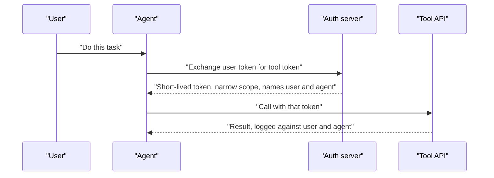

# Agent Identity and Delegated Access

When a Swiggy delivery partner comes to your gate, you know two things: who the partner is, and which order they are delivering for. Agents need the same clarity. Most systems today have neither.

## What it is

An agent touches your systems with credentials. Three questions must always have an answer:

1. **Who is the agent?** Its own identity (a workload identity), not a shared password.
2. **For whom is it acting?** The human user (or team) who started the task.
3. **What may it do right now?** Narrow scopes, for a short time.

OWASP's agentic list names the failure as ASI03, Identity and Privilege Abuse: shared, borrowed or long-lived credentials with broad scopes turn a single hijack into a big breach.

## How it works

### Delegation with OAuth

**OAuth 2.0** lets a user allow an app to act for them with limited scopes, without sharing a password. For agents, the user approves, the agent receives a token, and the API checks the scopes.

**Token exchange** (RFC 8693) helps when one service must call another on the user's behalf. A client trades a token it holds for a new token meant for the next service. The spec defines two flavours:

- **Impersonation:** the new token makes the actor look like the user. Downstream systems usually cannot tell the difference.
- **Delegation:** the token names both the user (subject) and the actor, using an `act` claim. Logs then show "agent X acting for user Y".

Prefer delegation, because it keeps accountability.

*Figure: A narrow, short-lived token that names both the user and the agent.*

### Workload identity

Agents also need to prove *which software* they are, without a stored secret. **SPIFFE** (Secure Production Identity Framework for Everyone) gives each workload an ID like `spiffe://<trust domain>/<workload>`, proved with a short-lived certificate or token called an SVID. A local Workload API hands it out and rotates it automatically. Cloud providers offer similar workload-identity features, which vary by vendor.

### What MCP requires

For remote MCP servers, the MCP authorisation spec treats the server as an OAuth resource server. The latest revision I checked (on 2 November 2026) is dated 2026-07-28. Key rules from the spec and its security guidance:

- The client **must** send the `resource` parameter (RFC 8707) naming the MCP server it wants a token for.
- The server **must** accept only tokens issued for itself. It **must not** pass a client's token on to another API. This "token passthrough" breaks audit trails and trust boundaries.
- Start with minimal scopes. Ask for more through step-up authorisation when needed.
- A proxy server that uses one static client ID needs per-client consent, otherwise it can be a "confused deputy" for attackers.

Chapter 9 explains the MCP authorisation flow in detail. See [Chapter 9](../09-mcp.md).

## Trade-offs

| Pattern | Good | Bad |
|---|---|---|
| Shared API key or service account | Easy | No user traceability, huge blast radius |
| Pass the user's own token to every tool | Simple | Token may be too broad, can leak |
| Token exchange with narrow scope | Least privilege, clear audit | More set-up |
| Workload identity (SPIFFE-like) | No static secret | Needs platform support |

## Standards are still moving

Agent-specific identity standards are young. As of 2026 there are IETF Internet-Drafts, for example a July 2026 draft on credential delegation for AI agents in the WIMSE working group. Internet-Drafts are work in progress, not standards. NIST's AI Agent Standards Initiative, created in February 2026, lists work on agent authentication and identity, including an NCCoE concept paper. Watch these, but build today on OAuth, token exchange and workload identity.

> [!TIP]
> **Key takeaways**
> - Know who the agent is, who it acts for, and what it may do.
> - Use short-lived, narrow tokens that name both user and agent. Avoid shared keys.
> - MCP servers accept only tokens meant for them, and never pass tokens through.
