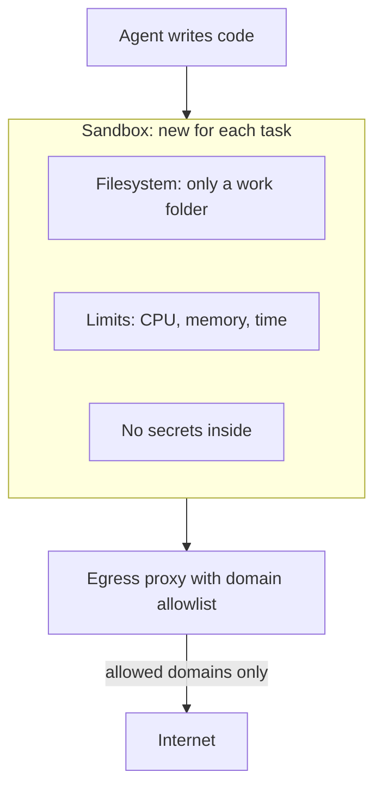

# Sandboxing Code Execution

If a student wants to try a chemistry experiment, the school gives a lab with a fume hood. It does not give the principal's office. Code written by an LLM should run in a lab too.

## What it is

Many agents write and run code: Python for data analysis, shell commands, browser scripts. The code may be wrong, or may be steered by an attacker through prompt injection. OWASP's agentic list calls this ASI05, Unexpected Code Execution.

A **sandbox** is a restricted place where code runs, so that if it misbehaves the damage stays small.

## How it works

Isolation comes in layers. A stronger wall costs more in speed and effort.

| Layer | Idea | Notes |
|---|---|---|
| Plain process or container | Share the host kernel | Light and fast. A kernel bug can break out. |
| gVisor | An "application kernel" (the Sentry), written in Go, handles the app's system calls in user space | Fewer calls reach the host kernel. File access goes through a separate Gofer process. |
| microVM (Firecracker) | A tiny virtual machine on KVM, with its own kernel | Built by AWS developers, used for multi-tenant serverless. Only five emulated devices. |
| OS-level sandbox (bubblewrap on Linux, seatbelt on macOS) | Restrict one process tree on your own machine | Useful for local coding agents. Applies to child processes too. |

Choose by risk. Running code from many untrusted users on one server needs a strong wall such as a microVM. A developer's own laptop agent may use an OS-level sandbox.

*Figure: Isolate files and network together, and keep secrets outside.*

## Both files and network

Anthropic's engineering post on sandboxing Claude Code makes a useful point. You need **both** filesystem and network isolation:

- With no network isolation, a hijacked agent can send sensitive files (such as SSH keys) to an outsider.
- With no filesystem isolation, it can escape the sandbox and reach the network.

In that design the agent can write in the working directory only, and internet access goes through a proxy outside the sandbox that allows only approved domains. Anthropic reported that this cut permission prompts by 84% in its internal usage. That figure is one company's internal result, so do not treat it as a general benchmark.

## Checklist

- **Fresh and short-lived.** New sandbox per task or session. Destroy it after.
- **Default no network.** Allow named domains only. Block private IP ranges and cloud metadata addresses, as the MCP guidance on server-side request forgery (SSRF) advises.
- **Resource limits.** CPU, memory, disk, process count and wall-clock time. This also helps with OWASP's Unbounded Consumption risk.
- **No credentials inside.** Pass results, not keys. See [Secrets handling](07-secrets-handling.md).
- **Read-only where possible.** Mount inputs read-only. Write to a scratch folder.
- **Log commands and outputs** for review.

## Common mistakes

- Giving the sandbox your home folder "for convenience".
- Allowing all outbound internet "to install packages". Use a package mirror instead.
- Running local MCP servers with full user rights. The MCP spec advises running them in a sandbox with minimal default privileges.

> [!TIP]
> **Key takeaways**
> - Treat all model-generated code as untrusted. Run it in a sandbox.
> - Pick the isolation layer by risk: container, gVisor, microVM, or OS sandbox.
> - Isolate both filesystem and network, limit resources, and keep secrets outside.
