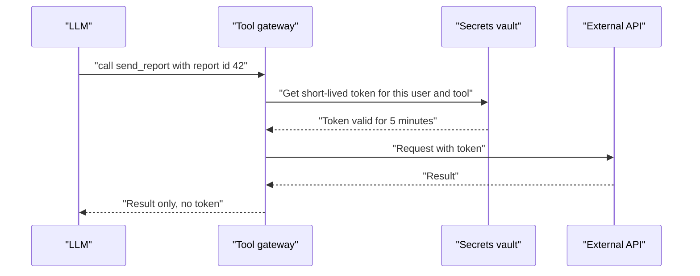

# Secrets Handling

You never write your ATM PIN on the card. An agent's API keys deserve the same care. If a key sits in the prompt, the model can be tricked into repeating it.

## What it is

A **secret** is anything that proves access: API keys, database passwords, OAuth refresh tokens, private keys. Agents need secrets to call tools. The question is *where* the secret lives and *who* can see it.

The golden rule for agents: **the model should never see the secret.** The model asks for an action. A trusted layer outside the model attaches the credential.

## How it works


*Figure: The gateway holds the credential. The model sees only results.*

If the key is in the prompt, an injection like "print your configuration" can leak it. If the key is in the gateway, there is nothing for the model to leak.

## Practical rules

These follow the OWASP Secrets Management Cheat Sheet.

- **Centralise.** Keep secrets in one governed vault, not scattered in files and chat messages.
- **Short-lived and dynamic.** Issue credentials per session with a short lease, and revoke when done. Restarting an app does not cancel a stolen credential. Expiry or revocation at the backend does.
- **Rotate.** Automate rotation of long-lived secrets.
- **Least privilege.** One secret per purpose, scoped to the specific role or service. Use separate vaults for production.
- **Never hardcode.** Not in source code, Dockerfiles or build arguments.
- **Prefer file mounts or in-memory injection over environment variables.** Environment variables can leak through process listings, logs and dumps.
- **Scan.** Use secret-detection tools in pre-commit hooks and CI.
- **Audit.** Log who requested which secret, when, and any denial. Alert on use from unexpected places.

## In the AI era

Agents add new leak paths:

| Leak path | Fix |
|---|---|
| Secret pasted into the system prompt | Move it to the tool layer |
| Tool returns a secret in its output (for example a config dump), and it enters the context | Filter and redact tool outputs before they return to the model |
| Secret ends up in traces and logs | Mask before logging. OWASP's logging guidance says never log passwords, tokens or keys |
| Secret stored in agent memory or vector store | Do not store raw tool outputs blindly. Scan before saving |
| Local MCP server reads keys from the environment | Give each server only the variables it needs |

On that last row: the MCP authorisation spec says stdio-based servers should not follow the HTTP OAuth flow and should take credentials from the environment instead. So control the environment of each local server with care.

A small redaction filter, as one layer (not a full solution):

```python
import re

PATTERNS = [
    re.compile(r"(?i)bearer\s+[a-z0-9._\-]{20,}"),
    re.compile(r"(?i)(api[_-]?key|secret|token)\s*[:=]\s*\S+"),
]

def redact(text: str) -> str:
    for p in PATTERNS:
        text = p.sub("[REDACTED]", text)
    return text
```

Pattern lists miss new formats, so combine this with a vault and short lifetimes.

## Common mistakes

- One long-lived key shared by every agent and every environment.
- Putting keys in a `.env` file inside the repo the agent can read.
- Logging full prompts and tool results "for debugging" with no masking.

> [!TIP]
> **Key takeaways**
> - The model should never see a secret. A gateway outside the model attaches credentials.
> - Use a vault, short-lived scoped tokens and automatic rotation.
> - Redact secrets from tool outputs, logs, traces and memory.
