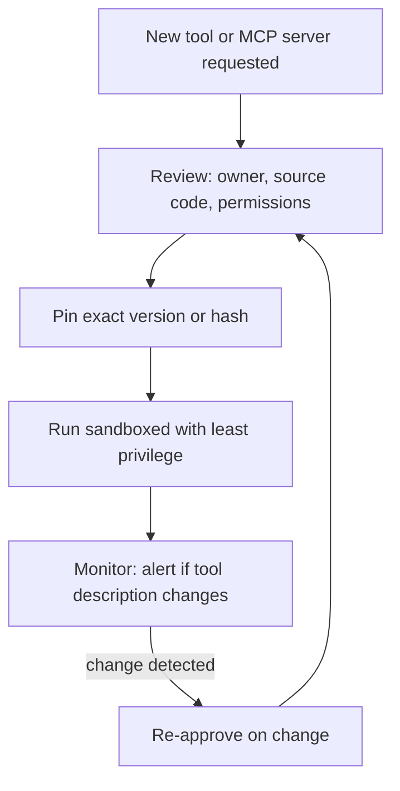

# Tool and MCP Supply-Chain Risk

You buy a mobile charger from a roadside stall. It works, but you cannot know what is inside. Tools and MCP servers are like that charger: you plug them into your agent and trust them with power.

## What it is

Your agent depends on outside parts: MCP servers, plugins, packages, tool descriptions, prompts, models. A **supply-chain attack** compromises one of these parts so that it harms everyone who uses it. OWASP lists this as Supply Chain (LLM04 in the 2026 LLM list) and Agentic Supply Chain Vulnerabilities (ASI04).

The new twist for agents: a tool's *description* is text that the model reads. So a tool can attack through words, not only through code.

## Real examples

| What happened | Date | Lesson |
|---|---|---|
| **Tool poisoning** (Invariant Labs). Hidden instructions inside an MCP tool's description told the model to read sensitive files such as SSH keys and send them out. Users usually do not see the full description. | Published 1 April 2025 | Descriptions are an attack surface |
| **Rug pull** (same research). A server changes a tool's description after the user approved it. | April 2025 | Approval must be re-checked on change |
| **postmark-mcp** (reported by Koi Security). A copy of the real Postmark package on npm. Version 1.0.16 added one line that blind-copied every email to an outside address. About 1,643 downloads were reported. Postmark said it had no part in the package. | September 2025 | Name-alike packages are a trap |
| **Q3 2026 OWASP roundup**: a server behaved normally at first and later changed its tool definitions to steer an agent toward local secrets. | July to September 2026 | The rug pull is not only theory |

## How it works

*Figure: Vet once, pin, sandbox, watch for changes, and re-approve when something changes.*

## Controls

- **Allowlist.** Only approved servers and packages can be added. Keep an internal registry. Chapter 9 covers governance of MCP servers: see [Chapter 9](../09-mcp.md).
- **Verify the source.** Check the publisher. Beware of look-alike names.
- **Pin versions** (or content hashes). Do not auto-update tools that run with real privileges. Invariant Labs itself recommended pinning with checksums.
- **Treat tool metadata as untrusted input.** Show users the full description. Re-prompt when it changes.
- **Sandbox local servers.** The MCP security guidance says clients must show the exact command before running a local server from one-click setup, and should run servers with minimal privileges.
- **Narrow tokens per server.** One server's token should not work on another. See [Agent identity](05-agent-identity-delegated-access.md).
- **Review the combined toolset** for the lethal trifecta. See [Rule of Two](03-lethal-trifecta-rule-of-two.md).
- **Keep a software bill of materials.** Know which tools, models and datasets each agent uses, so you can respond when a package is reported.

## Beyond MCP

The same thinking applies to models downloaded from public hubs, fine-tuning data, embeddings and vector stores (OWASP lists Data and Model Poisoning, and Vector and Embedding Weaknesses). Check where each artefact came from before it enters production. RAG-side risks are covered in [Chapter 7](../../module-3/07-rag-architectures.md).

> [!TIP]
> **Key takeaways**
> - Tool descriptions are read by the model, so they can carry attacks.
> - Real cases exist: tool poisoning, rug pulls and the postmark-mcp backdoor.
> - Allowlist, verify, pin versions, sandbox, and re-approve when tools change.
