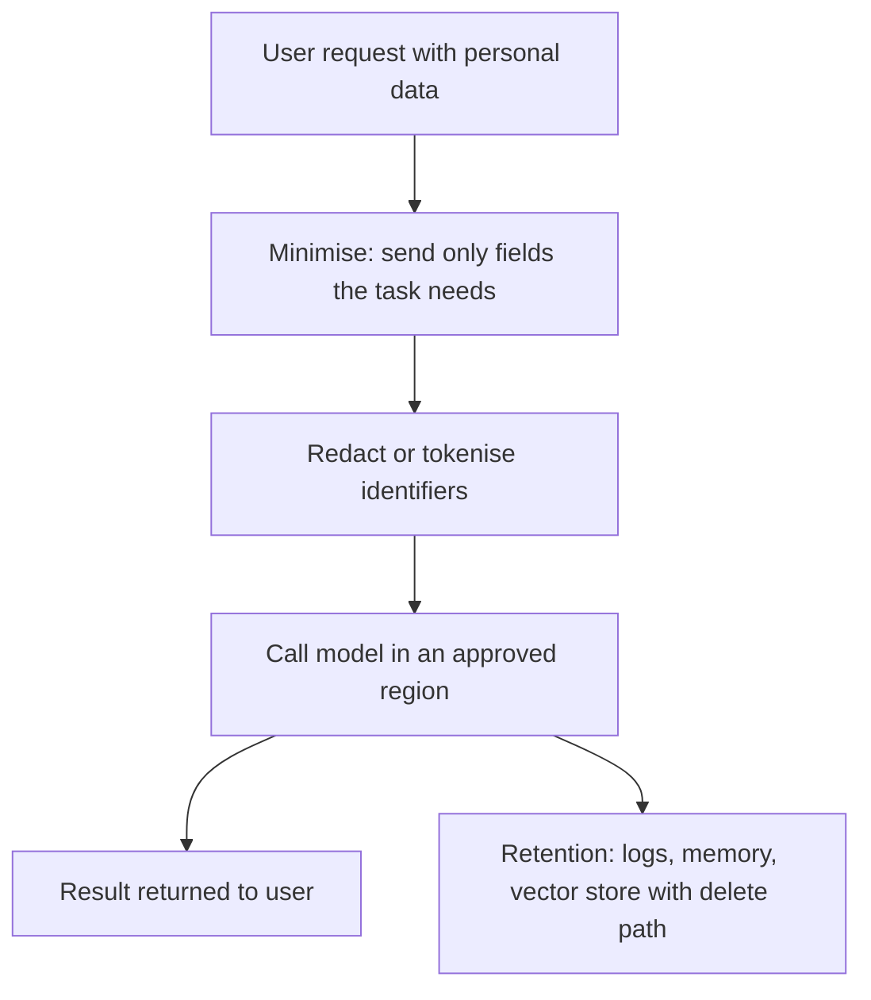

# Data Privacy and Residency: DPDP and GDPR

When you give your Aadhaar copy to a hotel, you expect it to be used for check-in and then protected, not forwarded to a marketing agency. Privacy law turns that expectation into duties. Agents make it harder, because they move data between many systems.

> [!WARNING]
> This page is for engineers, not legal advice. Laws change. Facts below are as of 2 November 2026. Ask your legal team before you decide.

## What it is

**Data privacy** is about personal data: who may collect it, for what purpose, how long to keep it, and where it may go. **Data residency** is about the country where data is stored and processed.

Two laws matter most for many readers.

| | India: DPDP Act 2023 and Rules 2025 | EU: GDPR |
|---|---|---|
| Person whose data it is | Data Principal | Data subject |
| Who decides how data is used | Data Fiduciary | Controller |
| Security duty | Reasonable security safeguards (Act, section 8(5)) | Security of processing (Article 32) |
| Cross-border | Allowed, except to countries the Government restricts (section 16) | Needs a legal transfer mechanism (Articles 44 to 49) |
| Top fines | See the Act's Schedule | Up to 20 million euro or 4% of worldwide annual turnover, whichever is higher, for breaking core principles, data subject rights or transfer rules (Article 83(5)) |

## India: where things stand

- The DPDP Act was passed in 2023. The **DPDP Rules, 2025** were notified on 13 November 2025 (G.S.R. 846(E)). Some sources report 14 November, which is the day of the public announcement.
- Rollout is in phases. Rules about the Data Protection Board began at once. Rule 4 (consent manager registration) starts around 13 November 2026. Most duties (notice, consent, security, breach reporting, children's data, rights) start around 13 May 2027. Some sources count a day later, so check the Gazette.
- In January 2026 MeitY proposed cutting the 18-month period to 12 months. A September 2026 timeline found no amending notification, so the 18-month schedule stands for now.
- The Board exists in law. As of September 2026 no Chairperson or Members were reported as appointed.
- Rule 6 lists security measures such as encryption, masking or tokenisation, access control, activity logs and backups. One law-firm summary says logs must be kept for at least one year. Check the Gazette text for exact wording.
- Significant Data Fiduciaries (a class the Central Government designates) face extra duties: a yearly impact assessment and audit, due diligence on algorithmic software, and possible localisation of specified data.
- There is no blanket data-localisation rule for everyone. Cross-border transfers are generally allowed, with Government restrictions possible.

## EU: GDPR in brief

GDPR has applied since 2018. Article 5 sets six principles: lawfulness, fairness and transparency; purpose limitation; data minimisation; accuracy; storage limitation; integrity and confidentiality. Article 22 gives people the right not to be subject to decisions based *solely* on automated processing with legal or similarly significant effect, with exceptions, and safeguards such as the right to ask for human involvement and to contest the decision. EU "digital omnibus" proposals to change parts of GDPR (including for AI training) were still under discussion in autumn 2026. Do not assume they are law.

## How it works in agent design

*Figure: Minimise, mask, keep data in an approved region, and plan deletion.*

Design checks:

- **Minimise.** Do not paste a whole customer record into the prompt. Send only needed fields.
- **Purpose.** Do not reuse chat logs or memory for a new purpose without a basis.
- **Region.** Know where the model provider processes and stores prompts, logs and embeddings. Check the vendor's regional options, which vary.
- **Processors.** Every model API, tracing tool and vector database that sees personal data is a processor. Sign contracts and check their retention.
- **Deletion.** If a user asks for erasure, can you delete from chat history, long-term memory, vector indexes, caches and logs? Plan this on day one.
- **Human review.** For decisions that affect people (credit, jobs), design a way to contest and review.

> [!TIP]
> **Key takeaways**
> - DPDP Rules 2025 are phased: main duties start around 13 May 2027, and the Act allows transfers abroad unless restricted.
> - GDPR already applies: principles, Article 22 and fines up to 20 million euro or 4%.
> - Minimise, mask, pick regions, and build deletion into memory, logs and vector stores.
