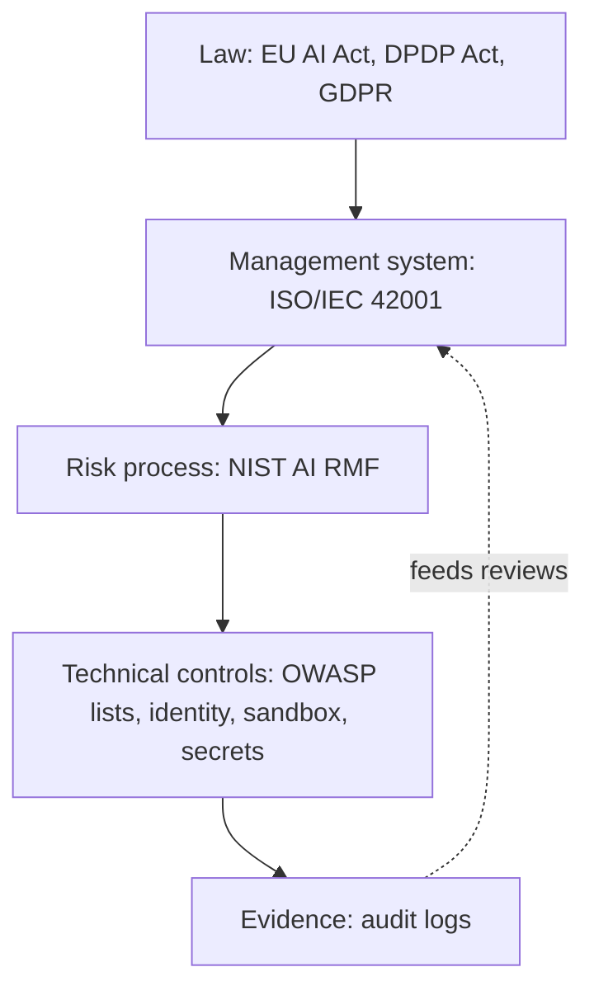

# Audit Logs and Governance Frameworks

After a train accident, the first thing officials ask for is the logbook. After an agent incident, the first question is the same: what exactly did it do, and who allowed it?

## Audit logs

An **audit log** is a tamper-resistant record of who did what, when and why. For agents, log the *decisions and actions*, not only errors.

| Field | Why |
|---|---|
| User and agent identity | Accountability. See [Agent identity](05-agent-identity-delegated-access.md) |
| Time and a correlation ID that links one task's events | Rebuild the story |
| Tool name, arguments, result status | See what actually happened |
| Policy decision (allow, deny, ask) and who approved | Prove control worked |
| Model name and version, prompt version | Reproduce behaviour |
| Source of untrusted content used | Trace an injection back |

OWASP's Logging Cheat Sheet adds good practice:

- Never log passwords, tokens, keys or payment data. Mask or hash if needed.
- Protect logs from tampering. Restrict who can read them, and write them to read-only storage soon.
- Use structured formats and sanitise untrusted input to prevent log injection.
- Make sure a logging failure does not crash the application.

Logs hold personal data too, so apply retention rules from [Privacy](09-data-privacy-residency.md). Traces, metrics and dashboards are covered in [Chapter 11](../../module-5/11-observability.md).

## Governance frameworks

Governance is how an organisation decides, documents and checks its AI use. Four things to know. Dates are as of 2 November 2026.

| Framework | What it is | Key facts |
|---|---|---|
| **NIST AI RMF** | US voluntary risk framework | AI RMF 1.0 released 26 January 2023, built around four functions: Govern, Map, Measure, Manage. Generative AI Profile (NIST AI 600-1) released 26 July 2024. NIST's page says AI RMF 1.0 is being revised. |
| **NIST AI Agent Standards Initiative** | NIST programme on agent standards | Created February 2026. Covers industry-led standards, open protocols and research on agent identity and authentication. Voluntary. |
| **ISO/IEC 42001** | International standard for an AI management system | Published December 2023. Certifiable by an accredited auditor. Shares its structure with ISO 9001 and ISO 27001. |
| **EU AI Act** | Binding EU law, risk-based | See the timeline below. |

### EU AI Act timeline (official Commission page, checked November 2026)

- Entered into force: 1 August 2024.
- Banned practices and AI literacy: from 2 February 2025.
- Governance rules and general-purpose AI (GPAI) model duties: from 2 August 2025.
- General application, with exceptions, and transparency rules: from 2 August 2026.
- High-risk systems in sensitive areas (Annex III, such as employment and education): now **2 December 2027**.
- High-risk AI inside regulated products (Annex I): now **2 August 2028**.

The later dates come from the Digital Omnibus on AI, Regulation (EU) 2026/1744, which entered into force on 27 July 2026. Earlier dates were different, so check any older material you read.

## How it fits together

*Figure: Law sets duties, frameworks organise the work, controls and logs give proof.*

## Common mistakes

- Treating governance as paperwork. If controls are not in code, the paper does not help.
- Logging everything, including secrets and personal data.
- Copying an old compliance date from a blog. Always check the official source.

> [!TIP]
> **Key takeaways**
> - Log identity, tool calls, policy decisions and approvals, with no secrets, and protect the logs.
> - NIST AI RMF and ISO/IEC 42001 are voluntary; the EU AI Act is law, and its high-risk dates moved to December 2027 and August 2028.
> - Frameworks organise the work. Technical controls and logs give the proof.
