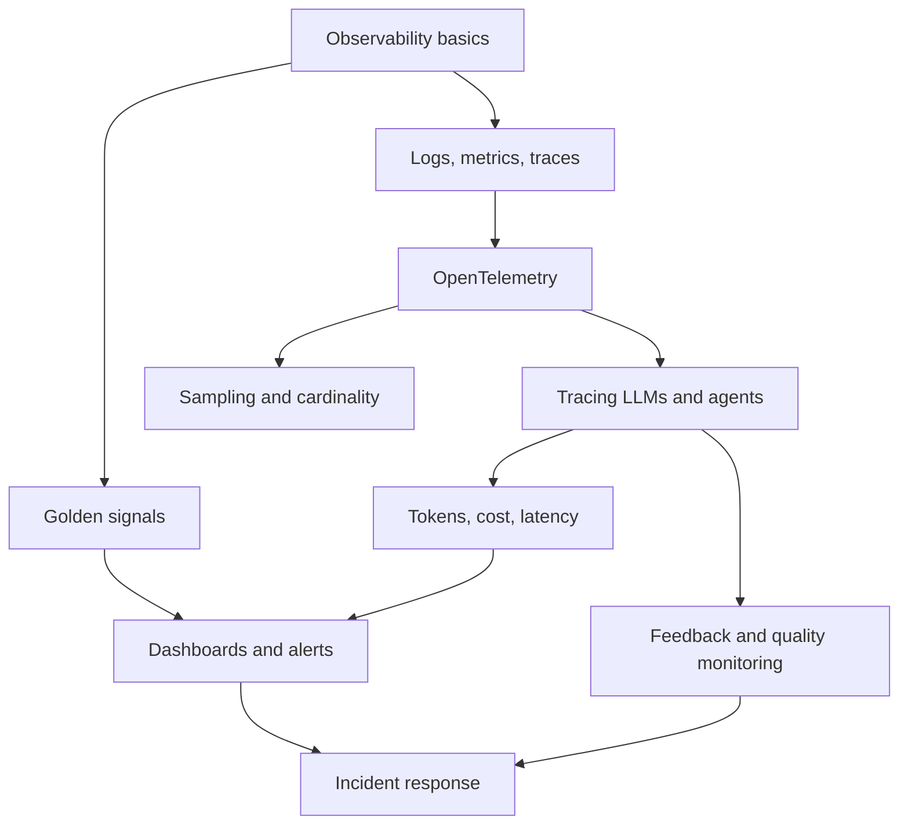

# Chapter 11: Observability, Telemetry & Monitoring

A normal web service fails in loud ways. A server crashes, a database times out, an error rate jumps. An AI system also fails in quiet ways. The API returns "200 OK", but the answer is wrong, slow, too costly, or unsafe. Nobody gets paged, and users simply stop trusting the product.

This is why observability matters more in the AI era. You still need the classic basics: logs, metrics and traces. On top of that, you now need to see inside prompts, tokens, tool calls, retrieval steps and model quality.

This chapter starts with the basics, then moves to LLM and agent tracing, cost and quality monitoring, and incident response. It builds on [Chapter 3](../module-1/03-reliability.md) (SLOs), and it supports [Chapter 6](../module-3/06-llm-serving.md) (serving), [Chapter 8](../module-4/08-agentic-architectures.md) (agents) and [Chapter 12](12-evaluation-safety.md) (evaluation).

*Figure: How the concepts in this chapter connect.*

## What you will learn

- **Observability vs Monitoring:** what each one means and why you need both.
- **Logs, Metrics and Traces:** the three basic signals and when to use which.
- **OpenTelemetry:** the open standard that carries all your telemetry.
- **The Four Golden Signals for AI Systems:** latency, traffic, errors and saturation, with an AI twist.
- **Tracing LLM Calls and Agents:** what a trace of an agent run looks like, and the GenAI conventions.
- **Token, Cost and Latency Metrics:** the numbers that decide your bill and your user experience.
- **Dashboards and Alerts:** how to alert on symptoms without waking people for nothing.
- **Sampling and Cardinality:** how to keep telemetry affordable.
- **Feedback and Quality Monitoring:** how to notice when answers get worse.
- **Incident Response for AI Systems:** how to handle an outage or a quality drop.
