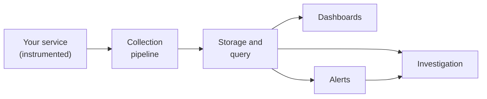
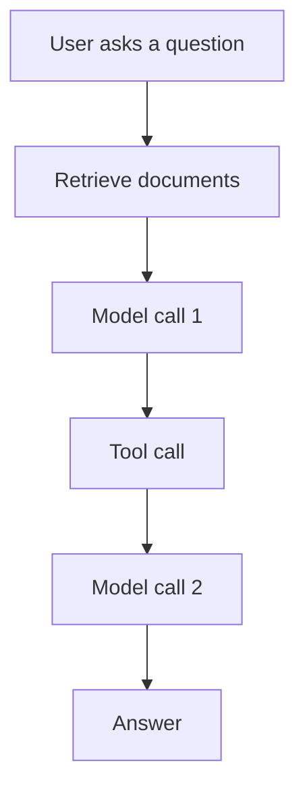

# Observability vs Monitoring

Think of a railway control room. One board shows green and red lights for every signal. That tells you something is wrong. But to find out why a train is stuck, you need the logbook, the timetable and the driver's report.

Monitoring is the board of lights. Observability is being able to ask new questions and get answers.

## What it is

**Telemetry** is the data your system sends out about itself. The OpenTelemetry project describes it as data emitted from a system and its behaviour, in the form of traces, metrics and logs.

**Observability** is the ability to understand a system from the outside by asking questions about it, without knowing its inner workings. It helps you answer "why is this happening?". It is especially useful for *unknown unknowns*: problems you never predicted.

**Monitoring** means watching known signals and acting when they cross a limit. For example: "alert if the error rate is above 1%".

| | Monitoring | Observability |
|---|---|---|
| Question | "Is something wrong?" | "Why is it wrong?" |
| Works for | Known failure modes | Unknown failure modes |
| Typical output | Dashboards, alerts | Traces, rich logs, queries |
| Example | p99 latency chart | Find the one slow tool call in one slow request |

You need both. Monitoring tells you *when* to look. Observability tells you *where* to look.

## How it works

The loop is simple. Your code is **instrumented**, which means it is changed (by hand or by a library) to emit signals. A pipeline collects the signals and stores them. People and alert rules then query that data.

*Figure: From instrumented code to dashboards, alerts and investigation.*

The OpenTelemetry primer says a system is properly instrumented when developers do not need to add more instrumentation to troubleshoot an issue. In practice, you aim for that: when a new problem appears, the data to explain it is already there.

## Why AI systems need more

Classic services mostly fail in ways that look like errors or slowness. AI systems add three new kinds of trouble.

- **Silent quality failures.** The call succeeds, but the answer is wrong or off-topic. Normal error-rate charts stay green.
- **Variable cost.** Each request uses a different number of tokens, so one change in a prompt can change your bill.
- **Many hidden steps.** One user question may trigger retrieval, several model calls and several tool calls. A single latency number hides which step is slow.

Anthropic's own public post-mortem of three bugs in 2025 shows how real this is. Some users saw degraded answers for weeks, and the company wrote that its evaluations did not capture the degradation users were reporting. We study this case in [Incident Response for AI Systems](10-incident-response.md).

*Figure: One user request, five hidden steps. Any of them can be the slow or wrong one.*

## Common mistakes

- Treating a dashboard as observability. A dashboard answers only the questions someone thought of in advance.
- Adding telemetry only after the first incident.
- Logging everything as free text, which is hard to search.
- Watching only infrastructure (CPU, memory) and not the AI-specific signals (tokens, retries, quality).

> [!TIP]
> **Key takeaways**
> - Monitoring watches known signals; observability lets you ask new questions about unknown problems.
> - Telemetry has three basic signals: logs, metrics and traces.
> - AI systems add silent quality failures, variable cost and many hidden steps per request.
