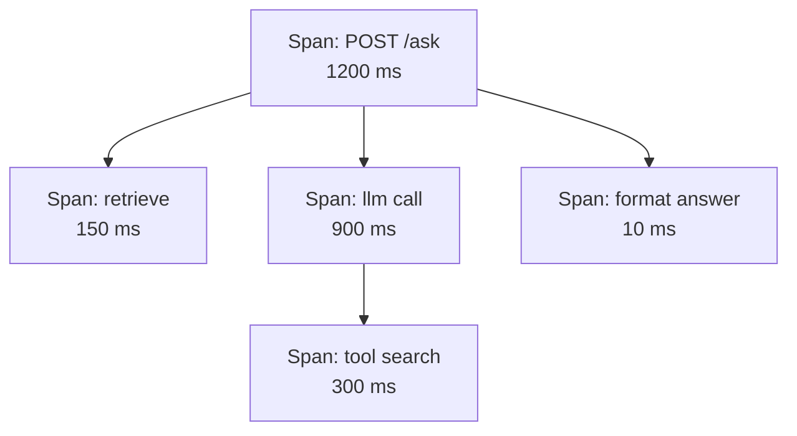
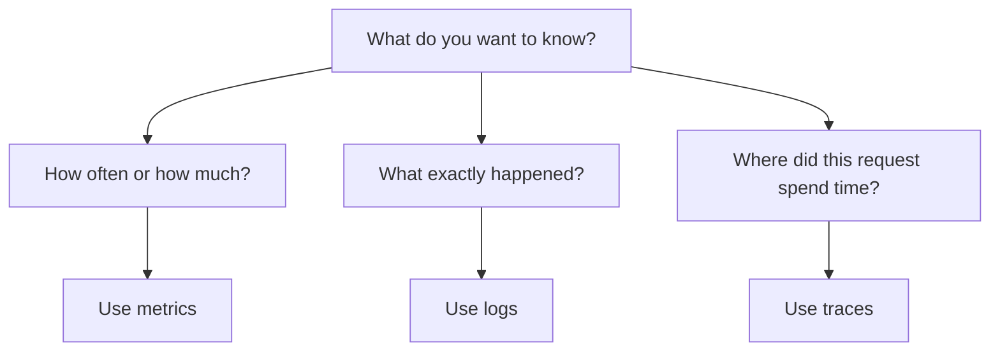

# Logs, Metrics and Traces

Think of a Swiggy order. A **metric** is the count of orders per minute. A **log** is one line saying "order 8123 assigned to a rider". A **trace** is the full journey of order 8123: app, restaurant, rider, delivery, with the time spent at each step.

## What it is

| Signal | What it is | Best for | Weak at |
|---|---|---|---|
| **Logs** | A timestamped message about one event | Details of what happened | Showing the big picture; can be huge |
| **Metrics** | Numbers measured over a period of time | Trends, dashboards, alerts | Explaining one specific request |
| **Traces** | The path of one request through many services | Finding where time or errors come from | Cheap long-term trends |

These definitions follow the OpenTelemetry docs. A **span** is one unit of work inside a trace. It has a name, timing and attributes. A trace is a tree of spans: one root span for the whole request and child spans for the steps inside it.

## How it works

### Logs

Write **structured logs**: key-value pairs (for example JSON) instead of free text. They are easy to filter. The OpenTelemetry log data model also lets a log record carry a `TraceId` and `SpanId`, so you can jump from a log line to the exact trace it belongs to.

```json
{"level":"ERROR","msg":"tool call failed","tool":"search_orders",
 "trace_id":"4bf92f3577b34da6a3ce929d0e0e4736","attempt":2}
```

### Metrics

Metrics come in a few shapes:

- **Counter:** only goes up (requests served, tokens used).
- **Gauge:** a value that goes up and down (queue length).
- **Histogram:** counts values in buckets, so you can find percentiles like p95 and p99.

Use histograms for latency. An average can hide slow requests. The Google SRE book gives an example: if 1% of requests take 50 times the average, then assuming most requests are near the average is just hopeful thinking.

Prometheus advises adding the unit to the metric name (for example `http_request_duration_seconds`) and `_total` for counters. It also says histograms can be added across instances, but pre-computed percentiles cannot be averaged in a meaningful way.

### Traces

When service A calls service B, it passes the trace ID along in a header. The standard W3C `traceparent` header looks like this:

```text
traceparent: 00-4bf92f3577b34da6a3ce929d0e0e4736-00f067aa0ba902b7-01
```

The fields are version, trace ID, parent span ID and flags. This is how many services draw one picture.



*Figure: A trace is a tree of spans. Here the model call is the slow part.*

## When to use what



*Figure: Pick the signal by the question.*

A good flow: an **alert** fires from a metric, you open a **trace** to find the slow step, and you read the **logs** of that span for details.

## In the AI era

- Metrics: tokens, cost, time to first token, tool-call count.
- Traces: model calls, retrieval and tool calls as child spans.
- Logs: prompts and responses, which are useful but may hold personal data. Handle with care (see [Tracing LLM Calls and Agents](05-tracing-llm-agents.md)).

> [!TIP]
> **Key takeaways**
> - Metrics tell you how much, logs tell you what, traces tell you where.
> - Use structured logs with a trace ID, and histograms for latency.
> - A trace is a tree of spans, linked across services by the `traceparent` header.
