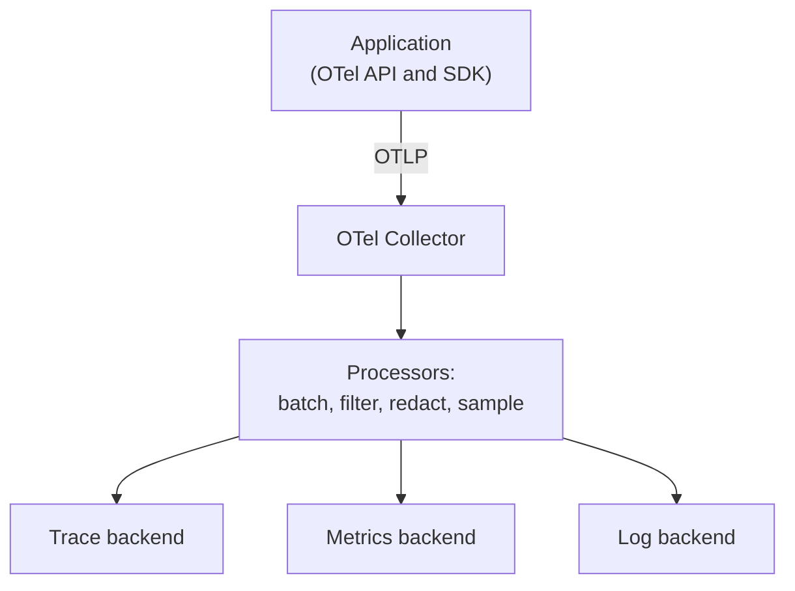

# OpenTelemetry

Every phone charger used to be different. Then USB-C came, and one cable now fits many devices. OpenTelemetry (OTel) does this for telemetry. You instrument your code once, and you can send the data to almost any backend.

## What it is

OpenTelemetry is an open-source, vendor-neutral standard for generating, collecting and exporting telemetry. Its docs list these signals as supported: traces, metrics, logs and baggage (context carried along with a request). Events and profiles are listed as still in development or proposal stage (as of November 2026, per the OTel signals page).

It has four main parts:

| Part | Job |
|---|---|
| **API** | What your code calls to create spans and metrics |
| **SDK** | The implementation: sampling, batching, exporting |
| **OTLP** | The OpenTelemetry protocol used to send data |
| **Collector** | A separate service that receives, processes and exports data |

Because the standard is open, your application code does not change when you switch the backend (for example from one dashboard vendor to another).

## How it works



*Figure: App to Collector to backends. The Collector is the control point.*

The Collector has receivers (data comes in), processors (data is changed) and exporters (data goes out). The OTel docs recommend running a collector alongside each service, where it can handle retries, batching, encryption and filtering of sensitive data. This is a good place to remove personal data before it leaves your network.

### Context propagation

For a trace to cross services, the trace ID must travel with the request. The sender puts it in a header, the receiver reads it and creates a new span under the caller's span. OTel's default propagator uses the W3C Trace Context headers (`traceparent`). Instrumentation libraries usually do this automatically.

### Instrumentation

You have two ways to produce telemetry:

- **Automatic:** libraries wrap popular frameworks, HTTP clients and databases for you.
- **Manual:** you add spans and metrics around your own logic. A short Python example:

```python
from opentelemetry import trace, metrics

tracer = trace.get_tracer("support.bot")
meter = metrics.get_meter("support.bot")
latency = meter.create_histogram(
    "bot.answer.duration", unit="s", description="Answer time"
)

with tracer.start_as_current_span("answer_question") as span:
    span.set_attribute("tenant.tier", "pro")
    # ... call retrieval and the model here ...
    latency.record(1.2, {"tenant.tier": "pro"})
```

This uses the standard OTel Python API (`get_tracer`, `start_as_current_span`, `set_attribute`, `create_histogram`, `record`). You also need to configure the SDK and an exporter; without that, the calls do nothing.

## Semantic conventions

A **semantic convention** is an agreed name for a common thing. For example, everyone agrees on one attribute name for the HTTP method. With shared names, dashboards and queries work across tools and teams.

For AI work, OpenTelemetry has GenAI semantic conventions. They now live in a separate repository (`semantic-conventions-genai`) and are still marked **Development** status as of November 2026. Names can still change. We cover them in [Tracing LLM Calls and Agents](05-tracing-llm-agents.md).

## Trade-offs

| Choice | Good | Watch out |
|---|---|---|
| Use OTel | No vendor lock-in; one standard | You manage SDK and Collector config |
| Vendor agent only | Quick start | Harder to switch later |
| Collector per service | Redaction, retries near the app | More things to run |
| Central gateway Collector | One place for policy and sampling | Can become a bottleneck |

> [!TIP]
> **Key takeaways**
> - OpenTelemetry is the open standard for traces, metrics and logs; instrument once, choose the backend later.
> - The Collector is the best place to batch, filter personal data and sample.
> - GenAI semantic conventions exist but are still in Development status, so expect some change.
