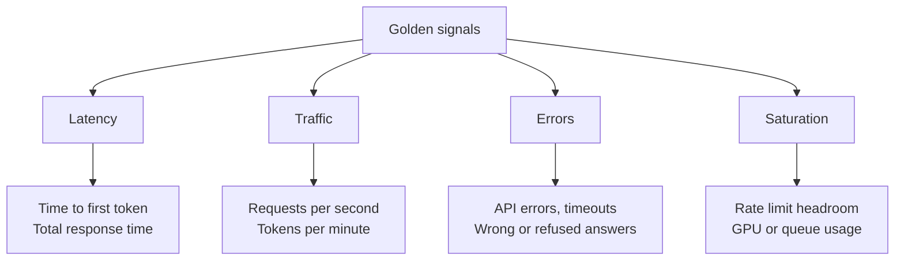

# The Four Golden Signals for AI Systems

A doctor does not run a hundred tests on every patient. First she checks pulse, temperature, blood pressure and breathing. If one is off, she looks deeper. The four golden signals are the same idea for services.

## What it is

The Google SRE book names four signals as the minimum to watch for a user-facing system:

| Signal | Meaning (from the SRE book) |
|---|---|
| **Latency** | Time to serve a request. Track successful and failed requests separately. |
| **Traffic** | Demand on the system, such as requests per second. |
| **Errors** | Rate of failed requests, explicit (HTTP 500), implicit (success code, wrong content) or by policy (too slow). |
| **Saturation** | How full the service is, focused on its most constrained resource. |

The book makes one more useful point: "a slow error is even worse than a fast error". So never mix error latency into the success latency chart.

## How it works

For a normal API these signals are easy. For an LLM application, you adapt each one.

*Figure: Golden signals mapped to LLM applications.*

| Signal | Classic service | LLM or agent service |
|---|---|---|
| Latency | p50, p95, p99 response time | Time to first token (TTFT) for streaming, total time, time per tool call. See [Chapter 6](../../module-3/06-llm-serving.md) for TTFT |
| Traffic | Requests per second | Requests per second **and** tokens per minute, because one request can be small or huge |
| Errors | HTTP 5xx | 5xx and timeouts, plus *implicit* errors: empty output, output cut off at the token limit, refusals, invalid JSON, failed tool calls |
| Saturation | CPU, memory, connections | Provider rate limits, queue depth, GPU memory if you self-host, context window usage |

The "implicit errors" row matters most. The SRE book says an error can be a success code with the wrong content. For LLMs that is common. A response can be HTTP 200 and still be a failure. Count such cases yourself, for example "output stopped because max tokens was reached" or "JSON did not parse".

### Agents need two more counts

An agent loop (see [Chapter 8](../../module-4/08-agentic-architectures.md)) can run many steps. Track:

- **Steps per task**, so you notice loops that never end.
- **Tool-call failure rate**, per tool.

The OpenTelemetry GenAI conventions even define metrics for the number of inference calls and tool calls per agent run (`gen_ai.invoke_agent.inference_calls` and `gen_ai.invoke_agent.tool_calls`). They are in Development status, so check your library before relying on the exact names.

## Symptoms vs causes

Google's guidance is to focus on symptoms: it is better to spend more effort catching symptoms than causes. A user-visible symptom is "answers take 20 seconds". A cause is "the vector database is slow". Alert on the symptom. Use traces and cause-level metrics to find the reason.

## Common mistakes

- Watching only average latency.
- Measuring only requests, not tokens.
- Calling every HTTP 200 a success.
- Mixing streaming and non-streaming requests in one latency chart. Time to first token only makes sense for streaming.

> [!TIP]
> **Key takeaways**
> - Watch latency, traffic, errors and saturation first; dig deeper only when one is off.
> - For LLMs, count tokens as well as requests, and treat empty, cut-off or invalid outputs as errors.
> - Alert on user-visible symptoms; use traces to find causes.
