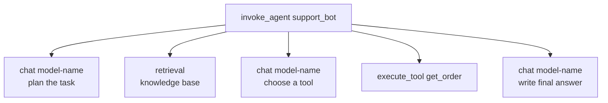

# Tracing LLM Calls and Agents

When an agent answers wrongly after 14 steps, "it gave a bad answer" is not enough. You need to replay the story: what did it retrieve, which tool did it call, what did the model see at step 9? A trace gives you that story.

## What it is

LLM tracing means recording each model call, retrieval step and tool call as a **span**, all inside one trace for the user request. Each span carries attributes such as the model name, token counts and finish reason.

OpenTelemetry has GenAI semantic conventions that define the names. As of November 2026 they are in the `semantic-conventions-genai` repository and carry **Development** status. They cover model calls, embeddings, agents, tool execution, retrieval, and MCP. The OTel team says this standard is needed to avoid lock-in caused by vendor- or framework-specific formats.

## How it works

A typical agent trace looks like this:

*Figure: One agent run as a trace. Each box is a span.*

The conventions suggest span names like `invoke_agent {agent name}`, `execute_tool {tool name}` and `{operation} {model}` for a model call (for example `chat` plus the model name). The value of `gen_ai.operation.name` tells you the kind of step: `chat`, `embeddings`, `retrieval`, `invoke_agent`, `execute_tool`, `plan` and others.

### Useful attributes on a model-call span

| Attribute | Why you want it |
|---|---|
| `gen_ai.operation.name` | The kind of step |
| `gen_ai.provider.name` | Which provider served it |
| `gen_ai.request.model` / `gen_ai.response.model` | Model asked for vs model that answered |
| `gen_ai.usage.input_tokens` / `gen_ai.usage.output_tokens` | Cost and size |
| `gen_ai.response.finish_reasons` | Stopped normally, or cut off? |
| `error.type` | Class of error, if any |

Some attributes are **opt-in** because they hold sensitive content: `gen_ai.input.messages`, `gen_ai.output.messages`, `gen_ai.system_instructions` and `gen_ai.tool.definitions`. The spec also allows storing big content outside the span and keeping only a reference (the `*_ref` attributes, such as a storage URI).

### Crossing the MCP boundary

When an agent calls a tool through MCP ([Chapter 9](../../module-4/09-mcp.md)), ordinary HTTP headers are not enough, because many MCP messages can share one HTTP request. The OTel MCP conventions say instrumentation should inject trace context into the MCP request's `params._meta` field. The server reads it and continues the same trace. So one trace can cover agent, MCP client and MCP server.

## In practice

For Python, OpenTelemetry's contrib project has a GenAI instrumentation for the `openai` library. Its docs state that by default it stays on older (v1.30.0) conventions and does not capture prompt or completion content. To get the newer attributes you set the environment variable `OTEL_SEMCONV_STABILITY_OPT_IN=gen_ai_latest_experimental`. Content capture is controlled by `OTEL_INSTRUMENTATION_GENAI_CAPTURE_MESSAGE_CONTENT`. This is the same "off by default" idea used by other tools. Claude Code, for example, redacts prompt text unless `OTEL_LOG_USER_PROMPTS` is turned on. Settings differ by library and version, so read your library's docs.

There are two common ways to get spans: frameworks that ship with built-in OTel instrumentation, and separate instrumentation libraries you import. The OTel blog lists both, with the trade-off of convenience vs flexibility.

## Privacy and cost warning

> [!WARNING]
> Prompts and responses can contain names, phone numbers, account details and secrets. Capture content only when you need it, redact before export (the Collector is a good place), set a short retention, and restrict who can read it. See [Chapter 10](../../module-4/10-security-governance.md) for data privacy.

Traces with full content are also large. Pair content capture with sampling (see [Sampling and Cardinality](08-sampling-cardinality.md)).

> [!TIP]
> **Key takeaways**
> - Model calls, retrieval and tool calls become spans inside one trace per user request.
> - OpenTelemetry GenAI conventions give shared names, but they are still in Development status, so pin versions.
> - Prompt and response content is opt-in because it is sensitive; MCP carries trace context in `params._meta`.
