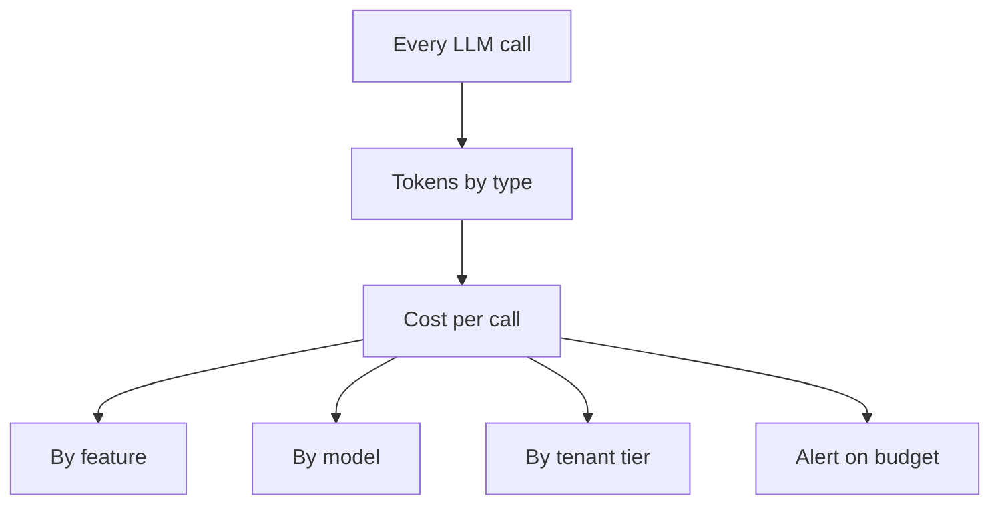

# Token, Cost and Latency Metrics

Your electricity bill is not a surprise if you read the meter every day. With LLMs, tokens are the meter. If you do not read it, the bill will surprise you at the end of the month.

## What it is

Most hosted LLM APIs charge by tokens (small pieces of text). Input and output tokens are usually priced differently, and cached input is often priced differently again. So the three numbers that matter are:

- **Tokens** used, split by type.
- **Cost**, worked out from tokens and the price list.
- **Latency**, including time to first token for streaming (covered in [Chapter 6](../../module-3/06-llm-serving.md)).

Every provider response tells you the token counts. Track them on every call.

## How it works

### Read usage from every response

Take Anthropic's Messages API as one example. The prompt caching docs say the response `usage` has `input_tokens`, `cache_creation_input_tokens` and `cache_read_input_tokens`, and that:

```text
total_input_tokens = cache_read_input_tokens
                   + cache_creation_input_tokens
                   + input_tokens
```

Here `input_tokens` counts only the part after the last cache breakpoint. If you chart only `input_tokens`, a well-cached prompt will look tiny and you will think your cost is low. Other providers name these fields differently, so always map them into one common shape in your code.

### Turn tokens into money

Keep a small price table in config and compute cost per call. The price values change often, so never hard-code them in many places.

```python
PRICE = {"in": 2.0, "out": 8.0, "cache_read": 0.2}  # example USD per 1M tokens

def cost_usd(u):
    return (u["input"] * PRICE["in"]
            + u["output"] * PRICE["out"]
            + u["cache_read"] * PRICE["cache_read"]) / 1_000_000
```

Example: with these assumed prices, a call with 10,000 input tokens and 500 output tokens costs 0.02 + 0.004 = 0.024 USD. Multiply by calls per day to forecast.

OpenTelemetry's GenAI conventions define token counters such as `gen_ai.client.inference.usage.input_tokens` and `...output_tokens`, plus cache-read and cache-write token counters (Development status, November 2026). Claude Code is a real example of an app that exports its own: `claude_code.token.usage` (split by type: input, output, cache read, cache creation) and `claude_code.cost.usage` in USD, both with a `model` attribute.

### Which dimensions to slice by



*Figure: Record usage once per call, then slice cost by a few small dimensions.*

Use **low-cardinality** labels: feature name, model, customer tier. Do not use user ID as a metric label. Prometheus warns that every unique label combination creates a new time series, and that user IDs and similar unbounded values should not be labels. For per-user cost, use logs or a database instead. See [Sampling and Cardinality](08-sampling-cardinality.md).

## Latency for LLM calls

| Metric | Meaning | Use |
|---|---|---|
| Total duration | Request start to full response | Overall user wait |
| Time to first token / chunk | Start to first streamed piece | Feels-fast measure for chat |
| Time per output token | Speed of generation | Streaming smoothness |
| Queue or retry time | Waiting before the call | Finds rate-limit trouble |

OTel names the first two `gen_ai.client.inference.duration` and `gen_ai.client.inference.time_to_first_chunk` (Development status). Record them as histograms and look at p95 and p99, not the average.

Track the **cache hit ratio** too: `cache_read` tokens divided by total input tokens. A drop in this ratio often means someone changed the start of the prompt, and your cost has quietly jumped.

## Common mistakes

- Counting only input and output, and ignoring cached and reasoning tokens.
- Forgetting retries. A retried call is a second bill.
- Not tracking tokens per task for agents, where one task may make many calls.
- Not setting a daily budget alert.

> [!TIP]
> **Key takeaways**
> - Record token usage by type on every call, and compute cost from a single price table.
> - Slice cost by feature, model and tier, but keep labels low-cardinality; avoid user ID as a label.
> - Watch p95 latency, time to first token and cache hit ratio, not just averages.
