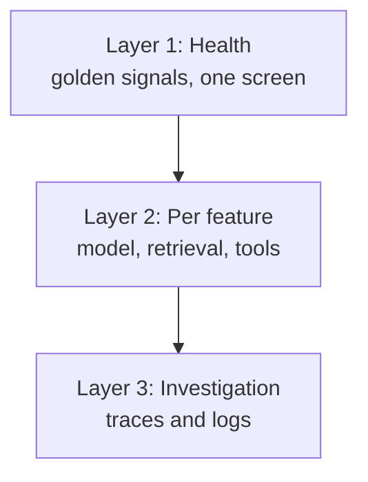

# Dashboards and Alerts

A smoke alarm that rings every time you make tea soon gets its battery removed. Bad alerts do the same to on-call engineers. They stop reading them.

## What it is

A **dashboard** is a screen of charts you look at. An **alert** is a rule that tells a human (or a system) to act. They have different jobs: dashboards help you explore, alerts demand action.

The Google SRE book has simple rules for alerts:

- A **page** interrupts a human, so it must be urgent and need judgement. "Every page should be actionable."
- A **ticket** is for work that can wait for working hours.
- Anything else belongs on a dashboard, not in someone's inbox.

Before creating an alert, ask: does it show a real user-visible problem, can I act on it, and can it wait till morning?

## How it works

### Design dashboards in layers

*Figure: Start broad, then drill down.*

A useful first screen for an LLM product:

| Panel | Why |
|---|---|
| Requests and tokens per minute | Traffic |
| p50 / p95 / p99 latency, TTFT | User wait |
| Error rate including cut-off and invalid outputs | Real failures |
| Cost per hour by model | Money |
| Cache hit ratio | Cost and speed |
| Rate-limit headroom | Saturation |
| Thumbs-down rate | Quality (see [Feedback and Quality Monitoring](09-feedback-quality-monitoring.md)) |

### Alert on symptoms, using burn rates

[Chapter 3](../../module-1/03-reliability.md) explains SLOs. An SLO gives you an **error budget**: how much failure you can afford. The **burn rate** is how fast you are using that budget. A burn rate of 1 means you will use exactly the whole budget by the end of the SLO window.

The Google SRE Workbook recommends alerting on several burn rates and windows together. Its example table for a 99.9% SLO:

| Action | Long window | Short window | Burn rate | Budget used |
|---|---|---|---|---|
| Page | 1 hour | 5 minutes | 14.4 | 2% |
| Page | 6 hours | 30 minutes | 6 | 5% |
| Ticket | 3 days | 6 hours | 1 | 10% |

Fast, severe burns page someone. Slow burns create a ticket. The short window makes the alert clear soon after the problem stops.

For AI systems, define SLIs (the measured indicators) on things users feel:

- Share of requests answered within a latency target.
- Share of requests that return a valid, complete output.
- Optionally, share of sampled answers that pass an online quality check.

### Good alert hygiene

- Hold the condition for a few minutes so it does not flap.
- Put context in the message: service, value, a link to the dashboard and runbook.
- Route by severity: page, ticket, or just a chart.
- Review noisy alerts every month and delete or fix them.

### Alerts that are special to AI systems

| Alert | Type |
|---|---|
| Daily or hourly spend above budget | Page or ticket by size |
| One tenant using a sudden large share of tokens | Ticket (could be abuse or a loop) |
| Agent steps per task far above normal | Ticket |
| Tool failure rate jumps for one tool | Page if it blocks users |
| Cache hit ratio falls sharply | Ticket |
| Refusal or thumbs-down rate jumps after a release | Page for big jumps |

## Common mistakes

- Alerting on every cause (CPU 70%, one retry) instead of user symptoms.
- Alerts with no owner and no runbook.
- One huge dashboard of 60 charts. Nobody reads it.
- No cost alert. A runaway agent loop can burn a month's budget over a weekend.

> [!TIP]
> **Key takeaways**
> - Dashboards are for exploring; alerts are only for things a human must act on.
> - Use multi-window burn-rate alerts on SLIs that match what users feel.
> - Add AI-specific alerts: spend, tokens per tenant, agent steps, tool failures, cache hit ratio, feedback drops.
