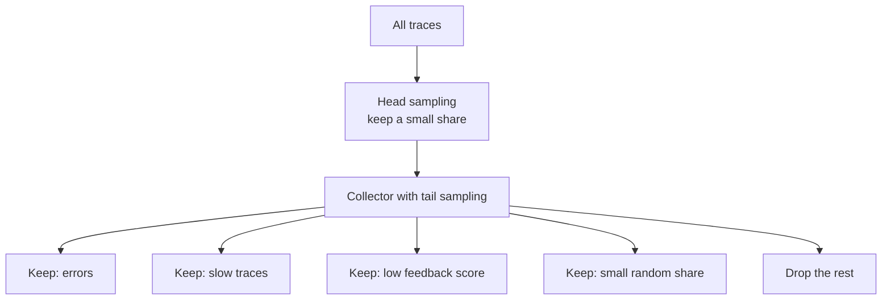
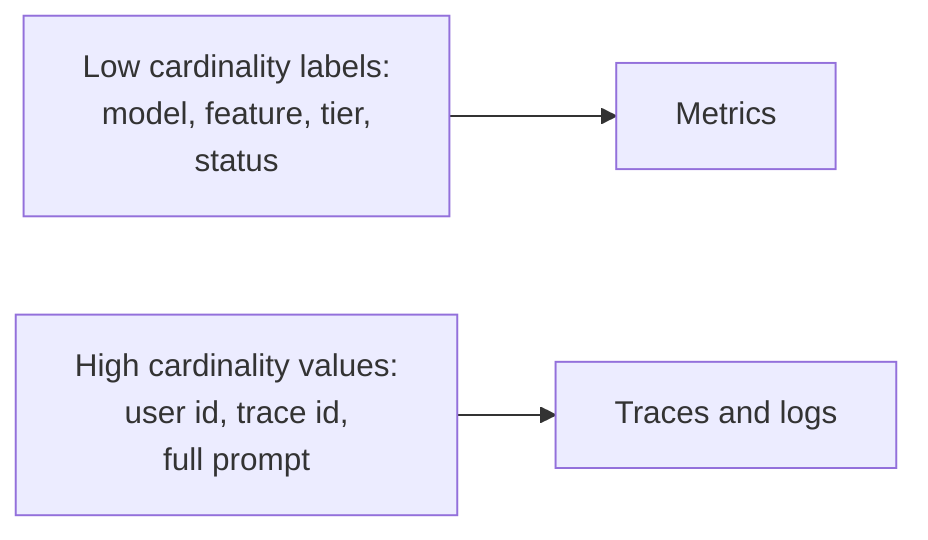

# Sampling and Cardinality

Observability data can cost more than the system it watches. Two ideas keep this under control: keep only some traces (sampling), and avoid labels with too many unique values (cardinality).

## What it is

**Sampling** means storing only a part of your traces. You keep enough to see what is going on, and drop the rest.

**Cardinality** is the number of unique values a label can take. Prometheus explains that every unique combination of label key-value pairs creates a new time series. If you add `user_id` as a label and have a million users, you get a million series for every metric. Storage and query cost explode.

## How it works

### Head sampling

The decision is made at the start of the trace, without seeing how it ends. The OpenTelemetry docs describe the common form as deterministic sampling based on the trace ID and a target percentage, so a whole trace is either kept or dropped. For example, keep 5%.

- Good: simple, cheap, works anywhere in the pipeline.
- Bad: it cannot promise to keep every trace that has an error, because it decides before the error happens.

### Tail sampling

The decision is made after the trace is complete, so you can use what you now know. The OTel docs list typical rules: always keep traces with errors, keep slow traces, sample by span attributes, and use different rates for different services. For large systems, the docs say tail sampling is almost always necessary to balance volume and usefulness.

- Good: you keep the interesting traces.
- Bad: harder to build and run. It needs stateful components that hold whole traces in memory until a decision is made, and it can need many nodes. It is often vendor-specific.

Teams often combine both: a light head sample to protect the pipeline, then tail sampling before export.

*Figure: Head sampling protects the pipeline; tail sampling keeps what matters.*

## In the AI era

LLM traces are heavier than normal ones, because prompts, retrieved chunks and responses can be many kilobytes. Tail sampling rules that make sense for AI systems:

| Keep this trace | Reason |
|---|---|
| Any error, timeout or cut-off output | Needed for debugging |
| Latency above a target | Find slow steps |
| Token count far above normal | Cost spikes, loops |
| Thumbs-down or user complaint | Quality review |
| A small random share of the rest | Baseline and quality sampling |

Another useful trick: keep the **span** (timing, tokens, model) for most traces, but capture the **full prompt and response** only for a small share or only when a rule matches. This also helps with privacy. Remember that metrics are calculated before sampling, so token and cost counters stay accurate even if you drop traces. Record them as metrics, not by counting spans.

## Controlling cardinality

*Figure: Put bounded values in metrics. Put unbounded values in traces and logs.*

Rules of thumb:

- Metric labels must come from a small, known set. Prometheus says not to use labels for dimensions with high cardinality such as user IDs or email addresses.
- Never put prompt text, document IDs or session IDs on a metric.
- Put high-cardinality details on spans and logs, which are built to be searched one record at a time.

### Other cost levers

- Set log levels sensibly; do not log full payloads at INFO level.
- Set retention: raw traces for days, metrics for months.
- Drop health-check and noisy spans in the Collector.

## Common mistakes

- Sampling at 1% and then being unable to find the one failing request.
- Counting requests from sampled spans, which gives wrong totals.
- Using user ID or prompt hash as a metric label.
- Keeping raw prompts forever.

> [!TIP]
> **Key takeaways**
> - Head sampling is cheap but blind; tail sampling keeps errors and slow traces but needs more infrastructure.
> - Record cost and token counters as metrics, not from sampled traces.
> - Keep metric labels low-cardinality; put unbounded values in traces and logs.
