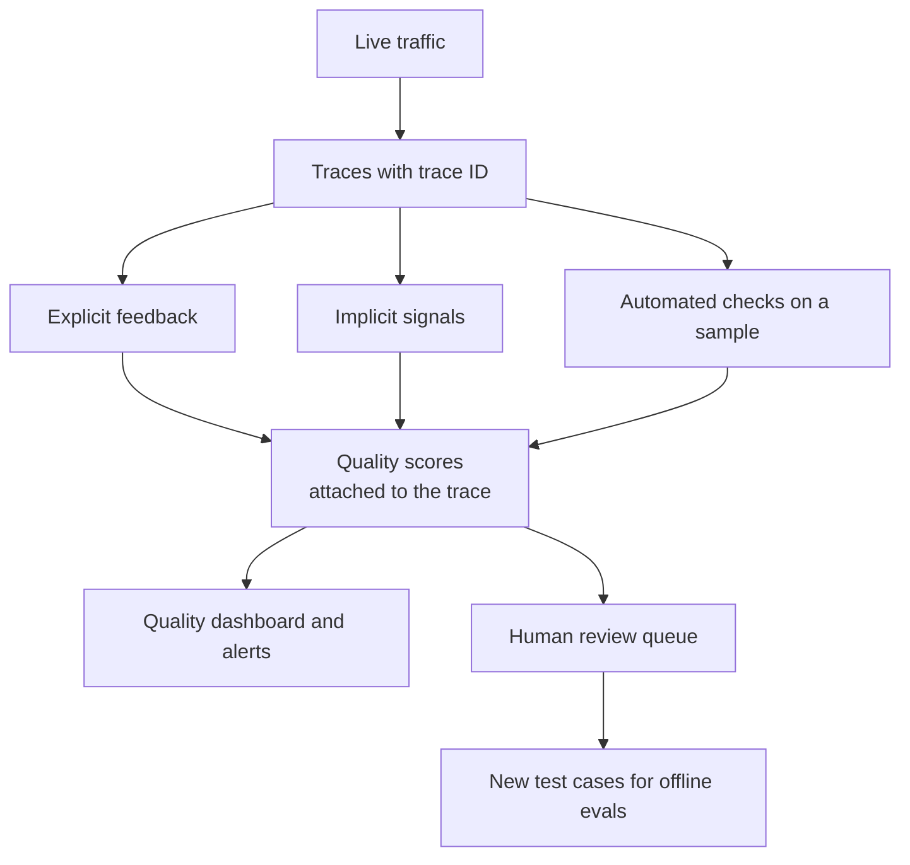

# Feedback and Quality Monitoring

A restaurant can see that tables are full and orders are going out on time. That does not tell it whether the food tasted good. For that, it needs customers' feedback and the chef's own tasting. AI systems need the same.

## What it is

Latency and error rate tell you the system is *running*. **Quality monitoring** tells you whether the answers are *good*. It is done in production, on live traffic, and it is different from the offline tests you run before release (see [Chapter 12](../12-evaluation-safety.md)).

There are three sources of quality signals:

| Source | Examples | Strength | Weakness |
|---|---|---|---|
| **Explicit feedback** | Thumbs up/down, star rating, report button | Direct opinion | Few users give it; biased to angry users |
| **Implicit signals** | User rephrases the question, retries, abandons, copies the answer, accepts or rejects a suggested edit | Plenty of data | Needs interpretation |
| **Automated checks** | Format validation, rule checks, LLM-as-judge on a sample | Always on | Judges have their own errors (see Chapter 12) |

## How it works

*Figure: The online feedback loop. Scores are attached to the trace, then used for alerts, review and new test cases.*

The key design step is to **attach every score to the trace ID** of the response it is about. Then a thumbs-down is not just a number. You can open the trace and see the prompt, retrieved documents and tool calls behind that bad answer.

Real tools follow this pattern. For example, Langfuse (an open-source LLM observability tool) describes traces as records of a request's lifecycle with nested steps, and links scores and LLM-as-judge evaluation to them for monitoring quality.

### Cheap proxy metrics

Even without a judge, some numbers move when quality drops. Chart them over time, by model and by feature:

- Refusal rate and empty-answer rate.
- Output cut off at the token limit.
- Invalid JSON or schema failures.
- Output length (sudden change in average length).
- For RAG ([Chapter 7](../../module-3/07-rag-architectures.md)): share of queries with no retrieved results, or with no citation.
- For agents: tool-call failure rate, steps per task.

None of these proves quality, but a sudden jump says "look here".

### Drift

**Drift** means the world your system sees has changed from what you tested for. [Chapter 4](../../module-2/04-ml-pipelines.md) covers drift for classic ML. For LLM apps, watch for:

- **Input drift:** users start asking about new topics, longer questions, or a new language.
- **Model drift:** the provider updates or replaces a model behind a name. Record `gen_ai.response.model` (the model that actually answered) on every span, so a change shows up in your data.
- **Data drift:** your RAG documents become stale or the index changes.
- **Prompt drift:** someone edits a prompt template. Version your prompts and put the version in the trace.

## Case study: quality problems that were noisy to detect

Anthropic's public post-mortem (September 2025) described three infrastructure bugs that degraded some model responses between August and early September 2025. The company wrote that early user reports were hard to tell apart from normal feedback variation, and that its evaluations did not capture the degradation. Changes it announced included more sensitive evaluations, **quality evaluations run continuously on production systems**, and tooling to debug community feedback while preserving privacy.

The lesson for you: quality signals are noisy, so combine many of them, tie them to traces and run checks on live traffic, not only before release.

## Common mistakes

- Relying only on thumbs-down. Most users never click.
- Storing feedback without the trace ID.
- Judging quality only on the average. Slice by feature, language and model version.
- Reading raw user conversations without consent or access control.

> [!TIP]
> **Key takeaways**
> - Quality needs its own signals: explicit feedback, implicit behaviour and automated checks on a sample.
> - Attach every score to a trace ID, so a bad score leads straight to the evidence.
> - Watch for input, model, data and prompt drift; record the model that actually answered.
