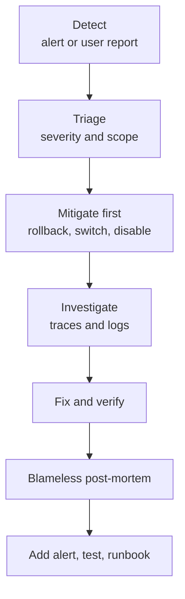

# Incident Response for AI Systems

Imagine a ticket-booking site that gets a huge rush at 10 AM, like a Tatkal window. A good team knows who to call, what to check first and how to tell users. An AI incident needs the same calm routine, plus a few new checks.

## What it is

An **incident** is an event that hurts users or the business and needs a coordinated response. Incident response is the routine for detecting it, limiting the damage, fixing it and learning from it.

Google's SRE book gives a base for this. It splits roles in a serious incident:

- **Incident commander:** holds the overall state and assigns work.
- **Ops lead:** the only group that changes the system during the incident.
- **Communications:** gives regular updates to responders and stakeholders.
- **Planning:** files bugs and tracks changes so they can be undone later.

It advises declaring an incident early (for example when a second team is needed, customers can see the outage, or the problem is still unsolved after about an hour), and keeping a living incident document.

## How it works

*Figure: The incident loop. Mitigate before you find the root cause.*

### What is different for AI systems

Most AI incidents are one of these types:

| Type | Typical signs | First safe actions |
|---|---|---|
| **Provider outage or slowdown** | Timeouts, 5xx, p99 latency up | Fail over to another model or provider, shorten timeouts, show a clear message |
| **Rate limited** | 429 errors, queueing | Shed low-priority traffic, reduce context size |
| **Cost spike** | Spend alert, tokens per task up | Cap per-tenant tokens, stop the runaway job, lower agent step limit |
| **Quality drop** | Thumbs-down up, proxy metrics shift | Roll back the prompt, model version or index to the last good one |
| **Unsafe output or data leak** | User or filter report | Turn off the feature or tool, preserve logs, involve security |
| **Agent loop or bad tool action** | Steps per task very high, repeated tool calls | Kill the run, disable the tool, review what actions it took |

For many of these, the fastest fix is a **switch you prepared earlier**: a feature flag to disable a tool, a way to pin a model version, a fallback model, or a rollback for prompts. Prepare these before you need them. See [Chapter 3](../../module-1/03-reliability.md) for failure-handling patterns.

### Ask these questions early

1. Did anything change? Check deploys, **prompt versions, model versions** (`gen_ai.response.model`), index updates and config.
2. Is it everyone, or one tenant, region, language or feature?
3. Is it the provider? Check their status page and compare with your own error data.
4. Open a few bad traces. Which span is the first wrong one?

Without versions recorded in traces, question 1 is nearly impossible. So log prompt version, model, tool set and index version on every request.

### Security incidents

Prompt injection and data leaks are incidents too. Keep an audit trail of tool calls and who triggered them, and have a security contact in your runbook. See [Chapter 10](../../module-4/10-security-governance.md).

## Post-mortem

The SRE book recommends **blameless** post-mortems: focus on systemic causes, not people. Triggers include user-visible degradation, data loss, rollbacks and a monitoring failure that caused manual discovery. For AI systems, add "quality degradation found by users instead of by us" as a trigger.

Good follow-ups for an AI incident:

- A new alert or proxy metric that would have caught it.
- A new test case in your evaluation set ([Chapter 12](../12-evaluation-safety.md)).
- A better runbook and a tested rollback switch.

Anthropic's post-mortem is a public example. Its announced follow-ups included detection tests for unexpected character outputs in its deployment process.

## Common mistakes

- Hunting for the root cause while users still suffer. Mitigate first.
- No way to roll back a prompt or model.
- Treating "model quality dropped" as unfixable. Often the cause is a change you can find and undo.
- Skipping the post-mortem because "the model is just random".

> [!TIP]
> **Key takeaways**
> - Use clear roles, declare early, and mitigate before you find the root cause.
> - Prepare kill switches: disable a tool, pin or roll back a model or prompt, fail over to a fallback.
> - Record prompt, model, tool and index versions in every trace so you can find "what changed".
