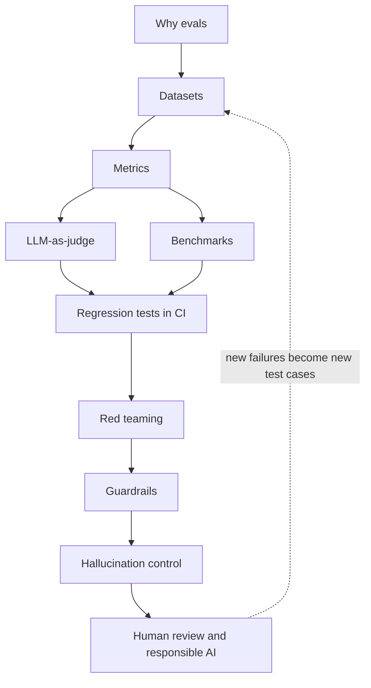

# Chapter 12: Evaluation, Safety & Trust Infrastructure

In normal software, a test says "pass" or "fail" and the answer does not change tomorrow. An LLM application is different. The same question can give a different answer each time, and "correct" is often a matter of degree.

So how do you know your assistant is good? How do you know last week's prompt change did not break something? How do you stop it from saying something harmful or false?

This chapter is the answer. Think of it as the **quality control department** of an AI product. A factory does not ship a batch without inspection, and an AI system should not ship without evals, safety layers and human oversight.

We cover two connected halves:

- **Evaluation**: measuring quality, before release and after.
- **Safety and trust**: stopping bad outputs, finding weaknesses early, and keeping humans in charge.

*Figure: The map of this chapter. The dotted arrow shows the loop: every failure you find becomes a new test.*

This chapter builds on [Chapter 7](../module-3/07-rag-architectures.md) (RAG), [Chapter 8](../module-4/08-agentic-architectures.md) (agents) and [Chapter 10](../module-4/10-security-governance.md) (security). It pairs with [Chapter 11](11-observability.md), which gives you the production traces that evals need.

## What you will learn

- **Why evals matter**: offline and online evals, and the improvement loop.
- **Eval datasets**: golden sets, real logs and synthetic data.
- **Metrics**: what to measure for classification, text generation, RAG and agents.
- **LLM-as-judge**: using a model to grade, and its known biases.
- **Benchmarks**: what public leaderboards can and cannot tell you.
- **Regression testing in CI**: stopping quality drops before they ship.
- **Red teaming**: attacking your own system to find holes.
- **Guardrails**: input, output and tool-level safety layers.
- **Hallucination mitigation**: why models make things up and how to reduce it.
- **Human review and responsible AI**: review queues, documentation and governance frameworks.
