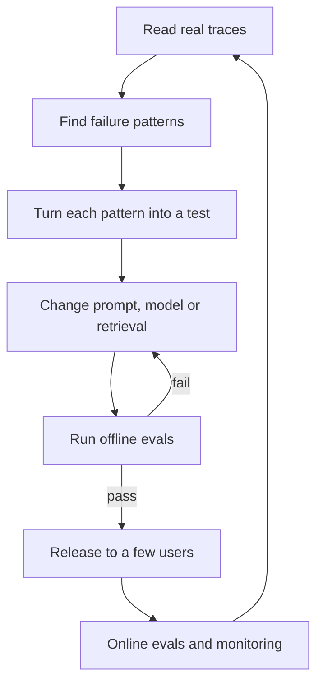

# Why Evals Matter: Offline and Online

Imagine a cricket coach who watches the team only on match day and never in the nets. He cannot tell which change helped. Many AI teams work like this: they edit a prompt, try three examples by hand, and say "looks good".

## What it is

An **eval** (short for evaluation) is a repeatable test that scores how well your AI system does its job. It is the AI version of a unit test, but built for outputs that vary.

Three words you will see often (these are the terms Anthropic's engineering team uses for agent evals):

- **Task**: one test case, with an input and a definition of success.
- **Trial**: one attempt at a task. You may run several trials, because outputs vary.
- **Grader**: the logic that scores the result.

OpenAI's guidance calls the habit **eval-driven development**: evaluate early and often, not after launch. Their guide also warns against judging quality "by impression".

## How it works

Evals run in two places.

- **Offline evals** run before release, on a fixed set of examples. They are cheap, repeatable and safe.
- **Online evals** run on real traffic after release. They show what users actually do, but you cannot control the inputs.

Hamel Husain, who writes widely on this topic, describes three levels, from cheap to costly:

1. **Unit tests**: fast assertions on every code change.
2. **Human and model evaluation**: review of logged traces, with an LLM judge to scale up.
3. **A/B testing**: for mature products and big changes.

*Figure: The improvement loop. Offline evals guard the door. Online signals feed the next round.*

## Offline vs online

| | Offline eval | Online eval |
|---|---|---|
| Data | Fixed, curated set | Live user traffic |
| When | Before every change | Continuously after release |
| Cost | Low, you control it | Higher, needs tracing |
| Risk | None to users | Users see problems first |
| Best for | Catching regressions | Finding problems you did not imagine |

You need both. Offline evals only cover what you thought of. Online signals show what you missed. Chapter 11 covers how to collect those traces and feedback.

## Capability vs regression evals

Anthropic separates two kinds of suite:

- **Capability evals** ask "what can this system do well?" They should start with a low pass rate, so there is room to improve.
- **Regression evals** ask "does it still do what it used to?" They should stay near 100 per cent.

When a capability eval becomes easy, it can move into the regression suite. If an eval sits at 100 per cent for long, it is **saturated** and no longer tells you anything new.

## In the AI era

In classic ML (Chapter 4), you had one label per row and one accuracy number. With generative systems the output is free text, a tool call or a whole multi-step plan. You must define "good" yourself, per product. Generic scores such as BLEU alone are not enough; OpenAI lists relying only on generic academic metrics as an anti-pattern.

## Common mistakes

- Changing prompts again and again with no eval, so one fix breaks another.
- Building the test set from imagination instead of real usage.
- Waiting until after launch to start.

> [!TIP]
> **Key takeaways**
> - An eval is a repeatable test with a task, a trial and a grader.
> - Use offline evals to guard releases and online evals to discover new failures.
> - Keep capability evals (room to grow) separate from regression evals (should stay near 100 per cent).
