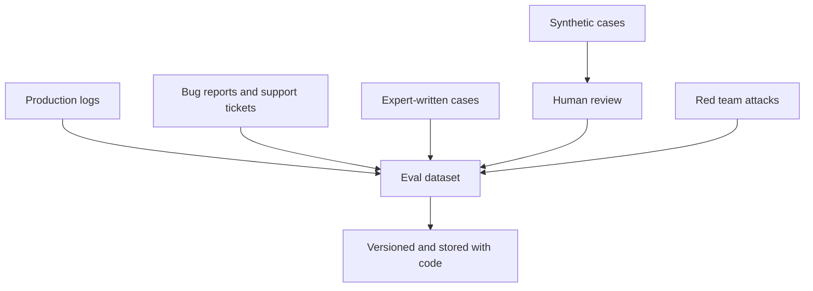

# Eval Datasets: Golden Sets and Synthetic Data

A teacher cannot set a good exam from one chapter and then say "the class is ready". The exam must cover what students will really face. An eval dataset is your exam paper.

## What it is

An **eval dataset** is a collection of test cases: inputs, and what a good result looks like. A **golden set** is the carefully checked core of it, where the expected answers have been reviewed by people who know the domain.

## Where the cases come from

OpenAI's evaluation guide lists several sources: production data, historical logs, human-curated data, domain data and synthetic data. It also says to include typical cases, edge cases and adversarial cases. Anthropic suggests starting small: around 20 to 50 tasks taken from real failures is a useful start.


*Figure: Many sources feed one dataset. Synthetic cases pass through human review first.*

## What a good test case looks like

Anthropic's advice for building eval tasks:

- The task should be **unambiguous**. Two domain experts should reach the same pass or fail verdict.
- Have a **reference solution**, so you know the task can be passed.
- Include cases where a behaviour **should** happen and cases where it **should not**. Otherwise you optimise in one direction only. For example, test both "refuses a harmful request" and "does not refuse a normal request".
- Start each trial in a **clean environment**, so shared state does not make failures depend on each other.

Example record (an illustration, not a standard format):

```json
{
  "id": "refund-014",
  "input": "I was charged twice for order 8841. Please fix.",
  "expected": {
    "must_call_tool": "refund_lookup",
    "must_not_say": "refund is guaranteed",
    "tone": "polite"
  },
  "source": "support-ticket",
  "tags": ["billing", "tool-use"]
}
```

Tags help you slice results later, for example "how do we do on billing questions?".

## Synthetic data

**Synthetic data** means test cases generated by an LLM. It helps when you have no logs yet, or want more variety.

The Ragas library shows one way for RAG. It builds a knowledge graph from your documents and then generates questions from it. Its default mix is 50 per cent single-hop specific, 25 per cent multi-hop abstract and 25 per cent multi-hop specific questions. (A **multi-hop** question needs facts from more than one passage.)

The Ragas guide itself advises you to review the output and choose which queries to keep. Synthetic data is a starting point, not a replacement for real traffic.

## Trade-offs

| Source | Strength | Weakness |
|---|---|---|
| Production logs | Matches real usage | Needs privacy care and labelling |
| Expert-written | High quality | Slow and costly |
| Synthetic | Fast, wide variety | May be unrealistic or repetitive |
| Red team attacks | Finds hard failures | Narrow, covers only attacks |

## Practical habits

- **Look at the data.** Hamel Husain says to read as much as you can and stop only when you stop learning anything new.
- **Version the dataset** like code, so a score change can be traced to a change in system or in data.
- **Protect personal data** in logs before reusing them. See [Chapter 10](../../module-4/10-security-governance.md) for privacy duties.
- **Keep some cases hidden** from the team that tunes the prompts, so you can check you have not just memorised the test.
- **Refresh it.** Every production failure should add a case.

> [!TIP]
> **Key takeaways**
> - Build the dataset from real failures first, and add synthetic cases for coverage.
> - Each case must be unambiguous; include both "should" and "should not" cases.
> - Treat the dataset as a living, versioned asset that grows with every incident.
