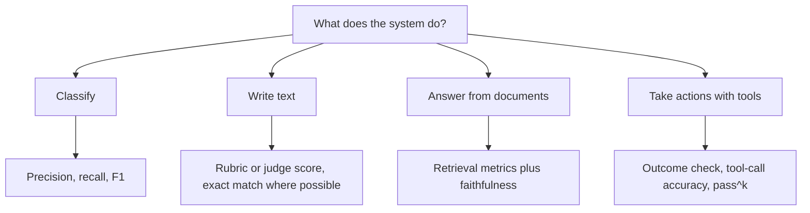

# Metrics for Classification, Generation, RAG and Agents

A cricketer is not judged by runs alone. You also look at strike rate, catches and fitness. In the same way, one number cannot describe an AI system. The right metric depends on what the system does.

## What it is

A **metric** turns an output into a score. Pick it from the task type.

*Figure: Choose metrics by task type.*

## Classification

Examples: spam or not, route a ticket, detect toxic text. Scikit-learn defines the standard metrics using true positives (tp), false positives (fp) and false negatives (fn):

- **Precision** = tp / (tp + fp). Of the items flagged, how many were truly positive?
- **Recall** = tp / (tp + fn). Of all true positives, how many did we find?
- **F1** is the harmonic mean of the two.

Which matters more depends on cost. A fraud filter that misses fraud (low recall) and one that blocks good customers (low precision) hurt in different ways.

## Text generation

Open-ended text is hardest. Options:

- **Exact or string match**, only when the answer is short and fixed (a date, an ID).
- **Overlap scores** such as ROUGE or BLEU. They are cheap but miss meaning. OpenAI warns against using only such generic metrics.
- **Rubric grading** by a person or an LLM judge. See the next page.
- **Programmatic checks**: valid JSON, length limits, banned words, schema match.

## RAG systems

For retrieval-augmented generation ([Chapter 7](../../module-3/07-rag-architectures.md)), measure retrieval and generation separately. Ragas documents these:

| Metric | What it asks | Needs a reference answer? |
|---|---|---|
| Context precision | Are relevant chunks ranked above irrelevant ones? | In the main version, yes |
| Context recall | Did retrieval bring back what was needed? | Yes |
| Faithfulness | Are the answer's claims supported by the retrieved text? | No |
| Response relevancy | Does the answer address the question? | No |

Faithfulness is computed by splitting the answer into claims and checking each against the context. If 1 of 2 claims is supported, the score is 0.5. A wrong score here points you to the right fix: bad retrieval needs better search; unfaithful answers need better prompting or a better model.

## Agents

For agents ([Chapter 8](../../module-4/08-agentic-architectures.md)), Anthropic advises grading the **outcome**, not a fixed sequence of steps. Did the booking really appear in the database, not just did the agent say so? OpenAI adds tool selection and argument accuracy for single agents, and handoff accuracy for multi-agent systems.

Agents are random, so one run is not enough:

- **pass@k**: chance of at least one success in k tries. Fine when one good answer is enough.
- **pass^k**: chance that **all** k tries succeed. Needed for customer-facing agents.

*Example:* if one try succeeds 75 per cent of the time, three tries all succeed about 42 per cent of the time (0.75 x 0.75 x 0.75, assuming tries are independent). The tau-bench paper uses pass^k for the same reason: agents that look fine on one run can be inconsistent.

## Do not forget

Track **cost, latency and number of steps** next to quality. A 2 per cent gain that doubles the bill may not be worth it. See [Chapter 11](../11-observability.md) for how to collect these.

> [!TIP]
> **Key takeaways**
> - Choose metrics by task: precision and recall for classifiers, rubrics for text, retrieval plus faithfulness for RAG, outcomes for agents.
> - For agents, use pass^k when consistency matters.
> - Always report cost and latency beside quality.
