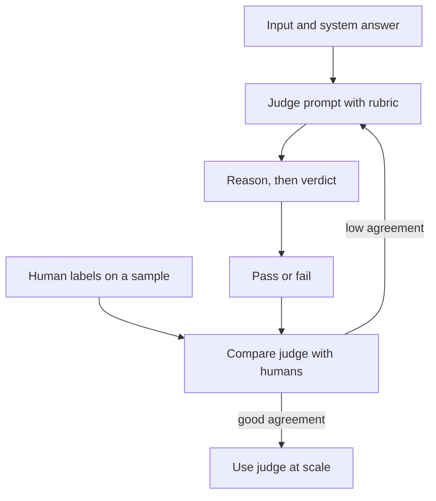
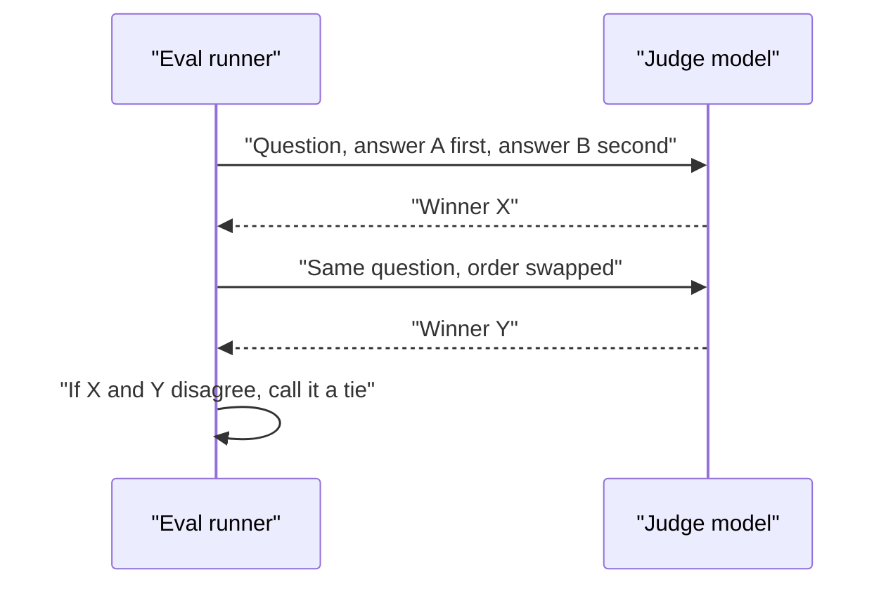

# LLM-as-Judge and Its Pitfalls

Checking ten thousand answers by hand is like one teacher marking a whole board exam alone. So teams ask a second model to be the examiner. It is fast, but the examiner can be biased.

## What it is

**LLM-as-a-judge** means using a strong language model to grade the outputs of your system, usually against a rubric. The idea was studied in the "MT-Bench and Chatbot Arena" paper (Zheng et al., NeurIPS 2023). It reported that strong judges such as GPT-4 agreed with human preferences over 80 per cent of the time, about the same level at which humans agree with each other.

That is encouraging, but it is a result on one set of tasks. You must check it on yours.

## How it works

Two common styles:

- **Pass/fail or score against a rubric**: "Does the answer follow the refund policy? Reply PASS or FAIL with a reason."
- **Pairwise comparison**: show answers A and B and ask which is better.

OpenAI's guidance prefers pairwise or pass/fail over open-ended scores, and suggests asking the judge to reason before it scores.


*Figure: A judge is trusted only after it matches human labels on a sample.*

A small sketch (the `call_llm` function stands for whichever model API you use):

```python
JUDGE_PROMPT = """You are grading a support answer.
Rubric: it must (1) follow the policy text, (2) not invent facts.
Policy: {policy}
Answer: {answer}
Think step by step, then end with exactly PASS, FAIL or UNKNOWN."""

def judge(policy, answer, call_llm):
    text = call_llm(JUDGE_PROMPT.format(policy=policy, answer=answer))
    last = text.strip().split()[-1].upper()
    return last if last in {"PASS", "FAIL", "UNKNOWN"} else "UNKNOWN"
```

The `UNKNOWN` option follows Anthropic's tip: let the judge say it does not know, so it does not invent a grade.

## Known pitfalls

The Zheng et al. paper names these biases:

| Bias | What happens | Common fix |
|---|---|---|
| Position bias | Judge prefers the answer shown first (or last) | Swap order and run twice |
| Verbosity bias | Judge prefers longer answers | Control for length; say so in the rubric |
| Self-enhancement | Judge favours text from its own model family | Use a different judge model |
| Limited reasoning | Judge fails at maths or logic checks | Use code checks or reference answers |

The paper "Large Language Models are not Fair Evaluators" (Wang et al.) shows how strong position bias can be: the ranking of two models could change just by changing the order of the answers. Its fixes include averaging over several orderings and asking the judge for evidence before the rating.


*Figure: Swapping the order and keeping only consistent verdicts reduces position bias.*

## Aligning the judge with humans

A judge is itself a small ML system, so it needs its own test.

1. Have humans label a sample, with short notes on why.
2. Run the judge on the same sample.
3. Compare. Hamel Husain warns that raw agreement can mislead when classes are imbalanced (if 95 per cent of answers are good, a lazy judge that always says PASS scores 95 per cent). Look at precision and recall for the failing class.
4. Improve the rubric and repeat.

The "Who Validates the Validators?" paper found **criteria drift**: people refine what they want only after seeing outputs. So expect to revise your rubric. Re-check the judge now and then, and whenever you change the judge model.

## Common mistakes

- Trusting a judge never compared with humans.
- Giving the judge a 1-to-10 scale with no examples per level.
- Letting the system under test grade itself.

> [!TIP]
> **Key takeaways**
> - A judge scales grading but carries position, verbosity and self-enhancement biases.
> - Prefer pass/fail or pairwise questions, swap order, and allow an UNKNOWN answer.
> - Validate the judge against human labels, and re-check it regularly.
