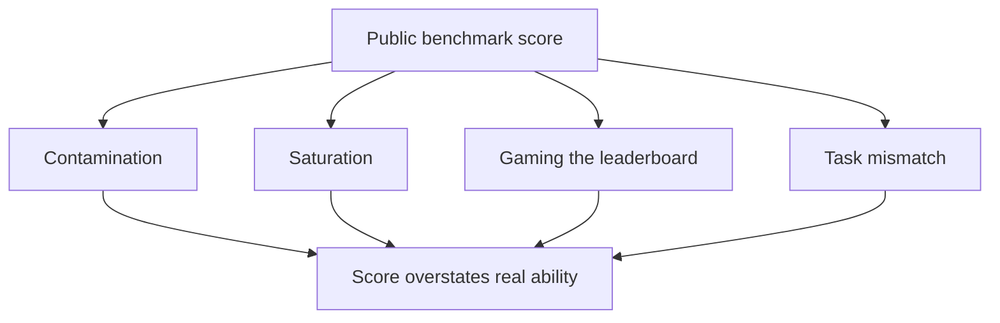

# Benchmarks and Their Limits

When choosing a school, people look at board results. Useful, but the result does not say whether *your* child will do well. Public AI benchmarks are similar.

## What it is

A **benchmark** is a shared test set with a fixed scoring method, used to compare models. It answers "how does model A compare with model B in general?" It does not answer "will this work in my product?"

## Some well-known examples

| Benchmark | What it tests | Fact from its paper |
|---|---|---|
| MMLU | Knowledge across subjects | 57 tasks, such as elementary maths, US history, computer science and law |
| HELM | Broad, many-metric comparison | Seven metrics (accuracy, calibration, robustness, fairness, bias, toxicity, efficiency) over 16 core scenarios |
| SWE-bench | Fixing real software issues | 2,294 problems from real GitHub issues in 12 Python repositories |
| tau-bench | Tool-using agent talking to a simulated user, following policy | Checks the final database state against a goal state |
| Chatbot Arena | Human preference in anonymous head-to-head chats | Crowdsourced votes |

HELM shows a good idea: report several properties together, so trade-offs are visible. Accuracy alone hides cost, bias or toxicity.

Leaderboard positions change fast, so this page gives none. Check live sources when you need current numbers.

## Why benchmark scores can mislead

*Figure: Four common reasons a benchmark number does not match product quality.*

- **Contamination.** If test questions leaked into training data, the model may have seen them. A 2023 study (Deng et al.) probed this by hiding a wrong answer option and asking models to guess it. It reported that ChatGPT and GPT-4 could do this with exact-match rates of 52 per cent and 57 per cent on MMLU, which suggests memorisation. The authors describe a gap between inflated scores and real performance.
- **Saturation.** When top models all score near the ceiling, the test stops separating them.
- **Gaming.** The paper "The Leaderboard Illusion" (Singh et al., 2025) argues that Chatbot Arena rankings are skewed by private testing of many variants, selective disclosure of results, and unequal sampling. Treat any single leaderboard as one signal.
- **Task mismatch.** A model that is good at multiple-choice exams may still fail at your invoice-parsing task.
- **Scoring that rewards guessing.** Kalai et al. argue that most benchmarks give no credit for saying "I don't know", so models learn to guess. This links to the hallucination page.

## How to use benchmarks sensibly

1. **Shortlist** candidate models with public benchmarks close to your task type (for example, SWE-bench for coding agents).
2. **Decide** with your own eval set (page 2). This is the benchmark that matters.
3. **Re-run** your set whenever you switch model versions.
4. **Read the method.** Check what prompt, how many tries and what scoring the number came from.

> [!NOTE]
> A benchmark score is a hint, not a guarantee. Your own eval set is the final authority.

> [!TIP]
> **Key takeaways**
> - Benchmarks compare models in general; they do not predict your product's quality.
> - Contamination, saturation, leaderboard gaming and task mismatch all distort scores.
> - Shortlist with public benchmarks; decide with your own evals.
