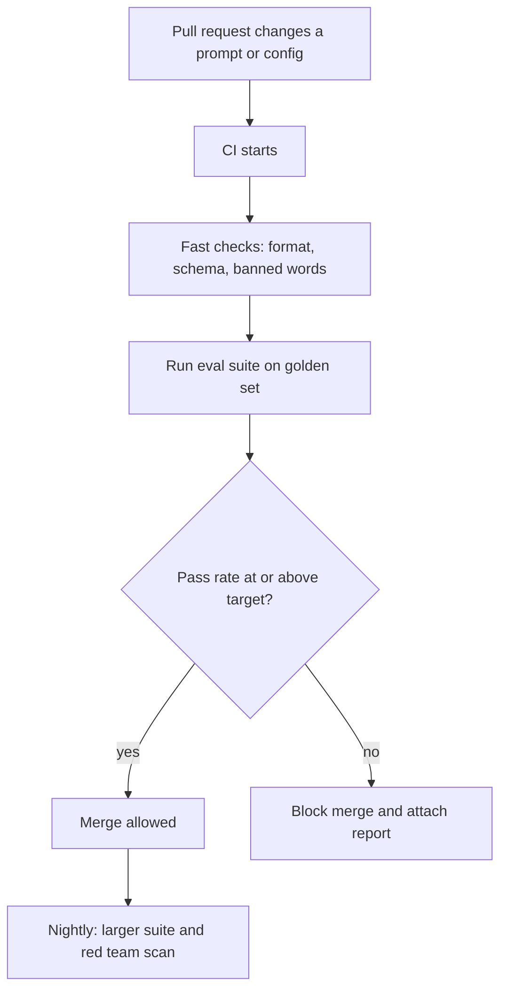

# Regression Testing in CI

Before a train leaves, staff check brakes, doors and signals, every single time. Nobody says "it was fine yesterday". Your AI system needs the same routine before each change goes live.

## What it is

A **regression** is when something that used to work stops working. **Regression testing** runs your eval suite automatically on every change, so a drop in quality blocks the release. **CI** (continuous integration) is the pipeline that runs checks when code is pushed or a pull request is opened.

In AI systems, many things can change quality, not just code:

- the prompt text
- the model or model version
- retrieval settings, chunking, embeddings
- tool descriptions
- guardrail rules

All of these should be treated like code: stored in Git and tested on every change.

## How it works


*Figure: A quality gate in CI. The slow, costly tests run on a schedule.*

The promptfoo documentation shows a typical set-up. You write assertions in a config file, run the eval, save results as JSON, and then fail the build if the failure count or pass rate is not acceptable. Its assertion types include `contains`, `is-json`, `regex`, `latency`, `cost`, `similar` and `llm-rubric`.

A test config (the prompts and providers sections are left out here):

```yaml
tests:
  - vars:
      question: "I was charged twice. What now?"
    assert:
      - type: contains
        value: "refund"
      - type: not-contains
        value: "guaranteed"
      - type: latency
        threshold: 3000   # milliseconds
      - type: llm-rubric
        value: "Polite and follows the refund policy"
```

A CI step that fails the build when any test fails (adapted from the promptfoo CI guide):

```bash
npx promptfoo@latest eval -c promptfooconfig.yaml -o results.json
FAILURES=$(jq '.results.stats.failures' results.json)
if [ "$FAILURES" -gt 0 ]; then exit 1; fi
```

The same guide suggests uploading the report even when the gate fails (`if: always()` in GitHub Actions), so reviewers can see why. It also suggests tagging runs with the Git commit, so you can trace a score to a change.

## Design choices

| Question | Common answer |
|---|---|
| Which tests run on every PR? | A small, fast golden subset |
| Which run nightly? | Full suite, multiple trials, red team scans |
| What is the gate? | A pass-rate target per tag, not only one global number |
| How to handle randomness? | Run several trials, and use pass^k for critical flows |
| How to control cost? | Cache model responses, run only when relevant files change |

The promptfoo guide shows caching and path filters (run only when `prompts/**` or the config file changes) for this reason. A suite that costs too much or takes too long will be skipped by the team.

## Pitfalls

- **Flaky tests.** Outputs vary, so a single failure may be noise. Re-run or use trials before you panic.
- **Fixed pass rates.** Hamel Husain notes the target is a product decision, not always 100 per cent.
- **Judge drift.** If a model-based grader changes, scores change. Pin its version and re-check it against humans.
- **Gaming the test.** Anthropic advises designing graders so that passing needs the real solution, and reading transcripts to confirm failures are fair.
- **Secrets.** Keep API keys in CI secrets, never in the config.

## In the AI era

Add a safety slice to the suite: known jailbreaks, prompt-injection samples and "must refuse" cases. Every attack found in red teaming (next page) should be added here so it stays fixed.

> [!TIP]
> **Key takeaways**
> - Treat prompts, models and retrieval settings as code, and run evals on every change.
> - Keep PR checks small and fast; run big suites and red team scans on a schedule.
> - Handle randomness with trials, pinned judges and a pass-rate target agreed as a product decision.
