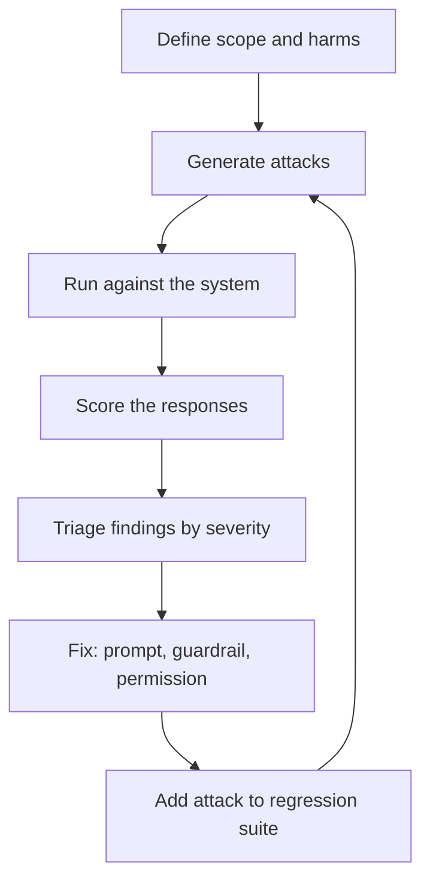

# Red Teaming

Before a bank opens a new app, it hires people to try to break in. These people think like thieves, but they report to the bank. Red teaming does the same for AI.

## What it is

**Red teaming** means deliberately attacking your own AI system to find harmful, unsafe or insecure behaviour before real users or attackers do. Ordinary evals ask "does it work?" Red teaming asks "how can I make it fail?"

Anthropic's 2022 paper "Red Teaming Language Models to Reduce Harms" released a dataset of 38,961 red team attacks. It found that models trained with reinforcement learning from human feedback became harder to red team as they grew larger, while the other model types it tested showed a flat trend.

## What attackers try

Typical goals include:

- **Jailbreaks**: tricking the model past its safety rules.
- **Prompt injection**: hiding instructions in user input or in documents the model reads. Chapter 10 covers this in depth.
- **Data leakage**: extracting private data or the system prompt.
- **Harmful content**: hate, self-harm, dangerous instructions.
- **Misuse of tools**: making an agent take actions it should not.

The OWASP Top 10 for LLM Applications (2025 edition) is a handy checklist. It includes prompt injection, sensitive information disclosure, excessive agency, system prompt leakage and misinformation. See [Chapter 10](../../module-4/10-security-governance.md).

## How it works

*Figure: The red team loop. Every fix ends with a new regression test.*

There are two styles, and you need both:

| Style | Strength | Weakness |
|---|---|---|
| Manual (people) | Creative, finds new tricks | Slow, hard to repeat |
| Automated (tools) | Wide coverage, repeatable | Mostly known patterns |

**PyRIT** (Python Risk Identification Tool) is an open-source framework for automated and human-led red teaming. Its documentation describes single-turn and multi-turn attacks, a set of scorers (true/false, Likert-scale and others) and a memory store for results. It also has a web interface for human-led testing. The promptfoo project can run red team scans as a separate scheduled job too.

## A real example of scale

Anthropic described red teaming for its Constitutional Classifiers (safety filters). In a prototype test, 183 active participants spent an estimated 3,000-plus hours over two months trying to find a universal jailbreak, with rewards of up to $15,000. None succeeded. In a public demo in February 2025, the most successful strategies were ciphers and encodings, role-play, keyword substitution and prompt injection. Anthropic also noted that the demo differed from real conditions.

The lesson for you is not the numbers. It is the method: give testers clear goals, let them be creative, record every attack, and fix what you find.

## Practical advice

- **Match the threat model.** A kids' tutoring app and an internal coding agent face different risks.
- **Test the whole system**, not just the bare model: retrieval, tools, memory and guardrails.
- **Mix in different languages.** Indian users often write in Hindi, Hinglish or other languages. Attacks and safety gaps may differ by language. Test this on your own system rather than assume.
- **Keep a findings log** with severity, owner and fix status.
- **Repeat** after every major change. A new model or tool can reopen old holes.

> [!WARNING]
> Run red teams only on systems you own or have written permission to test.

> [!TIP]
> **Key takeaways**
> - Red teaming attacks your own system to find failures before real attackers do.
> - Combine human creativity with automated, repeatable tools.
> - Every successful attack should become a permanent regression test.
