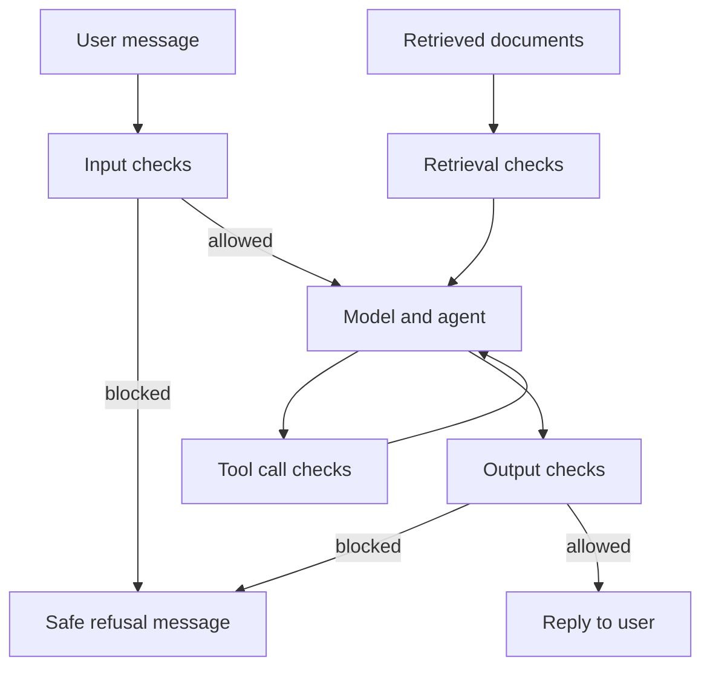

# Guardrails and Content Safety Layers

On a mountain road, the crash barrier does not drive the car. It only stops a mistake from becoming a disaster. Guardrails do this job for AI.

## What it is

**Guardrails** are checks placed around a model that block, change or flag unsafe, off-topic or policy-breaking inputs and outputs. They sit in your application, so they work even if the model itself makes a mistake.

NVIDIA's NeMo Guardrails documentation describes five kinds of "rails", based on where they run:

| Rail | Checks | Example |
|---|---|---|
| Input | User message before the model | Block jailbreak attempts, mask phone numbers |
| Retrieval | Content fetched from outside | Drop a document with hidden instructions |
| Dialog | Conversation flow | Keep a bank bot on banking topics |
| Execution | Tool inputs and outputs | Reject a refund tool call above a limit |
| Output | Model reply before the user sees it | Remove personal data, block toxic text |

## How it works

*Figure: Guardrails at four points: input, retrieval, tool calls and output.*

## Types of checks

- **Rules**: regular expressions, word lists, schema checks, allowed-tool lists. Fast, cheap and predictable.
- **Classifier models**: a model trained to label content. **Llama Guard** (Meta, December 2023) is an LLM-based safeguard that classifies both user prompts and model responses against a safety taxonomy, and can be adapted with different taxonomies.
- **Managed services**: for example Amazon Bedrock Guardrails offers content filters (hate, insults, sexual, violence, misconduct, prompt attack), denied topics, word filters, sensitive-information filters, contextual grounding checks and automated reasoning checks. It can also run on its own through an `ApplyGuardrail` API, without calling a model. Other cloud vendors have similar products; features vary.
- **LLM-based checks**: a second model reads the content with a policy prompt. Flexible but adds latency and cost.

## A real data point

Anthropic's Constitutional Classifiers are input and output classifiers trained on synthetic data generated from a "constitution" (written rules of allowed and disallowed content). In their automated test of 10,000 jailbreak prompts (as of Feb 2025 write-up), jailbreak success fell from 86 per cent without classifiers to 4.4 per cent with them. Refusals on harmless traffic rose by 0.38 per cent, not statistically significant in that sample, and compute cost rose by 23.7 per cent. The authors say the classifiers may not stop every universal jailbreak, and recommend other defences too.

Notice what this shows: protection costs compute and may refuse good requests. Always measure both.

## Trade-offs

| Concern | What to watch |
|---|---|
| Latency | Each check adds time; run independent checks in parallel |
| False positives | Over-blocking annoys users; track the refusal rate on normal traffic |
| False negatives | Attackers adapt; keep testing |
| Cost | Model-based checks add tokens |
| Coverage | Rules miss new phrasing; classifiers miss new tricks |

A common design is **layers**: cheap rules first, a small classifier next, and an LLM check only for borderline cases.

## In the AI era

Guardrails alone are not a security plan. Prompt injection can arrive through documents or tool results, so also use least privilege, sandboxing and approval steps for risky actions (see [Chapter 10](../../module-4/10-security-governance.md)). Guardrails also need evals: build a test set of "must block" and "must allow" cases and check precision and recall of the guardrail itself. Log every block as a trace ([Chapter 11](../11-observability.md)).

> [!TIP]
> **Key takeaways**
> - Place checks at four points: input, retrieval, tool calls and output.
> - Combine cheap rules, classifier models and, for hard cases, LLM checks.
> - Measure both attacks blocked and good requests wrongly refused, plus latency and cost.
