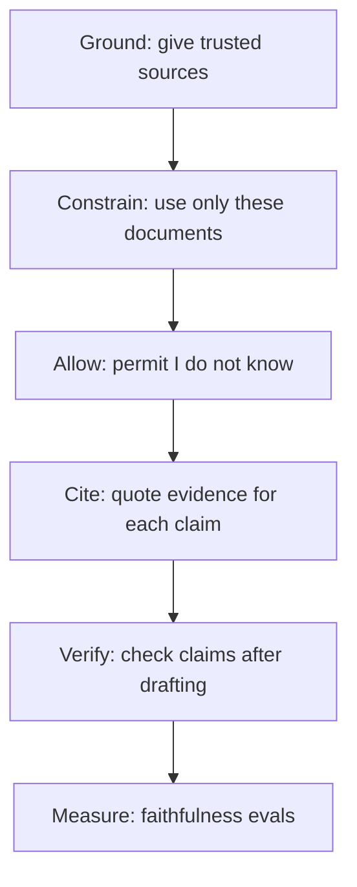

# Hallucination Mitigation

A confident stranger gives you wrong directions to the railway station. He is not lying. He just prefers answering to saying "I don't know". LLMs behave like this.

## What it is

A **hallucination** is output that sounds plausible but is false or not supported by the source. The survey by Huang et al. (2023) describes it as "plausible yet nonfactual content". Two common kinds:

- **Factual errors**: wrong facts about the world, such as a wrong date.
- **Unfaithful answers**: the answer disagrees with the documents or instructions you gave it. In RAG this is the main worry.

OWASP lists misinformation as a risk in its 2025 Top 10 for LLM applications, because applications may rely on false content.

## Why it happens

Kalai et al. ("Why Language Models Hallucinate", 2025) argue that training and evaluation reward guessing over admitting uncertainty. Like a student who writes something on every question because blank answers score zero, models learn to guess. They suggest changing how popular benchmarks score answers. The Huang survey also notes that retrieval augmentation has limits as a defence, so RAG helps but does not solve the problem.

## How to reduce it

No single fix works. Use layers.

*Figure: Layers of defence, from prevention to detection.*

Anthropic's guide on reducing hallucinations lists these techniques:

| Technique | How it helps |
|---|---|
| Allow "I don't know" | Gives the model permission to admit uncertainty |
| Direct quotes first | For long documents, extract exact quotes, then answer from them |
| Citations and verification | Each claim needs a supporting quote; if none is found, retract the claim |
| Restrict to provided documents | Tell the model not to use general knowledge |
| Best-of-N | Ask several times; inconsistent answers hint at hallucination |
| Iterative refinement | Ask the model to verify its earlier statements |

The same page cautions that these techniques reduce hallucinations "significantly" but do not eliminate them, so validate critical information.

## System-level controls

Beyond prompts, build checks into the architecture:

- **Retrieval quality**: better chunking and search ([Chapter 7](../../module-3/07-rag-architectures.md)) give the model better evidence.
- **Grounding check at runtime**: Amazon Bedrock Guardrails has a contextual grounding check that flags responses not grounded in the source or irrelevant to the query. Open-source tools can do similar claim-by-claim checks.
- **Structured output and tools**: fetch numbers (balance, price, date) from a database tool instead of letting the model recall them.
- **Show sources** in the UI so users can verify.
- **Route high-risk answers to people** (next page).

## Measuring it

You cannot fix what you do not measure. Use faithfulness-style metrics on RAG ([metrics page](03-metrics.md)), plus a golden set of questions that have **no answer** in the documents. A good system should say it does not know. Score "correct refusal" as a success, and reward calibrated uncertainty rather than confident guesses.

## Common mistakes

- Assuming RAG removes hallucination.
- Telling the model "do not hallucinate" and nothing more.
- Testing only questions that have answers.

> [!TIP]
> **Key takeaways**
> - Models hallucinate partly because training and scoring reward guessing.
> - Layer defences: grounding, constraints, permission to say "I don't know", citations, verification.
> - Test with unanswerable questions and measure faithfulness continuously.
