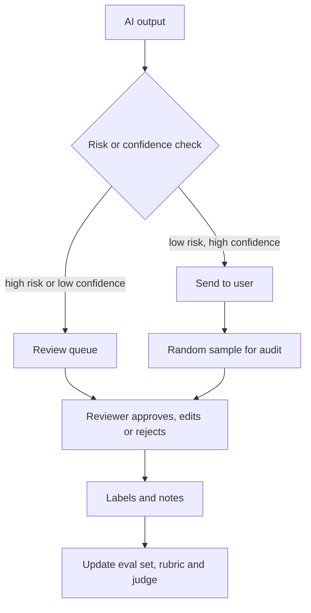

# Human Review and Responsible AI

In a hospital, a machine can read the scan, but a doctor signs the report. For decisions that matter, AI should assist people, not silently replace them.

## Human review workflows

Automated evals and guardrails cannot judge everything. Humans are the gold standard, but they are slow and costly. The aim is to use them where they add the most value.

*Figure: Route risky outputs to people, and sample the rest for audit. Reviewer labels feed back into evals.*

What goes to the queue? Common triggers:

- actions that are hard to undo, such as payments or deleting data
- low confidence, a failed guardrail or a failed grounding check
- sensitive topics such as health, legal or money advice
- a user thumbs-down or complaint
- a random sample, so you also catch problems the system did not notice

The same pattern applies to agents: pause before a risky tool call and ask a person to approve ([Chapter 8](../../module-4/08-agentic-architectures.md)).

## Making reviews consistent

OpenAI's evaluation guide gives practical tips for human graders:

- run several rounds to refine the scorecard
- show examples of each score level so reviewers calibrate
- add a pass/fail threshold next to the numeric score
- use consensus voting to combine reviewers

Also give reviewers an "unsure" option and a short note field. Notes become the raw material for better rubrics and for tuning your LLM judge. Wang et al. even propose asking for human help only on the examples where an automated judge is least stable.

Reviewer work is a real job. Keep queues manageable, protect reviewers from harmful content, and measure how much reviewers agree with each other.

## Responsible AI practice

Responsible AI means building systems that are safe, fair, transparent and accountable, and proving it. Useful building blocks:

**Documentation.** Mitchell et al. proposed **model cards** (2018): short documents shipped with a model, describing intended use, how it was evaluated and how it performs across different groups. Teams now write the same kind of note for whole AI features: what it is for, what it is not for, known limits.

**Risk frameworks.**

| Framework | What it gives you |
|---|---|
| NIST AI Risk Management Framework | Four functions: Govern, Map, Measure, Manage. Version 1.0 was released on 26 January 2023 |
| NIST Generative AI Profile (AI 600-1) | A profile for generative AI risks, released 26 July 2024 |
| OWASP Top 10 for LLM Applications 2025 | A checklist of application-level risks |
| India AI Governance Guidelines | Released by MeitY in November 2025 with seven guiding principles; officials said the focus is on using existing laws where possible |

NIST's page notes that AI RMF 1.0 is being revised, so check the current version. For legal duties such as India's DPDP Act, the EU AI Act and ISO/IEC 42001, see [Chapter 10](../../module-4/10-security-governance.md).

**Fairness checks.** Evaluate performance for different user groups, languages and regions, not just on average. A model that works well for English queries may not for Hindi or Tamil ones. Measure it on your own data.

**Transparency to users.** Tell users when they are talking to AI, show sources, and give an easy path to a human or to report a problem.

**Accountability.** Name an owner for each AI feature. Keep audit logs of inputs, outputs, versions and decisions ([Chapter 11](../11-observability.md)).

## A simple trust checklist for launch

- Eval set with pass-rate targets agreed
- Red team done, findings tracked
- Guardrails tested for blocks and false refusals
- Human escalation path in place
- Model or feature card written
- Owner, monitoring and rollback plan named

> [!TIP]
> **Key takeaways**
> - Send risky or uncertain outputs to humans, and sample the rest for audit.
> - Make review consistent with rubrics, examples and consensus, and feed notes back into evals.
> - Document intent and limits, use frameworks like NIST AI RMF, and assign clear accountability.
