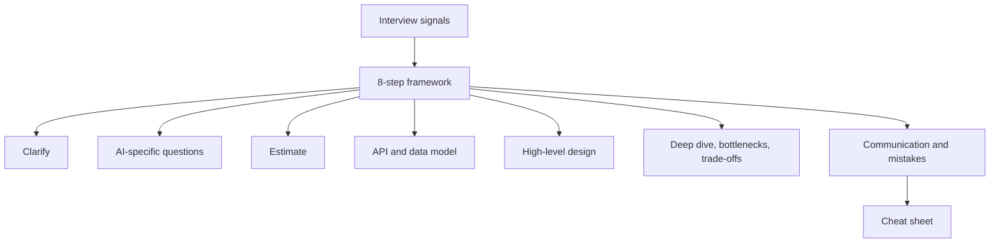

# Chapter 13: System Design Framework for the AI Era

A system design round is a 45-minute conversation about a problem with no single right answer. Most candidates do not fail because they lack knowledge. They fail because they have no repeatable way to use it. They jump to boxes and arrows, forget to ask questions, and run out of time before they reach the hard part.

In 2026 there is one more layer. Many interview questions now include an LLM, a RAG pipeline or an agent. Interviewers want to see that you can ask the right AI-specific questions: how fast, how costly, how accurate, how safe, and where does the data come from. They also want to see that you know when *not* to use an LLM.

This chapter gives you one framework you can use for any question, classic or AI. Chapter 14 then applies it to eight full designs.

*Figure: The chapter map. Each box is one page.*

## What you will learn

- **What interviewers look for**: the signals behind a good score, and what changes with AI.
- **The eight-step framework**: the steps and a 45-minute time plan.
- **Clarify requirements**: turn a vague prompt into a scoped problem.
- **AI-specific questions**: latency, cost, quality, safety and data.
- **Estimation for AI systems**: requests, tokens, concurrency and cost.
- **API and data model**: streaming, async jobs and what to store.
- **High-level design**: the building blocks of an AI system, and how to pick them.
- **Deep dive, bottlenecks and trade-offs**: how to go deep on the right part and defend your choices.
- **Communication and common mistakes**: how to think aloud, and what to avoid.
- **One-page cheat sheet**: everything on one screen for the night before.
