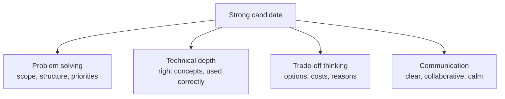

# What Interviewers Look For

Think of a cricket selector watching a batter. Runs matter, but the selector also watches footwork, shot choice and how the batter handles pressure. A design round is similar. The final diagram is only one part of the score.

## What it is

A system design interview checks how you think about an open-ended problem. There is no single correct design. The interviewer wants to see if you could lead a real design discussion at work.

A review of Alex Xu's well-known interview book makes three points that match this view:

- The interview is as much about talking with the interviewer as about technical knowledge.
- Reasoning about constraints and trade-offs matters. Giving a quick answer earns no extra credit.
- The discussion should be two-way, like real design work.

## The signals

Most rubrics can be grouped into four signals. Companies use different names, so treat this as a simple model, not an official list.

*Figure: Four signals interviewers commonly look for.*

| Signal | What it looks like | What it does not look like |
|---|---|---|
| Problem solving | You ask questions, state assumptions, and choose what to solve first | Drawing boxes in the first minute |
| Technical depth | You explain why a cache or queue is needed and what can go wrong | Dropping tool names without reasons |
| Trade-off thinking | "Option A is faster, option B is cheaper, I pick A because..." | Saying one tool is "the best" |
| Communication | You think aloud and check in with the interviewer | Long silence, or a monologue |

## In the AI era

The same four signals apply. AI adds three expectations.

1. **You know the building blocks.** For example, a model call, retrieval, tools, caching and evaluation. [Chapter 6](../../module-3/06-llm-serving.md), [Chapter 7](../../module-3/07-rag-architectures.md), [Chapter 8](../../module-4/08-agentic-architectures.md) and [Chapter 12](../../module-5/12-evaluation-safety.md) cover these, and this chapter shows how to use them under time pressure.
2. **You treat the model as an unreliable component.** It can be slow, costly and wrong. Good designs plan for all three.
3. **You do not reach for AI by default.** Anthropic's guidance on building agents says to find the simplest solution possible and add complexity only when needed. Sometimes that means not building an agentic system at all. Say this aloud when it applies. It shows judgement.

> [!NOTE]
> Interview formats differ by company. Some rounds are more coding-heavy, and some focus only on one area, such as ML systems. Ask your recruiter what the round covers.

## Common mistakes

- **Memorising designs.** Interviewers change the constraints to see if you can adapt. A memorised design breaks when the constraints change.
- **Treating it as a quiz.** It is a discussion. Ask, propose, listen, adjust.
- **Showing every concept you know.** Depth on the right two or three parts beats a shallow tour of twenty.

> [!TIP]
> **Key takeaways**
> - The score comes from problem solving, depth, trade-offs and communication, not only the diagram.
> - Treat the interview as a two-way design discussion.
> - In the AI era, also show that you know the model is a slow, costly and imperfect component.
