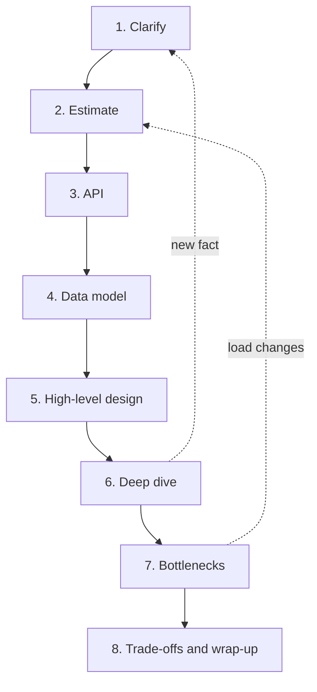
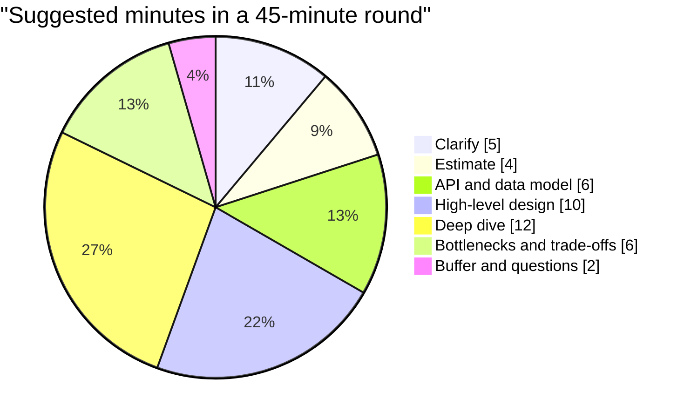

# The Eight-Step Framework

Cooking without a recipe is possible, but under pressure a recipe saves you. This page gives you the recipe for the whole round.

## What it is

A well-known four-step approach from Alex Xu's book is: understand the problem and set the scope, propose a high-level design and get buy-in, do a deep dive, then wrap up. This book keeps the same spirit but splits the work into eight smaller steps. Smaller steps are easier to remember and easier to time.

| # | Step | The question you answer |
|---|---|---|
| 1 | Clarify | What exactly are we building, and for whom? |
| 2 | Estimate | How big is the load, in requests, tokens and storage? |
| 3 | API | What does the system offer to its callers? |
| 4 | Data model | What do we store, and where? |
| 5 | High-level design | Which components, and how do requests flow? |
| 6 | Deep dive | How does the hardest part really work? |
| 7 | Bottlenecks | What breaks first as load grows? |
| 8 | Trade-offs | Why these choices, and what would change them? |

## How it works

You move forward step by step, but you may loop back. New facts in step 6 can change an assumption from step 1. That is normal. Say it aloud: "This changes my earlier estimate, let me update it."

*Figure: The eight steps, with the two most common loops back.*

## A 45-minute time plan

This split is a suggestion, not a rule. The Alex Xu book, as summarised in one review, suggests more time for the high-level design and deep dive than for scoping, and warns against starting the deep dive in the first 10 minutes. The plan below follows that idea.

*Figure: A suggested time split. Adjust it to the interviewer's cues.*

- **Skip or shrink steps when asked.** If the interviewer says "ignore the API", move on. Their cues beat your plan.
- **Do not skip step 1.** Even a 2-minute clarification is better than none.
- **Protect the deep dive.** It is where most of the score is won. If you are at minute 25 and still drawing the high-level design, speed up.
- **Keep a buffer.** Interviewers often ask "what if X changes?" near the end.

## In the AI era

The steps stay the same. The content inside them changes:

- Step 1 gets five extra question areas (next pages).
- Step 2 includes tokens and concurrent model calls, not just requests.
- Step 5 includes AI building blocks such as retrieval, a model gateway and guardrails.
- Step 6 often goes deep on retrieval quality, model serving, or agent reliability.
- Step 8 has a new triangle: quality, latency and cost.

> [!TIP]
> **Key takeaways**
> - Use eight steps: clarify, estimate, API, data model, high-level design, deep dive, bottlenecks, trade-offs.
> - Loop back when new facts appear, and say so aloud.
> - Protect time for the deep dive, and follow the interviewer's cues over your own plan.
