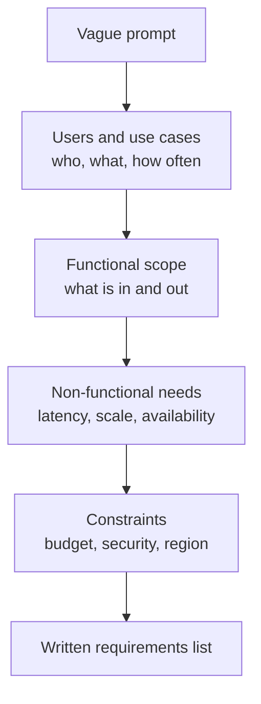

# Clarify Requirements

A customer says "make me a dinner." You would ask: how many people, any allergies, what budget? System design starts the same way.

## What it is

Clarifying means turning a vague prompt such as "Design a document Q&A assistant" into a short, agreed list of what the system must do and how well it must do it. You write it down on the board. You then design only against that list.

A summary of common interview advice lists the items to cover: users, core use cases, scale, latency and availability needs, and constraints such as budget or security. It also says: do not start with a diagram.

## How it works

Ask in four groups, in this order.



*Figure: From a vague prompt to a requirements list.*

**1. Users and use cases.** Who uses it: customers, employees, other systems? What is the main job they want done?

**2. Functional scope.** List three to five features. Mark clearly what is out of scope. "We will not build login or billing."

**3. Non-functional needs.** These shape the architecture most. Examples: response time, number of users, uptime, data size. Ask for numbers. If the interviewer does not give any, propose your own and ask "Is that reasonable?"

**4. Constraints.** Budget, team size, security rules, data location, existing systems.

## Example

Prompt: "Design an assistant that answers questions from a company's HR policy documents."

```text
In scope:     ask a question, get an answer with sources, give feedback
Out of scope: editing documents, voice, mobile app
Users:        Assume 50,000 employees, 5,000 active per day
Latency:      first words in under 2 seconds (to confirm)
Availability: working hours matter most
Constraints:  documents are internal, some are restricted by role
```

Notice the word "Assume". You are not hiding anything. You are showing the interviewer the numbers you will use, so they can correct you early.

## Trade-offs

| Approach | Good | Risk |
|---|---|---|
| Ask many questions upfront | Fewer wrong assumptions | Eats time; looks like stalling |
| Ask few, then assume | Saves time | A wrong assumption can ruin the design |
| Best mix | Ask 5 to 8 sharp questions, then state assumptions | Needs practice |

## In the AI era

Add the AI-specific questions from the next page. The most important one is: *what does a wrong answer cost?* A wrong movie suggestion is harmless. A wrong refund amount or a wrong medical answer is not. This one answer changes how much safety and evaluation work your design needs.

## Common mistakes

- Starting to draw before you know the scale.
- Asking questions that do not change the design. Ask only what would change a decision.
- Never writing the requirements down. Written requirements let you point back later: "We agreed on 2 seconds."

> [!TIP]
> **Key takeaways**
> - Clarify in four groups: users, functional scope, non-functional needs, constraints.
> - State assumptions with numbers and confirm them.
> - For AI systems, always ask what a wrong answer costs.
