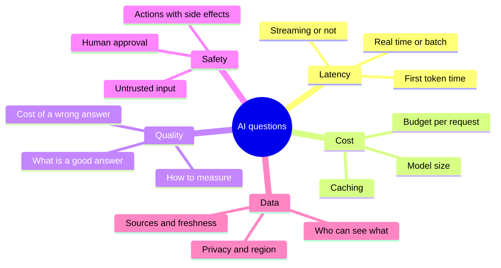

# AI-Specific Questions to Ask

A normal system has a database that returns the same answer each time. An AI system has a model that is slow, costs money per call, and can be wrong. So you need extra questions.

## What it is

These are five groups of questions you add to the clarify step whenever the design contains a model: **latency, cost, quality, safety and data**. Each one changes the architecture. Ask them early, briefly, and use the answers later.

*Figure: The five AI question areas.*

## How it works

| Area | Sample question | How the answer changes the design |
|---|---|---|
| Latency | Is the user waiting on screen, or can the result come later? | Waiting: streaming and small models. Later: queues and batch jobs |
| Cost | What is the budget per request or per user per month? | Tight budget: caching, routing to smaller models, shorter prompts |
| Quality | What is a good answer, and how will we measure it? | Needs an evaluation set and a feedback loop ([Chapter 12](../../module-5/12-evaluation-safety.md)) |
| Safety | Can the system take actions, or only answer? Does it read untrusted text? | Actions need permissions and approvals ([Chapter 10](../../module-4/10-security-governance.md)) |
| Data | Where does knowledge come from, how fresh, who may see it? | Retrieval, ingestion pipelines, access control ([Chapter 7](../../module-3/07-rag-architectures.md)) |

### Latency details

Use the standard vocabulary. NVIDIA's benchmarking docs define **time to first token (TTFT)** as the wait from sending a query until the first token arrives. **Inter-token latency (ITL)** is the average gap between output tokens after that. **End-to-end latency** is the time until the full response is received.

So you can ask a precise question: "Is a TTFT under about 2 seconds enough, with streaming?" ([Chapter 6](../../module-3/06-llm-serving.md) explains why these differ.)

### Cost details

Two levers are worth naming. Anthropic's docs describe **prompt caching**, which reuses a repeated prompt prefix at a lower cost. They also describe a **batch API** that reduces cost by 50 percent for work that does not need an immediate answer (as of November 2026; most batches finish within an hour). Other providers have similar features, but prices differ, so do not quote numbers in an interview. Say "cached tokens are cheaper" and move on.

### Safety details

The OWASP Top 10 for LLM Applications (2025 edition) lists prompt injection, sensitive information disclosure, excessive agency and unbounded consumption, among others. You do not need to recite it. You need two questions: "What happens if the model reads a malicious document?" and "What is the worst action this agent can take?"

### Data details

Ask about privacy early. India's Digital Personal Data Protection (DPDP) Rules were notified in November 2025 and their main obligations come into force in phases. If the data is personal, say you would check the legal and data-location needs with the team.

## In the AI era: the first question of all

Before the five areas, ask: **"Does this need an LLM at all?"** Rules, search or a classic ML model can be faster, cheaper and easier to test. If an LLM is needed, ask whether one model call is enough, or whether the task needs several steps. Anthropic advises starting with the simplest solution and adding complexity only when it improves outcomes.

> [!TIP]
> **Key takeaways**
> - Add five question groups for AI: latency, cost, quality, safety, data.
> - Use exact terms such as TTFT and end-to-end latency.
> - First ask whether an LLM is needed, and what a wrong answer costs.
