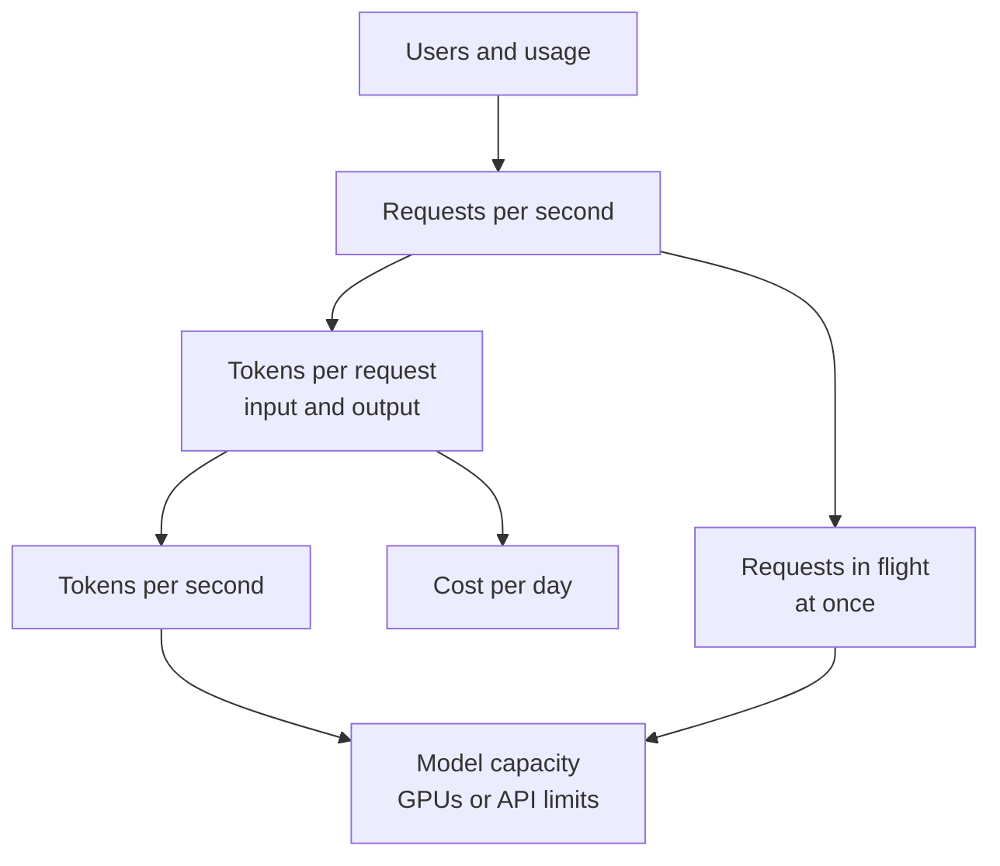

# Estimation for AI Systems

Before cooking for a wedding, you count guests, plates and gas cylinders. Estimation does the same for software. It tells you if the design needs one server or one hundred.

## What it is

Estimation is quick, rough arithmetic that sizes the system. The goal is not exact numbers. The goal is to find the *order of magnitude* and to decide which part is the expensive or risky one. The general method (requests per second, storage, bandwidth) is in [Chapter 3](../../module-1/03-reliability.md). Here we add the AI parts: **tokens** and **model concurrency**.

A **token** is a small piece of text that a model reads or writes. Models and providers charge and limit by tokens, not by words.

## How it works



*Figure: From users to capacity and cost.*

### Worked example

Every number below is an **Example / Assume**. Real numbers depend on the model, the prompt and your traffic.

Assume a chat assistant with 1 million daily users, 10 messages each.

```text
Requests per day   = 1M x 10               = 10M
Average req/s      = 10M / 86,400          = about 116
Peak (assume 3x)   = 116 x 3               = about 350 req/s

Assume per request: 1,500 input tokens (history + prompt), 300 output tokens
Output tokens/day  = 10M x 300             = 3 billion
Output tokens/s    = 3B / 86,400           = about 35,000 (peak about 104,000)

Assume a full answer takes 10 s on average.
In flight (Little's law) = 116 x 10        = about 1,160 at the same time
At peak                                    = about 3,500
```

Little's law says: the number of requests in the system equals arrival rate times time spent in the system. It tells you how many model calls run at once, which is what GPUs or API rate limits must handle.

**Capacity.** If you assume one model instance produces 2,500 output tokens per second, then 104,000 / 2,500 is about 42 instances at peak. In an interview, say plainly that this throughput number is an assumption and you would measure it ([Chapter 6](../../module-3/06-llm-serving.md)).

**Cost.** Assume a made-up price of 1 dollar per million input tokens and 4 dollars per million output tokens:

```text
Input:  10M x 1,500 = 15B tokens  -> 15,000 x $1 = $15,000 per day
Output: 10M x 300   = 3B tokens   ->  3,000 x $4 = $12,000 per day
Total                                 about $27,000 per day
```

Now you can argue with numbers. If 1,000 of the 1,500 input tokens are the same system prompt every time, caching that prefix cuts the biggest cost line. Anthropic's docs state that cache reads cost 0.1 times the base input price for most models, with some models even lower (as of November 2026). Check your provider before you quote it.

## Trade-offs

| Estimate | Why it matters | Typical design reaction |
|---|---|---|
| Requests in flight | Sets GPU or rate-limit needs | Autoscaling, queues, backpressure |
| Tokens per request | Drives cost and latency | Shorter prompts, caching, summarising history |
| Output share of cost | Output tokens are slower and often pricier | Limit answer length, stream |
| Peak vs average | Capacity must cover peaks | Queue non-urgent work, batch it |

## Common mistakes

- Counting requests but not tokens.
- Forgetting that history grows with every message, so input tokens grow per turn.
- Using an exact-looking number. Round it. "About 35 thousand" is better than "34,722".

> [!TIP]
> **Key takeaways**
> - Estimate requests per second, then tokens per second, then requests in flight, then cost.
> - Label every number as an assumption and round it.
> - Use the result to find the biggest cost or capacity risk, then design for it.
