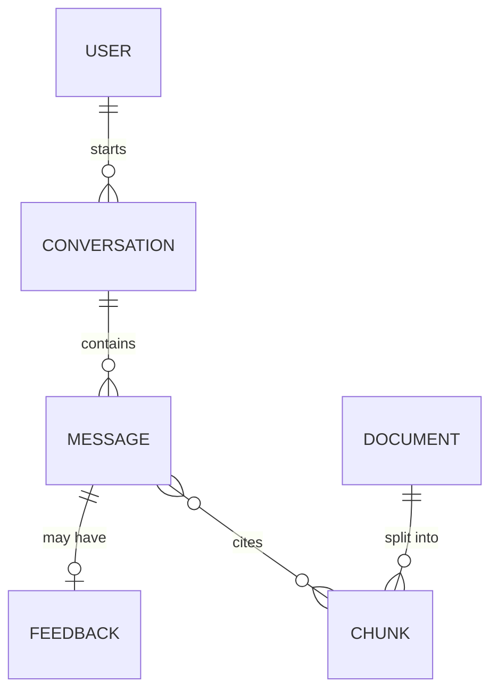

# API and Data Model

An API is the menu of a restaurant. The data model is the kitchen's storage. If the menu is clear and the storage is organised, the rest of the design becomes easier to explain.

## What it is

- **API design**: the few calls that clients make to your system. Name them, give inputs and outputs, and keep to three to five calls.
- **Data model**: the main things you store, how they link, and which database type fits each.

In the interview, spend about six minutes on both. Do not design every field. Show the shape.

## How it works: the API

Pick the main user journey and write one call for each step. For a chat assistant:

```text
POST /v1/conversations                      -> create conversation, returns id
POST /v1/conversations/{id}/messages        -> send a message, stream the reply
GET  /v1/conversations/{id}/messages        -> list history
POST /v1/messages/{id}/feedback             -> thumbs up or down, with reason
```

Three AI-specific points deserve a sentence each.

**Streaming.** Models produce tokens one at a time. Sending them as they arrive makes the answer feel fast. LLM APIs commonly use Server-Sent Events (SSE) for this. See [Chapter 1](../../module-1/01-networking.md) for SSE and WebSocket.

**Long tasks need async.** An agent that works for minutes should not hold an HTTP connection open. Return a job id, and let the client poll or receive a callback.

```json
{ "job_id": "job_123", "status": "running" }
```

**Idempotency.** A retry after a timeout must not run an expensive or side-effecting task twice. Accept an idempotency key on calls that cost money or change state ([Chapter 3](../../module-1/03-reliability.md)).

## How it works: the data model

List the main entities first. Then choose storage by access pattern.



*Figure: A small data model for a document Q&A assistant.*

| Data | Typical store | Why |
|---|---|---|
| Users, conversations, messages | Relational or document database | Simple lookups by id and time |
| Original documents | Object storage | Cheap and large |
| Chunks and embeddings | Vector index, often with keyword search | Similarity search ([Chapter 7](../../module-3/07-rag-architectures.md)) |
| Cache of repeated answers or prompts | In-memory store | Speed and cost saving |
| Traces, feedback, eval results | Log or analytics store | Debugging and improvement ([Chapter 11](../../module-5/11-observability.md)) |

See [Chapter 2](../../module-1/02-storage.md) for how to choose between these store types.

## In the AI era

Three things are new compared to a classic data model:

- **Store the prompt version and model version with each answer.** Without them you cannot explain or reproduce a bad answer.
- **Store feedback and traces.** They become your test set and your improvement loop.
- **Store access rules with each chunk.** If users have different permissions, retrieval must filter by them. Adding this later is painful.

## Common mistakes

- Designing twenty endpoints. Three to five is enough.
- Forgetting streaming and async for slow model calls.
- Putting everything in one database "for simplicity" and then not explaining how vector search works there.

> [!TIP]
> **Key takeaways**
> - Write three to five API calls that follow the main user journey.
> - Use streaming for chat, and async jobs for long-running agent tasks.
> - Store model and prompt versions, feedback and access rules, not just messages.
