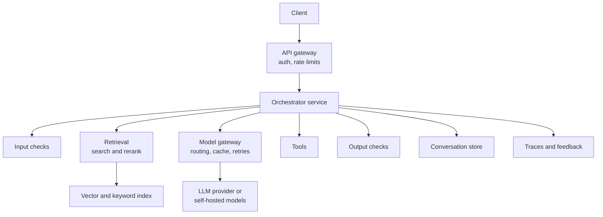
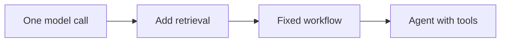

# High-Level Design

The high-level design is the map of a city: main roads, not every lane. Draw it simply, then walk the interviewer through one request.

## What it is

A high-level design shows the major components and how a request flows between them. You draw it after requirements, estimates, API and data model. It should fit on one whiteboard with about 6 to 10 boxes.

## How it works

Start with the classic layers: client, load balancer or API gateway, services, storage, cache, queue. Then add the AI-specific blocks only if the requirements call for them.

*Figure: A typical AI application. Include only the blocks you need.*

Walk through it as a story: "A request arrives at the gateway. The orchestrator checks the input, retrieves context, calls the model through a gateway, checks the output, and streams the answer. Traces go to a log store."

## When to use what

Do not add every block. Add one when a requirement asks for it.

| Block | Add it when | Chapter |
|---|---|---|
| Retrieval (RAG) | The answer must use private or fresh knowledge | [7](../../module-3/07-rag-architectures.md) |
| Model gateway | Many models or teams, need caching, fallbacks, cost limits | [6](../../module-3/06-llm-serving.md) |
| Tools | The system must act, such as fetch an order or create a ticket | [8](../../module-4/08-agentic-architectures.md), [9](../../module-4/09-mcp.md) |
| Input and output checks | Untrusted input, or wrong output is costly | [10](../../module-4/10-security-governance.md), [12](../../module-5/12-evaluation-safety.md) |
| Queue and workers | Work is slow or bursty, user need not wait | [3](../../module-1/03-reliability.md) |
| Traces and feedback | Always, to improve quality | [11](../../module-5/11-observability.md) |

### Choose the simplest pattern first

Anthropic's engineering guidance separates *workflows* (LLMs and tools following predefined code paths) from *agents* (LLMs directing their own steps and tool use). It notes that agents usually trade latency and cost for better task performance, and that their autonomy brings compounding-error risk. Use this as a ladder:

*Figure: Climb the ladder only when the step below is not enough.*

In the interview, say: "I would start with a retrieval workflow because the steps are known. I would move to an agent only if tasks need open-ended planning." That one sentence shows maturity.

## In the AI era

- Put the model behind an interface so you can change providers or sizes.
- Plan a fallback for model failure: a smaller model, a cached answer, or a polite error.
- Decide what runs synchronously and what runs in the background. Indexing documents is background work.

## Common mistakes

- Drawing a box called "AI" with no detail on what goes in and out.
- Making everything an agent.
- Skipping the failure path. Always ask: what if the model times out?

> [!TIP]
> **Key takeaways**
> - Draw 6 to 10 boxes and walk through one request end to end.
> - Add AI blocks only when a requirement needs them.
> - Prefer the simplest pattern: single call, retrieval, workflow, then agent.
