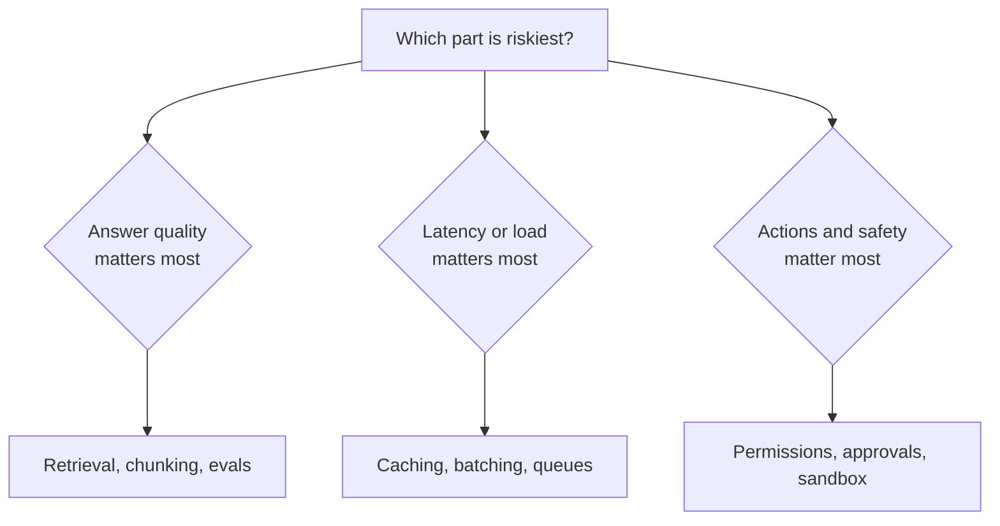
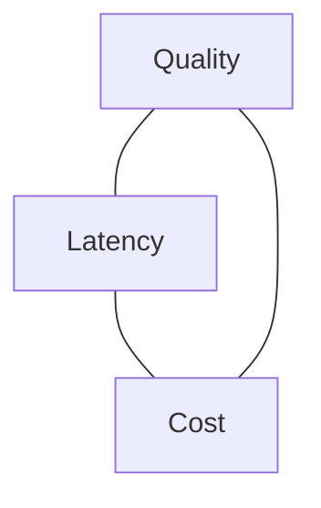

# Deep Dive, Bottlenecks and Trade-offs

The high-level design shows you know the map. The deep dive shows you can drive. This is usually the longest part of the round.

## What it is

- **Deep dive**: you pick one or two risky components and explain exactly how they work.
- **Bottlenecks**: you name what breaks first when load grows.
- **Trade-offs**: you explain why you chose each option and what would change your mind.

A summary of interview advice says to pick one or two risky components rather than expand every box, and to name the first bottleneck if load grows tenfold.

## How it works

### Choose what to dive into

Pick the part that is hardest, or the part the requirements stress most. Or ask: "Shall I go deeper on retrieval or on serving?" The interviewer often guides you.

*Figure: Let the requirements choose the deep dive.*

### A good deep-dive shape

1. State the problem in the component. ("Retrieval may return the wrong chunk.")
2. Give two or three options.
3. Pick one with reasons.
4. Say how it fails and how you would detect it.

### Typical AI bottlenecks

| Bottleneck | Sign | Common response |
|---|---|---|
| Model capacity or provider rate limit | Queues grow, latency spikes | Queue, autoscale, route to smaller model, cache |
| Token cost | Bill grows faster than users | Cache prefixes, shorten context, route by difficulty |
| Long context | Slow first token, high cost | Summarise history, retrieve less, better ranking |
| Retrieval quality | Right document exists but answer is wrong | Hybrid search, reranking, evaluation set |
| Unbounded loops in agents | Many calls per task | Step limits, budgets, timeouts |
| Evaluation gap | Cannot tell if changes help | Golden set, online feedback |

"Unbounded consumption" appears in the OWASP Top 10 for LLM Applications (2025) for the same reason: without limits, one user or one bug can consume large resources.

## Trade-offs

Every choice gives something and takes something. In AI systems, the main triangle is quality, latency and cost.

*Figure: Improving one corner usually pressures another.*

| Choice | Gain | Price |
|---|---|---|
| Bigger model | Often better quality | Slower, costlier |
| Smaller model plus routing | Cheaper and faster for easy tasks | Router can be wrong, more parts |
| More retrieved chunks | Better recall | More tokens, more noise |
| Reranking | Better precision | Extra latency |
| Agent instead of workflow | Handles open-ended tasks | More latency, cost and error risk |
| Synchronous reply | Simple for user | Hard to scale for slow work |
| Self-host vs buy an API | Control, data stays inside | Needs GPU skills; see [Chapter 6](../../module-3/06-llm-serving.md) |

Use a fixed sentence pattern:

> "I chose X because of requirement Y. The cost is Z. If the traffic became 10 times larger, or the budget changed, I would switch to W."

## Common mistakes

- Saying "it depends" and stopping. Always continue: "it depends on A; for our case A is true, so I pick X."
- Deep-diving into a component the interviewer did not care about.
- Naming a tool without saying what problem it solves.
- Ignoring failure: what happens when the model, the index or a tool is down?

> [!TIP]
> **Key takeaways**
> - Dive deep into one or two risky parts, chosen from the requirements.
> - Name the first bottleneck at 10 times load, with a response.
> - Justify every choice with a requirement, a cost and a condition that would change it.
