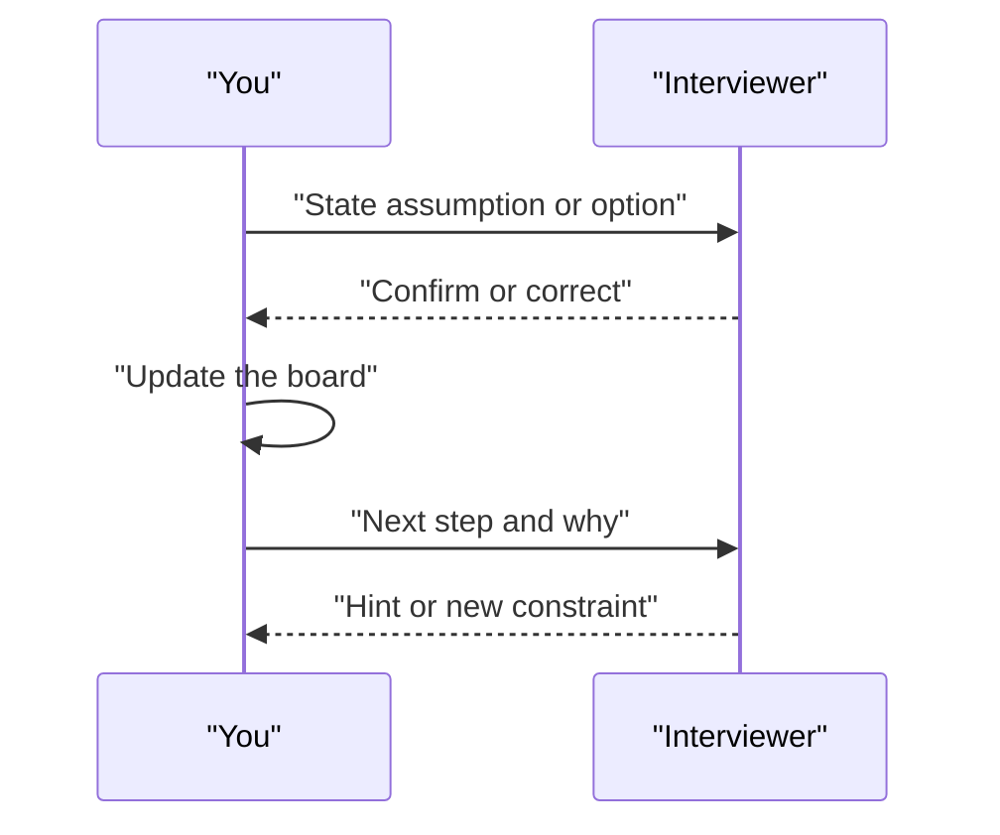

# Communication and Common Mistakes

Two candidates may know the same things. The one who explains clearly usually scores better. This page is about how you speak and what to avoid.

## What it is

Communication in a design round means three habits: think aloud, check in often, and stay organised. Mistakes are the common ways candidates lose marks even when they know the material.

## How it works: think aloud, check in

*Figure: A healthy design conversation is a loop, not a monologue.*

Habits that help:

- **Say the plan first.** "I will clarify, estimate, then design the API." The interviewer then knows where you are going.
- **Write assumptions on the board.** Number them, so you can refer back.
- **Check in at the end of each step.** "Does this match what you had in mind?" One sentence is enough.
- **Use the board.** Keep the diagram tidy. Number the arrows to match the story.
- **Take hints gladly.** A hint is a free direction, not a failure.
- **If you do not know, reason.** "I have not used this tool. I would expect it to behave like X. I would check Y."
- **Be honest about limits.** Do not invent numbers. "I would measure this" is a strong answer.

## Common mistakes

A summary of common interview pitfalls lists several that apply to every question: jumping to a solution before clarifying, trying to expand every box, naming the "correct" technology instead of explaining constraints, and ignoring how the design evolves. The Alex Xu book review adds memorising solutions and over-engineering.

| Mistake | Why it hurts | Better move |
|---|---|---|
| Drawing in minute one | Solves the wrong problem | Clarify first |
| Memorised design | Breaks when constraints change | Derive from requirements |
| Tool name-dropping | Shows no reasoning | Say the problem the tool solves |
| Expanding every box | Runs out of time | Pick one or two risky parts |
| Silence for long periods | Interviewer cannot score thinking | Think aloud |
| No numbers | Cannot justify scale | Rough estimates, labelled as assumptions |

### AI-specific mistakes

| Mistake | Better move |
|---|---|
| "Just call the LLM" with no failure plan | Add timeouts, fallbacks, and cached or simpler answers |
| Making everything an agent | Start with the simplest pattern; justify any agent |
| No plan to measure quality | Describe an evaluation set and online feedback |
| Ignoring token cost | Include tokens in estimates and name cost levers |
| Treating retrieved text as trusted | Mention prompt injection and access control |
| Giving the agent broad permissions | Least privilege, approvals for risky actions |
| Quoting model names, prices or benchmarks from memory | Speak in principles; say numbers change quickly |
| Forgetting data freshness and privacy | Ask about sources, update speed and who can see what |

## In the AI era

Interviewers know AI tools can generate diagrams. They are not testing if you can draw. They are testing if you can *decide*: which trade-off, which risk, which first step. Spend your words on decisions.

> [!TIP]
> **Key takeaways**
> - Say your plan, state assumptions, and check in after each step.
> - Avoid the classic mistakes: early drawing, memorising, name-dropping, expanding every box.
> - For AI, always cover failure, quality measurement, token cost and safety.
