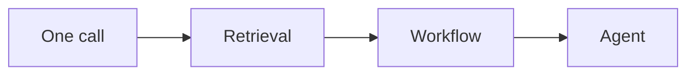

# One-Page Cheat Sheet

Read this the night before. Each row is a step you can do in order.

## The eight steps

| # | Step | Minutes | What to say or draw |
|---|---|---|---|
| 1 | Clarify | 5 | Users, 3 to 5 features, out of scope, non-functional needs, constraints. Write them down |
| 2 | Estimate | 4 | Requests per second, tokens per request, tokens per second, requests in flight, daily cost. Label as assumptions |
| 3 | API | 3 | 3 to 5 calls, streaming for chat, async job for long tasks, idempotency key |
| 4 | Data model | 3 | Entities, store per entity, prompt and model version, access rules, feedback |
| 5 | High-level design | 10 | 6 to 10 boxes, one request walked end to end, failure path |
| 6 | Deep dive | 12 | One or two risky parts. Options, choice, reason, failure and detection |
| 7 | Bottlenecks | 3 | What breaks first at 10 times load, and the response |
| 8 | Trade-offs | 3 | Quality, latency, cost. "I chose X because Y; I would switch if Z" |

Minutes are a suggested split for a 45-minute round (2 minutes left as buffer). Follow the interviewer's cues.

## AI question checklist

- **Need**: Does this need an LLM at all? Is one call enough?
- **Latency**: Time to first token? Streaming? Real time or batch?
- **Cost**: Budget per request? Caching, batching, smaller models?
- **Quality**: What is a good answer? How measured? Cost of a wrong answer?
- **Safety**: Untrusted input? Can it take actions? Human approval?
- **Data**: Sources, freshness, who can see what, privacy and region?

## Estimation formulas

```text
requests/s        = requests per day / 86,400
peak requests/s   = average x peak factor (assume 2x to 5x)
tokens/s          = requests/s x output tokens per request
in flight         = requests/s x seconds per request
daily cost        = tokens per day x price per token (assume a price)
```

## Pattern ladder



*Figure: Use the lowest step that meets the requirement.*

## Where to read more

| Topic | Chapter |
|---|---|
| Estimation, retries, SLOs | [Chapter 3](../../module-1/03-reliability.md) |
| Model serving, caching, latency | [Chapter 6](../../module-3/06-llm-serving.md) |
| Retrieval | [Chapter 7](../../module-3/07-rag-architectures.md) |
| Agents and tools | [Chapter 8](../../module-4/08-agentic-architectures.md) |
| Security | [Chapter 10](../../module-4/10-security-governance.md) |
| Monitoring | [Chapter 11](../../module-5/11-observability.md) |
| Evaluation and safety | [Chapter 12](../../module-5/12-evaluation-safety.md) |
| Worked examples | [Chapter 14](../14-case-studies.md) |

## Last-minute reminders

- Do not draw before you clarify.
- Say assumptions aloud and write them down.
- Choose the simplest design that meets the requirements.
- Name the failure path and the quality measure.
- End with trade-offs and what you would do next.

> [!TIP]
> **Key takeaways**
> - Follow the eight steps in order, and loop back when facts change.
> - Always add the AI checklist: need, latency, cost, quality, safety, data.
> - Finish with trade-offs, not with silence.
