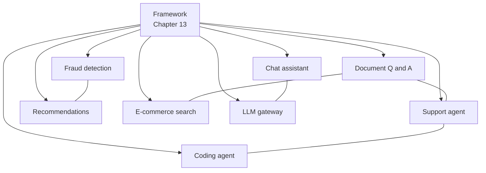

# Chapter 14: End-to-End Enterprise System Designs

In an interview, nobody asks "what is a vector database?" They ask, "Design an enterprise assistant for 50,000 employees." You must join many ideas into one working design, and explain why.

This chapter does exactly that. Each page is one worked case study. You will see the same shape again and again: requirements, estimates, a high-level diagram, one or two deep dives, trade-offs, and what an interviewer looks for.

> [!NOTE]
> These are design exercises. Every number is an **assumption** made to teach the method. We do not describe how any real company built its system. Where we cite a public document, the page says so.

The cases do not re-teach fundamentals. They link back to earlier chapters, so keep the [framework from Chapter 13](13-interview-framework.md) beside you.

*Figure: The eight cases, and some that share building blocks (a line means they reuse each other's ideas).*

## What you will learn

- **ChatGPT-Style Chat Assistant** - streaming, context, and keeping GPUs busy.
- **Enterprise Document Q&A with Access Control** - RAG that never leaks a document.
- **Customer-Support AI Agent with MCP Tools** - safe tools, identity and human handover.
- **Real-Time Payments Fraud Detection** - millisecond scoring with rules, ML and late labels.
- **Recommendation System for a Shopping or Video App** - the retrieval and ranking funnel.
- **Semantic Search for E-commerce** - hybrid search, filters and freshness.
- **Multi-Tenant LLM Gateway** - token budgets, routing and tenant isolation.
- **Background Coding Agent** - sandboxes, tests and limits.
- **Recap & Practice** - patterns across all cases, practice questions and sources.

Read at least two cases fully, then sketch the others from memory.
