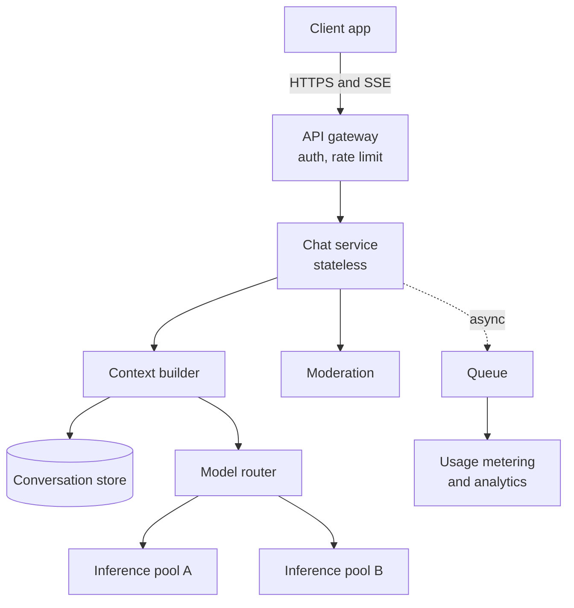
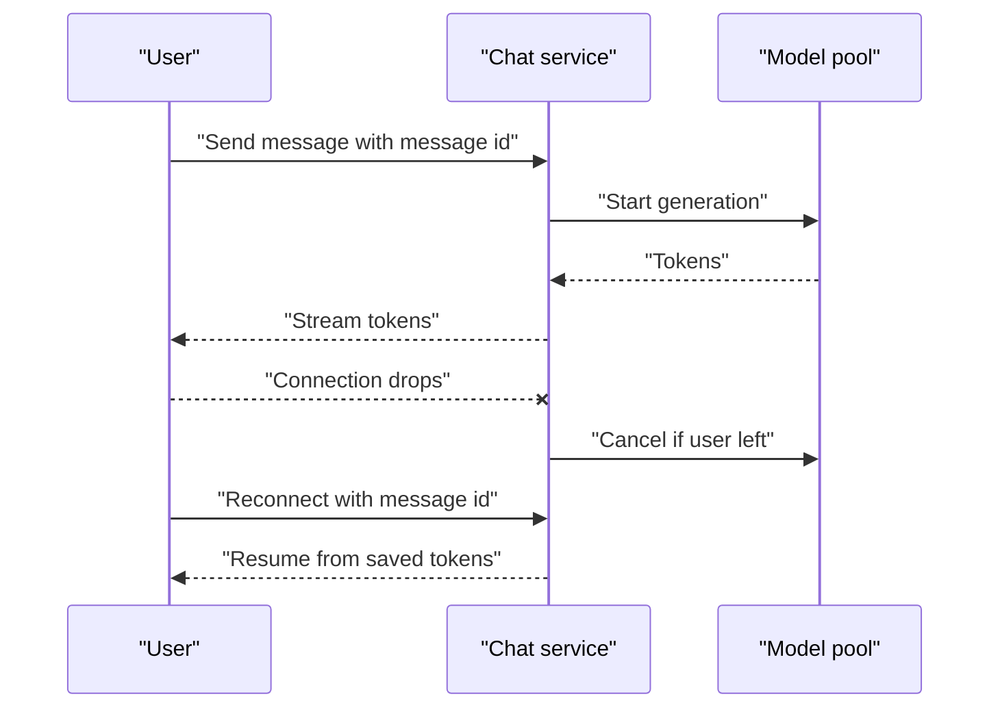

# ChatGPT-Style Chat Assistant

Imagine a very patient helpline agent who answers millions of people at the same time, one word at a time. That is a chat assistant. The hard part is not the model. It is keeping millions of long-running streams alive without wasting GPUs.

## Requirements

**Functional**
- Users send a message and see the reply stream in, word by word.
- Conversations are saved and can be reopened or continued.
- Users can stop a reply midway.

**Non-functional**
- Time to first token (TTFT, the wait before the first word appears) should feel instant.
- Safe output: moderation on inputs and outputs.
- Cost control: GPUs are the biggest bill.

## Estimates (all numbers are assumptions)

| Item | Assumption | Result |
|---|---|---|
| Daily active users | 10 million | |
| Messages per user per day | 8 | 80M messages/day, about 925/s average |
| Peak traffic | 3x average | about 2,800 requests/s |
| Reply time | 15 s per reply | 2,800 x 15 = about 42,000 open streams at peak |
| Storage | 3 KB per exchange | about 240 GB/day |

The key insight: the system is dominated by **open connections** and **GPU time**, not by request rate. See [Chapter 3](../../module-1/03-reliability.md) for the estimation method.

## High-level design

*Figure: A stateless chat service in front of a routed inference fleet.*

The chat service holds no conversation state. It rebuilds the prompt from the store on every turn. That keeps it easy to scale ([Chapter 3](../../module-1/03-reliability.md)). Streaming uses Server-Sent Events (SSE), a one-way HTTP stream from server to browser. OpenAI's API documentation describes the same approach: with `stream=true`, output arrives as typed SSE events. Details are in [Chapter 1](../../module-1/01-networking.md).

## Deep dive 1: context and cost

Each turn must send the whole history again, so prompts grow. Options when the history is too long:

- Drop the oldest turns (simple, loses facts).
- Summarise old turns into a short note (cheaper, may lose detail).
- Keep a small "memory" of user facts, retrieved when needed.

Re-sending the same prefix is wasteful. Providers offer **prompt caching**: Anthropic's documentation says a cache hit needs a 100% identical prefix. So build prompts in a stable order (system prompt, then history, then the new message) and never edit the early part. In your own fleet, route a conversation to the same replica so its prefix cache stays warm. See [Chapter 6](../../module-3/06-llm-serving.md).

## Deep dive 2: streaming that survives failure

*Figure: Client-generated message ids make retries and resume safe.*

- The client creates the message id. A retry then cannot create a duplicate message (idempotency, see Chapter 3).
- Write tokens to a short-lived buffer keyed by message id. A reconnecting client resumes from there.
- When the user presses Stop or leaves, cancel generation. Otherwise you pay GPU time for words nobody reads.
- Moderation is harder with streaming. OpenAI's streaming guide notes that moderation scores arrive only after the full output. Common choices are: check the prompt first, run a light check on chunks, and run a full check at the end.

## Trade-offs

| Decision | Option A | Option B |
|---|---|---|
| Moderation | Block until checked (safe, slower) | Stream and check later (fast, riskier) |
| History | Send everything (best quality) | Summarise (cheaper) |
| Routing | Small model first (cheap) | Large model always (consistent) |
| Storage | Store everything (useful) | Short retention (privacy) |

## What the interviewer expects

- You notice that streams, not requests per second, drive capacity.
- You handle cancel, retry and resume.
- You discuss cost levers: routing, caching, batching.
- You mention safety, privacy and retention for stored chats ([Chapter 10](../../module-4/10-security-governance.md)).

> [!TIP]
> **Key takeaways**
> - Chat capacity is set by open streams and GPU time, so estimate both.
> - Keep the chat service stateless; rebuild context from the store each turn.
> - Stable prompt prefixes and sticky routing make caching work.
> - Design for disconnects: message ids, resume buffer, cancel on leave.
