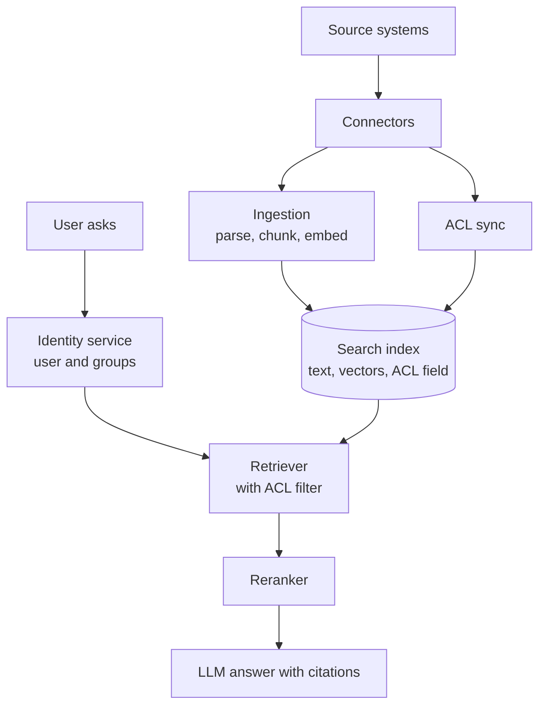
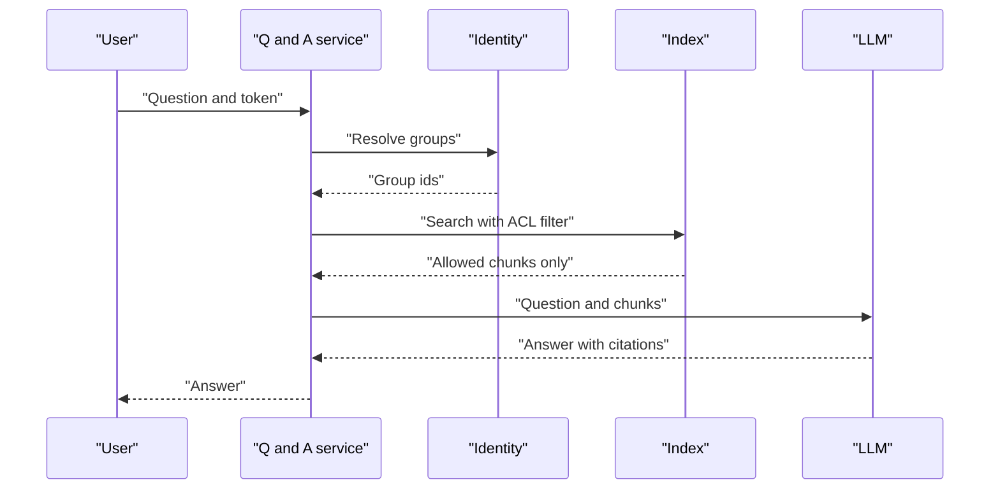

# Enterprise Document Q&A with Access Control

A new joiner asks, "What is our leave policy for contractors?" The assistant should answer from internal documents. It must never show a salary sheet to someone who cannot open it in the original system.

## Requirements

**Functional**
- Answer questions using company documents, with citations.
- Sources: file shares, wikis, ticket systems, email attachments.
- Respect each user's permissions exactly as in the source system.

**Non-functional**
- Zero leaks: a user must never see content they cannot access.
- Fresh data: a new or changed document should appear within minutes to hours.
- Answers in a few seconds.

## Estimates (assumptions)

| Item | Assumption | Result |
|---|---|---|
| Employees | 50,000 | |
| Questions per employee per day | 5 | 250,000/day, about 3/s average, plan for about 30/s peak |
| Documents | 5 million, 10 chunks each | 50 million chunks |
| Vector size | 1,024 dims x 4 bytes | about 4 KB per chunk, about 200 GB raw vectors |

Vectors plus index plus metadata will be larger than 200 GB. The point is that the index fits on a modest cluster, so correctness matters more than raw scale. Pipeline basics are in [Chapter 7](../../module-3/07-rag-architectures.md).

## High-level design

*Figure: Permissions travel with the data into the index and are applied at query time.*

## Deep dive 1: access control

The safest pattern is **filter before the model sees anything**. Store the allowed users and groups on every chunk. At query time, look up the user's groups and add them as a filter to the search.

Microsoft's Azure AI Search documentation describes this "security filter" pattern: a filterable field holds group or user ids, and each query filters on the caller's ids. Its page also warns that the filter must be applied to every query. Other vector databases offer metadata filters in the same way. The idea is not vendor-specific.

Things that go wrong:

- **Filter after retrieval.** If you take top 10 and then remove forbidden ones, you may be left with nothing, and you have already handled the data. Filter inside the search.
- **Stale permissions.** Someone is removed from a group, but the index still allows them. Sync ACL changes on a fast path, separate from content re-indexing.
- **Large group lists.** A user in hundreds of groups makes a big filter. Options: expand groups at query time from a cache, or index "roles" instead of raw groups.
- **Final check.** For high-risk sources, re-check the top few chunks against the source system just before answering.

*Figure: The identity is resolved first, so the LLM only ever receives allowed text.*

## Deep dive 2: freshness and deletes

Use change events or periodic crawls from each source. When a document is deleted, delete its chunks too. A "deleted" document that still answers questions is a serious bug. Keep a document id on every chunk so updates replace old chunks cleanly.

## Trade-offs

| Choice | Benefit | Cost |
|---|---|---|
| One shared index with ACL filter | Simple, cheap | Filter bugs leak data |
| Index per tenant or per department | Strong isolation | More indexes to run |
| Real-time ACL check | Always correct | Extra latency, source load |
| Cached ACLs | Fast | Stale for a few minutes |

## In the AI era

OWASP's Top 10 for LLM Applications (2025 edition) lists Sensitive Information Disclosure and Vector and Embedding Weaknesses as separate risks. Both apply here. Documents are also untrusted input: a file can contain text that tries to instruct the model. See [Chapter 10](../../module-4/10-security-governance.md).

## What the interviewer expects

- You raise permissions early, before drawing the model box.
- You explain where the filter runs and why.
- You cover ingestion, freshness and deletion.
- You mention evaluation of answer quality ([Chapter 12](../../module-5/12-evaluation-safety.md)).

> [!TIP]
> **Key takeaways**
> - Apply access control inside retrieval, before any text reaches the LLM.
> - Store ACLs with each chunk and sync changes on a fast path.
> - Plan for deletes, stale permissions and huge group lists.
> - Treat retrieved documents as untrusted input.
