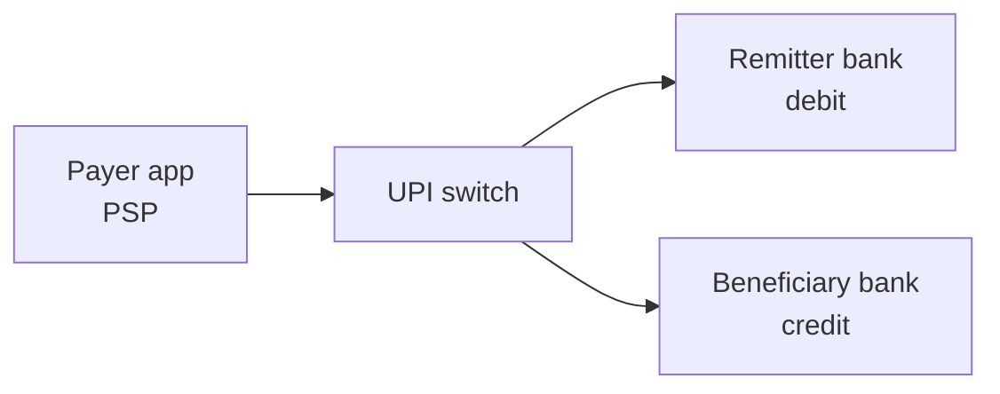
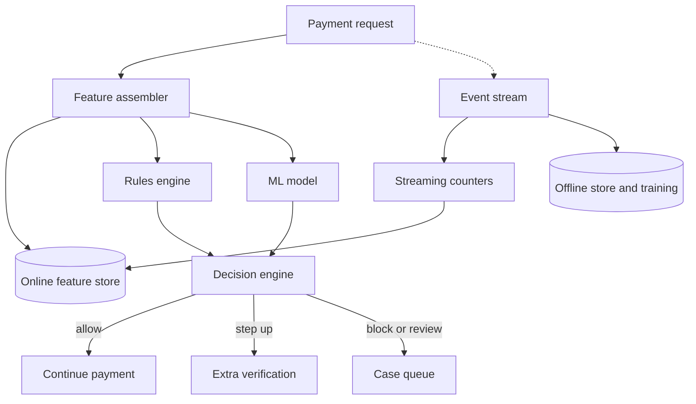

# Real-Time Payments Fraud Detection

You tap "Pay" at a chai stall. Within a couple of seconds money moves between two banks. Somewhere in that window a system must decide: normal payment, or fraud? Too strict and honest users are blocked. Too loose and money is lost.

UPI is used here only as an **illustration** of an instant-payment flow. The numbers and the design are an exercise, not a description of any real system.

## Requirements

**Functional**
- Score every payment before it completes.
- Decide: allow, ask for extra verification, block, or send for review.
- Learn from confirmed fraud.

**Non-functional**
- Decision within a tight latency budget (we assume 100 ms at p99).
- Very high availability: the payment path cannot depend on one fragile service.
- Explainable decisions for audit and customer complaints.

## Estimates (assumptions)

| Item | Assumption | Result |
|---|---|---|
| Transactions | 100 million/day at one bank or PSP | about 1,160/s average |
| Peak | 5x average (festival, salary day) | about 6,000/s |
| Fraud rate | very small, say 0.01% | about 10,000 fraud cases/day |
| Labels | arrive late | days to weeks |

Because fraud is rare, accuracy is a useless metric. Think precision, recall and the cost of each mistake.

## Where you sit in the flow

Oracle's UPI documentation describes four parties: the payer's PSP (payment service provider, the app), the NPCI UPI switch, the remitter bank (payer's bank) and the beneficiary bank (payee's bank). The switch routes a pay request, the remitter bank debits, then the beneficiary bank credits. Which party you are decides what data you can see.

*Figure: Simplified four-party flow. Your fraud system sits inside one of these boxes.*

## High-level design

*Figure: A fast path that scores in milliseconds and a slow path that learns.*

Feature store basics are in [Chapter 5](../../module-2/05-feature-stores.md).

## Deep dive 1: features inside the latency budget

Useful signals, all computed from recent history:

- Velocity: payments from this account in the last minute and hour.
- New payee, new device, new SIM or location change.
- Amount compared with the user's usual amounts.
- Payee risk: how many different payers sent money to this payee today (mule accounts, which collect stolen money, often show this).

Streaming jobs keep these counters up to date in a low-latency key-value store. The scoring path only does lookups. Budget example (assumption): features 20 ms, rules 10 ms, model 20 ms, rest as buffer. Use the same feature code for training and serving to avoid training-serving skew.

## Deep dive 2: rules plus ML, and failure modes

Use both. Rules catch known patterns instantly and are easy to explain. A tree-based model catches subtle combinations. The decision engine combines them.

- **If the scorer is down**, what then? Fail open (allow, with limits) or fail closed (block)? A common answer: fail open for small amounts, step-up or block for large ones. State it clearly.
- **Delayed labels**: a fraud report may come two weeks later. Train on old data and monitor drift ([Chapter 4](../../module-2/04-ml-pipelines.md)).
- **Adversaries adapt**: fraudsters change behaviour. Retrain often and keep humans in the loop.
- **Shadow mode** first: score without acting, compare with outcomes, then enable.

## In the AI era

Do not put an LLM in the 100 ms path: it is slow, costly and not deterministic. Use it beside the path: summarise a case for a reviewer, explain why a transaction was flagged, or help draft customer messages. Customers also face scam messages; an LLM can classify those, but a human must own the final call.

## Trade-offs

| Decision | Option A | Option B |
|---|---|---|
| Threshold | Low (catch more fraud, more false alarms) | High (fewer false alarms, more loss) |
| Failure mode | Fail open | Fail closed |
| Model | Simple, explainable | Complex, higher recall |

## What the interviewer expects

- Clear latency budget and an online/offline split.
- Rules plus ML, with a fallback when the model fails.
- Class imbalance, delayed labels and drift.
- Privacy and compliance awareness (personal data rules, audit logs).

> [!TIP]
> **Key takeaways**
> - Keep the scoring path to lookups; compute counters in a streaming job.
> - Combine rules and ML, and define behaviour when scoring fails.
> - Labels are rare and late, so judge by precision and recall, not accuracy.
> - LLMs help reviewers beside the path, not inside it.
