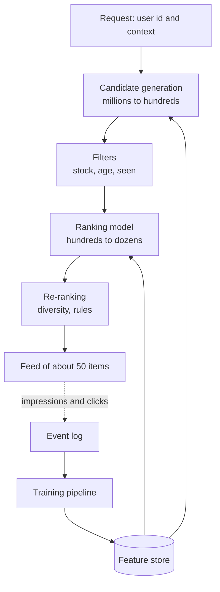

# Recommendation System for a Shopping or Video App

Open a video app and the home screen is already full of things you might like. Out of millions of items, the app shows about fifty, in under a quarter of a second. How?

## Requirements

**Functional**
- Personalised home feed and "similar items" lists.
- Handle new users and new items (cold start).
- Business rules: remove out-of-stock items, age filters, no repeats.

**Non-functional**
- Feed latency under about 150 ms (assumption).
- Fresh signals: what you clicked a minute ago should matter.
- Measurable by online experiments.

## Estimates (assumptions)

| Item | Assumption | Result |
|---|---|---|
| Daily active users | 20 million | |
| Feed requests per user per day | 10 | 200M/day, about 2,300/s average |
| Peak | 3x | about 7,000/s |
| Catalogue | 10 million items | |
| Item embedding | 128 dims x 4 bytes | 512 B each, about 5 GB total |

The embeddings fit in memory on a few machines. The costly part is ranking: scoring hundreds of items per request, 7,000 times a second.

## The funnel

The standard design is a funnel. YouTube's 2016 paper "Deep Neural Networks for YouTube Recommendations" describes a two-stage split: a candidate generation model, then a separate ranking model. Many systems follow the same idea. Fundamentals are in [Chapter 5](../../module-2/05-feature-stores.md).

*Figure: A funnel narrows millions of items to a short list, then logs what happened.*

## Deep dive 1: candidate generation

Run several retrievers in parallel and merge their results:

- **Two-tower model**: one tower makes a user vector, another makes item vectors. An approximate nearest neighbour (ANN) index finds items close to the user ([Chapter 7](../../module-3/07-rag-architectures.md) explains ANN indexes).
- Popular items in the user's region or language.
- "Because you watched X": items similar to recent history.
- Items from followed creators or brands.

Merging sources gives variety and helps cold start: a new user has no history, but still gets popular and trending items.

## Deep dive 2: ranking and the feedback loop

The ranker is a heavier model. It predicts, for each candidate, things like click, purchase or watch-time. A final score combines them. Inputs: user features, item features, context (time, device) and cross features.

A latency budget (assumption): candidates 30 ms, features 30 ms, ranking 50 ms, re-rank and response 20 ms, leaving buffer.

Problems to name:

- **Position bias**: top items get clicks just because they are on top. Log the position and handle it in training.
- **Feedback loop**: you only learn about items you showed. Reserve a small share of traffic for exploration.
- **Freshness**: update recent-activity features through streaming.
- **Training-serving skew**: use one feature definition for both.
- **Offline vs online**: offline metrics (for example recall or NDCG) are a filter, not a verdict. Decide with an A/B test ([Chapter 4](../../module-2/04-ml-pipelines.md)).

## In the AI era

LLMs rarely score each candidate in the live path: it is too slow and costly at this volume. Better uses:

- Create item embeddings from titles, descriptions and images, which helps new items with no clicks.
- Generate short "why recommended" text, cached offline.
- Understand free-text intent, for example "something light to watch tonight", then convert it to filters for the normal funnel.

## Trade-offs

| Decision | Option A | Option B |
|---|---|---|
| Objective | Clicks (easy to move) | Long-term value (harder to measure) |
| Precompute | Cache feeds per user (cheap, stale) | Compute live (fresh, costly) |
| Diversity | More variety (discovery) | Pure relevance (short-term clicks) |

## What the interviewer expects

- The funnel, with a clear reason for each stage.
- Cold start for users and items.
- A feedback loop with logging, exploration and experiments.
- A latency budget and a plan for failures (fall back to popular items).

> [!TIP]
> **Key takeaways**
> - Use a funnel: cheap broad retrieval first, heavy ranking on a few hundred items.
> - Merge many candidate sources to cover cold start and variety.
> - Log impressions and positions; keep a little exploration traffic.
> - Use LLMs for understanding and content embeddings, not for scoring every item live.
