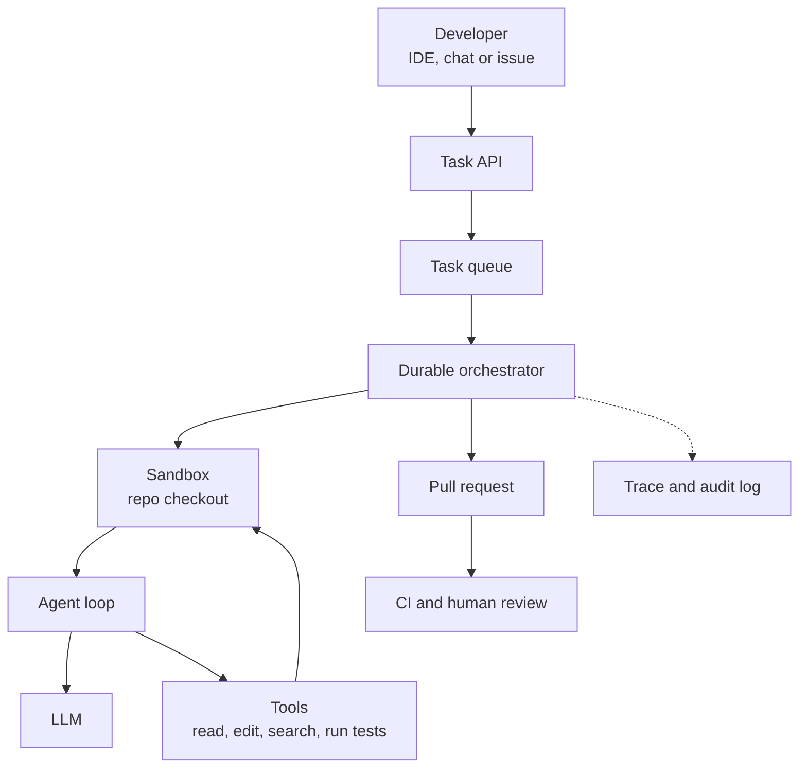

# Background Coding Agent

A developer writes, "Upgrade this library across the service and fix the failing tests." Then they go for chai. Twenty minutes later there is a pull request. This is a background coding agent: it works without a person watching every step.

## Requirements

**Functional**
- Accept a task (text plus repository) and work on its own.
- Read code, edit files, run commands and tests.
- Output a branch and a pull request with a summary.

**Non-functional**
- Safety: it must not leak secrets, damage other systems, or push to protected branches.
- Cost control: a time and token budget per task.
- Reproducible and auditable runs.

## Estimates (assumptions)

| Item | Assumption | Result |
|---|---|---|
| Developers | 5,000, with 20% using it daily | 1,000 users |
| Tasks | 2 per active user per day | 2,000 tasks/day |
| Sandbox time | 20 minutes per task | about 667 sandbox-hours/day |
| Working-day load | spread over 8 hours | about 83 sandboxes at a time, plan about 170 for peak |

LLM cost is probably the larger bill, so set a token budget per task.

## High-level design

*Figure: A queue and durable orchestrator start isolated sandboxes. A human reviews the output.*

The agent loop itself (think, call a tool, observe, repeat) is covered in [Chapter 8](../../module-4/08-agentic-architectures.md). Here we focus on the surrounding system.

## Deep dive 1: the sandbox

The agent runs commands generated by a model, reading files that may contain hostile text. So isolate it.

- **One sandbox per task**: a container or micro-VM with a fresh checkout. Delete it afterwards.
- **No long-lived secrets inside.** Use short-lived, narrowly scoped credentials.
- **Network allow-list**: only the package mirror and internal git proxy.
- **Limits**: CPU, memory, disk and wall-clock time.

Anthropic's documentation for Claude Code on the web is one public example of this pattern: each cloud session runs in an isolated VM, network access is limited by default, GitHub credentials stay outside the VM behind a proxy, the proxy rejects branch deletions and pushes of anything but a branch, and operations are logged. Other products may do it differently. See [Chapter 10](../../module-4/10-security-governance.md) for sandboxing and prompt injection.

## Deep dive 2: working on a big repository

You cannot paste a whole repository into the prompt. Give the agent **search tools** (find files, grep, read a range) and let it pull what it needs. Keep the context small: summarise old tool output and drop what is no longer needed ([Chapter 8](../../module-4/08-agentic-architectures.md), context engineering).

**Use tests as the feedback signal.** Anthropic's "Building effective agents" notes that coding suits agents because code can be verified by automated tests, and that human review is still needed. So:

1. The agent runs the existing tests before and after its change.
2. It stops when tests pass, or when a limit is reached.
3. It states what it could not verify.

Add **stopping rules**: maximum steps, maximum minutes, maximum tokens. Without them, a confused agent loops and burns money.

For long tasks, the orchestrator saves progress after each step. If a sandbox dies, the task resumes from the last checkpoint instead of starting again.

## Trade-offs

| Decision | Option A | Option B |
|---|---|---|
| Autonomy | Open a PR only (safe) | Merge automatically (fast, risky) |
| Sandbox | Container (cheap, fast start) | micro-VM (stronger isolation) |
| Agents | One agent (simple) | Several specialised agents (complex, costly) |
| Model | Strong model for all steps (quality) | Small model for easy steps (cost) |

## What the interviewer expects

- Isolation first: sandbox, credentials, network.
- Tools, tests and limits that keep the loop honest.
- Human review before merge, and CI as a second check.
- Metrics: PR acceptance rate, tests passing, cost per task, time to PR ([Chapter 11](../../module-5/11-observability.md), [Chapter 12](../../module-5/12-evaluation-safety.md)).

> [!TIP]
> **Key takeaways**
> - The system around the agent (queue, sandbox, credentials, review) matters as much as the model.
> - One short-lived sandbox per task, with minimal network and no long-lived secrets.
> - Tests give the agent real feedback; a human still reviews the PR.
> - Set hard limits on steps, time and tokens, and checkpoint long runs.
